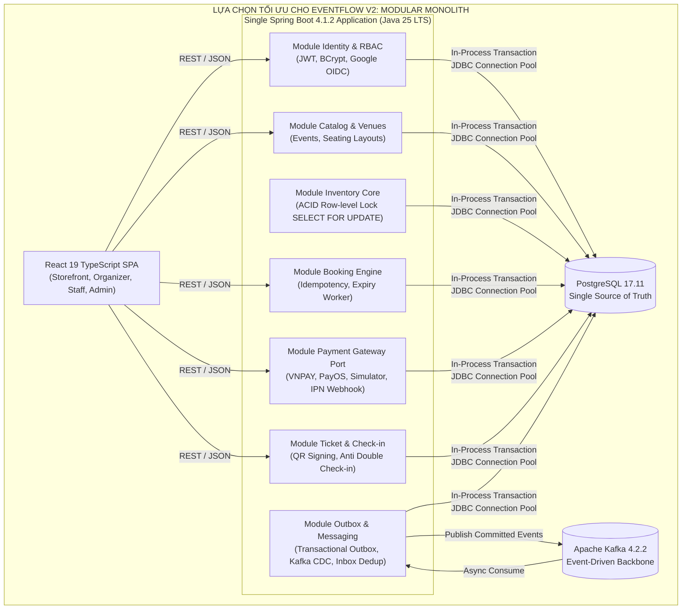
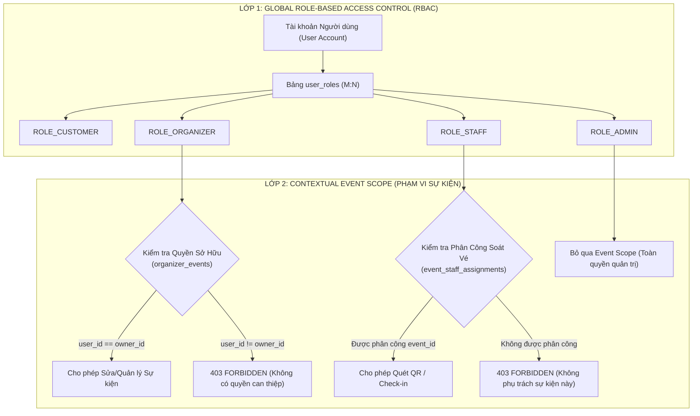
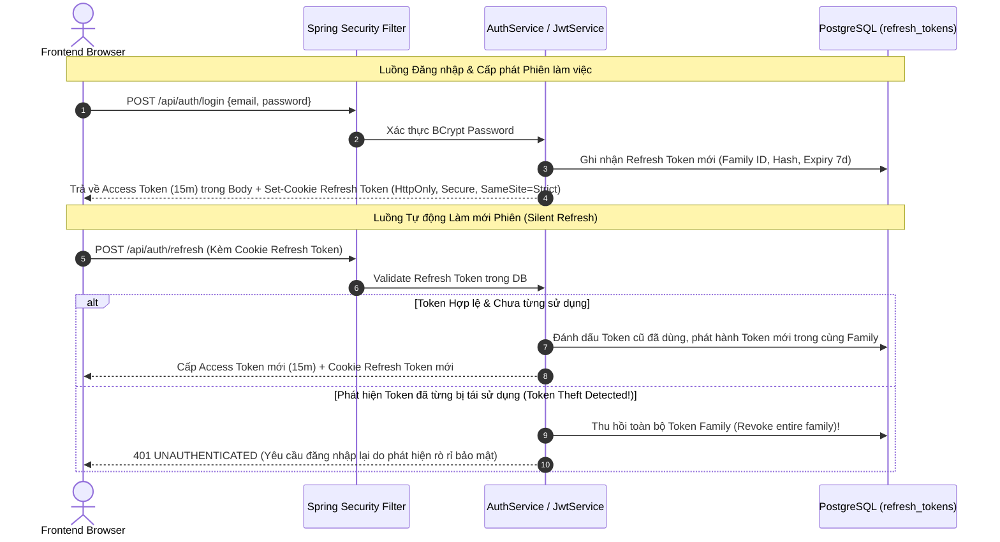
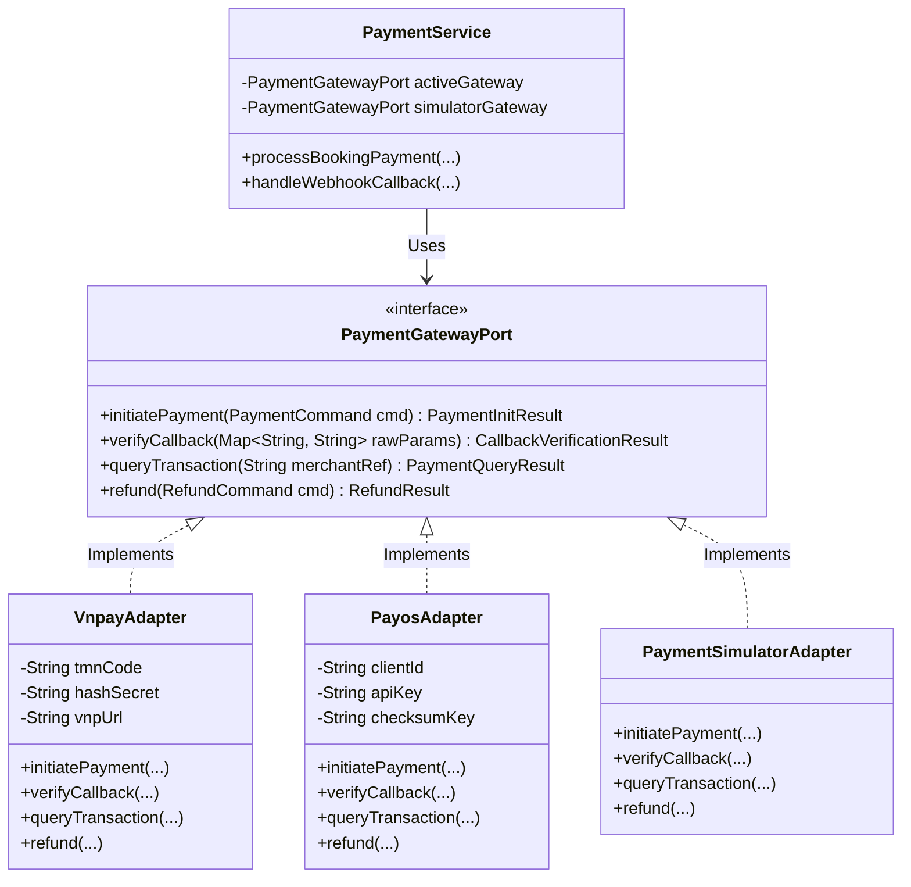

# EVENTFLOW V2 — THIẾT KẾ KIẾN TRÚC TỔNG THỂ HỆ THỐNG
## ARCHITECTURE RECOMMENDATION & TECHNICAL SPECIFICATION

> **Phiên bản:** 2.0.0 · **Mã tài liệu:** `DOC-REC-03`  
> **Tác giả:** Principal Software Architect, Senior Security Architect  
> **Căn cứ:** Cấu hình V2, Bộ quyết định kiến trúc [T11.2_DECISIONS.md](T11.2_DECISIONS.md), mã nguồn hiện tại commit `dd2cead`.

---

## 1. ĐÁNH GIÁ MÔ HÌNH KIẾN TRÚC: MODULAR MONOLITH VS. MICROSERVICES



### 1.1 Phân tích So sánh & Khuyến nghị Lựa chọn (DEC-001)

| Tiêu chí Đánh giá | Phương án Microservices | Phương án Modular Monolith (Được chọn) | Lý do Quyết định |
|---|---|---|---|
| **Bảo vệ Tính toàn vẹn Giữ vé (Zero Oversell)** | ❌ Rất khó và rủi ro cao. Cần Distributed Lock (Redis Redlock) hoặc Saga Pattern 2PC qua mạng, dễ lỗi khi mạng phân vùng (Split-brain). | ✅ **Tuyệt đối an toàn.** Sử dụng trực tiếp Khóa dòng ACID PostgreSQL `SELECT FOR UPDATE` trong một Database Transaction duy nhất. | **Lõi giá trị của EventFlow là không được bán lố vé.** Modular Monolith bảo toàn 100% tính nguyên tử này. |
| **Độ trễ Giao dịch (Transaction Latency)** | ❌ Cao (150ms – 400ms) do nhiều bước RPC/HTTP hop giữa các services. | ✅ **Cực thấp (< 50ms)** do mọi giao tiếp giữa các module diễn ra trong cùng JVM memory. | Phù hợp với kịch bản giật vé cao điểm khi mở bán concert lớn. |
| **Độ phức tạp Vận hành & Triển khai** | ❌ Cực cao: Cần Kubernetes, Service Mesh, Distributed Tracing, API Gateway độc lập. | ✅ **Gọn nhẹ, thực dụng:** 1 tệp `backend.jar`, 1 container PostgreSQL, 1 container Kafka qua Docker Compose. | Tối ưu tuyệt đối cho đồ án cá nhân và môi trường trình diễn trước Hội đồng. |
| **Mức độ Độc lập Module (Maintainability)** | Vừa phải. | ✅ **Rất cao:** Phân tách package rõ ràng theo Domain-Driven Design (DDD), giao tiếp qua Interfaces/Ports. | Dễ dàng tách thành Microservices trong tương lai nếu hệ thống đạt quy mô hàng triệu người dùng. |

> [!IMPORTANT]
> **Kết luận của Principal Architect:** Ban Cố vấn **khẳng định 100% tiếp tục duy trì kiến trúc Modular Monolith**. Không chuyển đổi sang Microservices để tránh làm phân mảnh giao dịch ACID và làm gãy hệ thống Concurrency Control đã được kiểm chứng xuất sắc.

---

## 2. TỔ CHỨC 9 MODULE NGHIỆP VỤ LÕI TRONG BACKEND

Backend được tổ chức trong package gốc `com.haolo.ticketing`, tuân thủ nguyên tắc ranh giới module nghiêm ngặt:

1. **`com.haolo.ticketing.identity` (Xác thực, Định danh & RBAC):**
   - Quản lý tài khoản: Đăng ký, đăng nhập mật khẩu băm BCrypt, cập nhật hồ sơ cá nhân.
   - Quản lý phiên: Access Token JWT ngắn hạn (15 phút) kết hợp Refresh Token HttpOnly Cookie (7 ngày), hỗ trợ Token Family Rotation.
   - Google OIDC: Xử lý Authorization Code Flow với PKCE, xác thực ID Token từ Google, Explicit Account Linking.
   - Phân quyền: Cung cấp `RbacSecurityService` và custom annotations `@RequireRole`, `@RequireEventOrganizer`, `@RequireEventStaff`.

2. **`com.haolo.ticketing.catalog` (Danh mục & Quản lý Sự kiện):**
   - Quản lý vòng đời sự kiện: `DRAFT` -> `PENDING_APPROVAL` -> `PUBLISHED` -> `CLOSED` -> `CANCELLED`.
   - Quản lý phân quyền sở hữu sự kiện (`organizer_events`).
   - Quản lý danh mục chuẩn hóa (`categories`), địa điểm biểu diễn (`venues`), và tài nguyên truyền thông (`event_media`).

3. **`com.haolo.ticketing.inventory` (Lõi Tồn kho & Kiểm soát Đồng thời):**
   - `GaInventory`: Quản lý sức chứa vé đứng `capacity >= held + sold`.
   - `SeatInventory`: Khóa ghế ngồi rạp hát theo danh sách sắp xếp tăng dần ID (`ORDER BY seat_id ASC`) chống Deadlock.
   - Khóa dòng nguyên tử: `SELECT ... FOR UPDATE` bảo vệ tuyệt đối không bán lố vé.

4. **`com.haolo.ticketing.bookings` (Quản trị Đơn hàng & Giữ chỗ):**
   - Khởi tạo booking với `Idempotency-Key` (bảng `ticketing.idempotency_keys`).
   - Quản lý chuyển trạng thái đơn hàng (`PENDING_PAYMENT`, `CONFIRMED`, `CANCELLED`, `EXPIRED`, `REFUND_REQUIRED`).
   - Cung cấp API cá nhân `GET /api/me/bookings` cho Customer và `GET /api/organizer/events/{id}/bookings` cho Organizer.

5. **`com.haolo.ticketing.expiry` (Tiến trình Quét Hết Hạn Độc lập):**
   - `ExpiryScheduler`: Chạy định kỳ mỗi 5 giây, quét các booking quá hạn `expires_at` dựa trên clock máy chủ PostgreSQL (`clock_timestamp()`).
   - Nhả tài nguyên tồn kho và cập nhật trạng thái `EXPIRED` trong một transaction độc lập, ghi nhận sự kiện vào Outbox, không làm chậm luồng đặt vé của người khác.

6. **`com.haolo.ticketing.payments` (Kiến trúc Cổng Thanh toán Ports & Adapters):**
   - Định nghĩa Interface `PaymentGatewayPort` độc lập nhà cung cấp.
   - Các Adapter triển khai: `VnpayAdapter`, `PayosAdapter`, `PaymentSimulatorAdapter`.
   - Xử lý Webhook IPN an toàn với chữ ký số HMAC-SHA512.
   - Trọng tài xử lý thanh toán muộn (Late Payment Arbitration) và điều phối hoàn tiền (`RefundOrchestrator`).

7. **`com.haolo.ticketing.tickets` (Phát hành Vé & Ví Vé Điện Tử):**
   - Cấp phát vé duy nhất có mã code ngẫu nhiên khi booking chuyển sang `CONFIRMED`.
   - Tạo chữ ký bảo mật cho mã QR và sinh tệp PDF vé điện tử.

8. **`com.haolo.ticketing.checkin` (Engine Soát vé & Kiểm soát Vào cổng):**
   - Cung cấp API quét mã QR cho Staff di động.
   - Xác thực vé nguyên tử, chống quét trùng lặp vé (Anti Double Check-in) bằng ràng buộc cơ sở dữ liệu `UNIQUE(ticket_id)` trong bảng `ticket_check_ins`.
   - Cung cấp lịch sử soát vé thời gian thực.

9. **`com.haolo.ticketing.messaging` (Hạ tầng Hướng sự kiện Transactional Outbox):**
   - `OutboxWriter`: Ghi sự kiện vào bảng `ticketing.outbox_events` trong cùng transaction cơ sở dữ liệu với nghiệp vụ.
   - `OutboxPublisher`: Gửi sự kiện từ bảng outbox sang Apache Kafka 4.2.
   - `InboxConsumer`: Tiếp nhận sự kiện từ Kafka và ghi vào `ticketing.inbox_events` với `(consumer_name, event_id)` để Deduplication.
   - Xử lý Dead Letter Queue (DLQ) và công cụ Replay sự kiện an toàn có ngân sách tối đa 3 lần.

---

## 3. THIẾT KẾ PHÂN QUYỀN BỐN VAI TRÒ (FOUR-ROLE RBAC & EVENT SCOPE)

### 3.1 Mô hình Phân quyền Hai Lớp (Two-Tier Security Model)



### 3.2 Quy tắc Cốt lõi của Mô hình Phân quyền:
1. **Quan hệ Nhiều - Nhiều (M:N):** Một người dùng có thể đồng thời là `CUSTOMER` (mua vé sự kiện A) và `ORGANIZER` (tổ chức sự kiện B) hoặc `STAFF` (soát vé sự kiện C).
2. **Không tự leo quyền (No Self-Escalation):** Người dùng chỉ có thể tự đăng ký vai trò mặc định `CUSTOMER`. Các vai trò `ORGANIZER`, `STAFF`, `ADMIN` phải do Admin phê duyệt hoặc Organizer phân công nhiệm vụ.
3. **Kiểm tra ở Tầng Backend (Server-Side Enforcement):** Mọi request lên API đều được kiểm tra kép qua Spring Security `@PreAuthorize`:
   ```java
   @PreAuthorize("hasRole('ADMIN') or @eventSecurity.isOrganizer(authentication, #eventId)")
   @PatchMapping("/api/organizer/events/{eventId}")
   public ResponseEntity<EventDto> updateEvent(@PathVariable UUID eventId, ...) { ... }
   ```

---

## 4. CHIẾN LƯỢC QUẢN LÝ PHIÊN & BẢO MẬT TOKEN (DEC-004)



---

## 5. THIẾT KẾ CỔNG THANH TOÁN (PORTS & ADAPTERS ARCHITECTURE - DEC-007)



### 5.1 Nguyên tắc Bảo mật Thanh toán Vàng (Golden Rules):
1. **Return URL chỉ hiển thị giao diện:** Tuyệt đối không cập nhật trạng thái đơn hàng chỉ dựa trên việc khách hàng được redirect về Return URL (vì người dùng có thể sửa query parameters).
2. **Server-to-Server IPN Webhook là Chân lý Duy nhất:** Trạng thái đơn hàng chỉ được chuyển sang `CONFIRMED` khi nhận được Webhook gọi ngầm từ Cổng thanh toán có chữ ký số HMAC-SHA512 hợp lệ.
3. **Idempotent Webhook Processing:** Webhook gửi lặp lại nhiều lần phải cho kết quả giống nhau, không ghi đè trạng thái và không phát vé lần thứ hai.
4. **Bảo toàn Payment Simulator:** Giữ nguyên Payment Simulator độc lập để toàn bộ bộ test tự động CI/CD chạy 100% không phụ thuộc kết nối Internet ra cổng ngoài.
