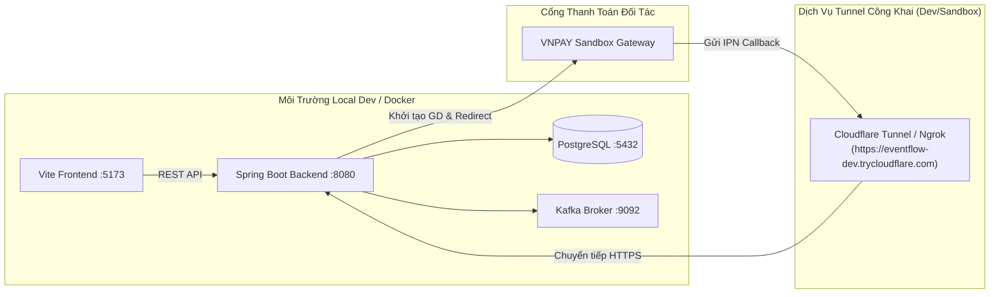

# EVENTFLOW V2 — TÀI LIỆU THIẾT KẾ KIẾN TRÚC TỔNG THỂ (ARCHITECTURE V2)

> **Phiên bản:** 2.0.0 · **Mã tài liệu:** `ARCH-V2-T11.2`  
> **Tác giả:** Principal Software Architect, Senior Security Architect, Senior Full-stack Engineer  
> **Trạng thái:** Thiết kế phê duyệt kiến trúc (Approved Architecture Design)  
> **Áp dụng cho:** Giai đoạn nâng cấp Full-stack Product V2 (T11 → T19)

---

## 1. TỔNG QUAN & TẦM NHÌN KIẾN TRÚC

EventFlow V2 được nâng cấp từ nền tảng nguyên mẫu kỹ thuật (Baseline v0.4) thành một **hệ thống thương mại điện tử đặt vé sự kiện hoàn chỉnh, đa vai trò, có thể đưa vào vận hành thực tế**.

### 1.1. Các Nguyên Tắc Thiết Kế Cốt Lõi
1. **Kiến trúc Modular Monolith vững chắc:** Giữ nguyên cấu trúc đóng gói theo domain module trong một ứng dụng Spring Boot duy nhất; tuyệt đối không phân tách thành microservices để tránh phức tạp hóa phân tán không cần thiết.
2. **PostgreSQL là Nguồn Sự Thật Duy Nhất (Single Source of Truth):** Toàn bộ trạng thái nghiệp vụ, tài khoản, giao dịch, tồn kho và vé được lưu trữ bền vững trong PostgreSQL 17 với bảo đảm ACID. Tuyệt đối không dùng Redis làm nguồn dữ liệu tồn kho.
3. **Phân quyền 4 Vai trò (Four-Role RBAC) & Bảo vệ Phạm vi Sự kiện (Event Scope):** Thực thi kiểm soát truy cập nghiêm ngặt ở tầng Server-side. Không bao giờ tin cậy `role`, `organizerId` hay `staffId` do client gửi lên.
4. **Cổng thanh toán trừu tượng (Payment Gateway Port & Adapters):** Tách biệt miền thanh toán khỏi SDK nhà cung cấp qua interface `PaymentGatewayPort`, hỗ trợ cổng thanh toán Sandbox ngoài thực tế (VNPAY) song song với `PaymentSimulator` cho kiểm thử tự động.
5. **Bảo toàn 100% các Bất biến Kỹ thuật Baseline (Core Invariants):** Giữ nguyên cơ chế chống bán lố Zero Oversell, khóa dòng ACID PostgreSQL, máy trạng thái đơn hàng, outbox/inbox messaging và xử lý thanh toán muộn (`REFUND_REQUIRED`).

---

## 2. SƠ ĐỒ NGỮ CẢNH HỆ THỐNG (SYSTEM CONTEXT & CONTAINER)

```mermaid
flowchart TB
    subgraph Users ["Người Dùng Hệ Thống"]
        Customer["🧑 Khách Hàng (CUSTOMER)"]
        Staff["👷 Nhân Viên Soát Vé (STAFF)"]
        Organizer["🏢 Nhà Tổ Chức (ORGANIZER)"]
        Admin["👑 Quản Trị Viên (ADMIN)"]
    end

    subgraph ExternalServices ["Hệ Thống Bên Ngoài"]
        GoogleOIDC["🌐 Google Identity Platform\n(OpenID Connect / OAuth2)"]
        PaymentGateway["💳 Payment Gateway Sandbox\n(VNPAY / Sandbox Merchant)"]
    end

    subgraph EventFlowPlatform ["Nền Tảng EventFlow V2"]
        FrontendSPA["💻 EventFlow Frontend (React 19 + TypeScript + Vite)\n- Public Discovery & Seat Map\n- Customer Ticket Wallet\n- Staff QR Scanner\n- Organizer Dashboard\n- Admin Platform Portal"]
        
        subgraph BackendMonolith ["Backend Modular Monolith (Java 25 LTS + Spring Boot 4.1.2)"]
            AuthModule["🔐 identity\n(Auth, RBAC, OIDC, Tokens)"]
            CatalogModule["🎪 events\n(Catalog, Venues, Lifecycle)"]
            OrganizerModule["📊 organizer\n(Ownership, Scoped Reports)"]
            BookingModule["🎟️ bookings\n(State Machine, Expiry)"]
            InventoryModule["📦 inventory\n(GA & Seat Row-Locks)"]
            PaymentModule["💵 payments\n(Gateway Port & Adapters)"]
            CheckinModule["📲 checkin\n(HMAC QR, Atomic Verification)"]
            OpsModule["⚙️ operations\n(Replay, Audit, Trace)"]
            MsgModule["📨 messaging\n(Outbox Publisher & Inbox)"]
        end

        PostgreSQL[("🐘 PostgreSQL 17.11\n(Ticketing Schema: 19 Tables V1-V10\n+ Planned Tables V11+)")]
        KafkaBroker["📬 Apache Kafka 4.2.2\n(Topic: booking.v1, Events Stream)"]
    end

    Customer -->|Duyệt sự kiện, chọn ghế, mua vé| FrontendSPA
    Staff -->|Quét vé, phiên soát vé| FrontendSPA
    Organizer -->|Quản lý sự kiện, vé, nhân sự| FrontendSPA
    Admin -->|Quản trị toàn nền tảng, đối soát| FrontendSPA

    FrontendSPA -->|HTTPS REST API / JSON| BackendMonolith
    BackendMonolith -->|OIDC Auth Code Flow| GoogleOIDC
    BackendMonolith -->|Redirect Checkout & QueryDR| PaymentGateway
    PaymentGateway -->|HTTPS Webhook IPN Callback| BackendMonolith

    BackendMonolith -->|JDBC / Connection Pool (ACID)| PostgreSQL
    BackendMonolith -->|Outbox Polling / Inbox Consume| KafkaBroker
```

---

## 3. PHÂN RÃ CÁC MODULE NGHIỆP VỤ (V2 MODULE BREAKDOWN)

Mã nguồn Backend tổ chức theo các bounded context độc lập trong package `com.haolo.ticketing`:

### 3.1. Module `identity` (Xác thực, Định danh & Phân quyền)
- **Chức năng:**
  - Đăng ký tài khoản email/mật khẩu, băm mật khẩu bằng **BCrypt** (cost factor 12).
  - Quản lý trạng thái tài khoản: `ACTIVE`, `LOCKED`, `DISABLED`.
  - Quản lý phiên làm việc: Access Token JWT ngắn hạn (15 phút) + Refresh Token dài hạn (7 ngày) lưu trong **HTTP-only, Secure, SameSite=Strict Cookie**.
  - **Token Family & Reuse Detection:** Phát hiện tấn công đánh cắp token để hủy toàn bộ chuỗi token liên quan.
  - Tích hợp **Google OpenID Connect (OIDC)** qua Authorization Code Flow chuẩn Spring Security OAuth2 Client.
  - Quản lý định danh liên kết bên ngoài (`external_identities`) thông qua `provider_subject` (`sub`) duy nhất.
  - Cơ chế phân quyền 4 vai trò: `CUSTOMER`, `STAFF`, `ORGANIZER`, `ADMIN`.

### 3.2. Module `events` & `catalog` (Danh mục & Vòng đời Sự kiện)
- **Chức năng:**
  - Quản lý vòng đời sự kiện: `DRAFT` ➔ `REVIEW` ➔ `PUBLISHED` ➔ `CLOSED` / `CANCELLED`.
  - Public Catalog chỉ cho phép truy vấn các sự kiện có trạng thái `PUBLISHED`.
  - Hỗ trợ tìm kiếm theo từ khóa (`search`), lọc theo danh mục (`category_id`), phân trang an toàn (`page`, `size`).
  - Quản lý địa điểm tổ chức (`venues`) chuẩn hóa với sơ đồ ghế khán phòng.
  - Đọc tồn kho khả dụng tức thời (`availability`) dạng snapshot không khóa dòng.

### 3.3. Module `organizer` (Quản trị Sự kiện Nhà tổ chức)
- **Chức năng:**
  - Hồ sơ nhà tổ chức (`organizer_profiles`) liên kết với tài khoản người dùng có vai trò `ORGANIZER`.
  - **Ranh giới sở hữu sự kiện (Event Ownership Boundary):** Mỗi sự kiện gắn với `organizer_id`. Toàn bộ thao tác sửa, cập nhật vé, xuất bản, báo cáo đều được kiểm tra:
    $$\text{event.organizer\_id} == \text{current\_user.organizer\_id}$$
    Tuyệt đối ngăn chặn truy cập chéo giữa các Organizer khác nhau.
  - Cấu hình loại vé GA và Sơ đồ ghế ngồi theo từng khán phòng.
  - Phân công nhân viên soát vé (`event_staff_assignments`).
  - Báo cáo doanh số và danh sách người tham dự trong phạm vi sự kiện được phân công.

### 3.4. Module `inventory` (Quản lý Tồn kho Ghế & GA)
- **Chức năng:**
  - Giữ nguyên 100% logic cốt lõi đã được kiểm chứng:
    - **Vé GA:** `GaInventory` sử dụng Row-Level Lock (`SELECT FOR UPDATE`), bảo đảm $held + sold \le capacity$.
    - **Vé Ghế:** `SeatInventory` sử dụng khóa hàng loạt ghế theo thứ tự ID tăng dần, bảo đảm tính nguyên tử All-or-Nothing và chống Deadlock.
  - Hỗ trợ giải phóng tồn kho tức thời khi người dùng hủy booking hoặc khi Expiry Worker quét booking quá hạn.

### 3.5. Module `bookings` (Quản lý Đơn hàng & Giữ chỗ)
- **Chức năng:**
  - Máy trạng thái đơn hàng (Booking State Machine):
    $$\text{PENDING\_PAYMENT} \xrightarrow{\text{pay}} \text{CONFIRMED} \xrightarrow{\text{cancel}} \text{REFUND\_REQUIRED}$$
    $$\text{PENDING\_PAYMENT} \xrightarrow{\text{timeout}} \text{EXPIRED}$$
  - Đơn hàng được gắn trực tiếp với `account_id` của người dùng đã xác thực (không dùng mock persona trong production).
  - Khóa Idempotency Key bảo vệ các yêu cầu trùng lặp trong cửa sổ giữ chỗ.
  - Background Expiry Worker quét các đơn hàng `PENDING_PAYMENT` quá hạn (TTL 600 giây) để chuyển sang `EXPIRED` và nhả tồn kho.

### 3.6. Module `payments` (Cổng Thanh Toán Trừu Tượng & Đối Soát)
- **Chức năng:**
  - Thiết kế theo mẫu **Hexagonal Architecture (Ports and Adapters)**:
    - Interface trung tâm: `PaymentGatewayPort`.
    - Adapter 1: `PaymentSimulatorAdapter` (phục vụ bộ test tự động và CI/CD).
    - Adapter 2: `VnpayGatewayAdapter` (kết nối cổng Sandbox ngoài thực tế).
  - Quản lý các lần thử thanh toán (`payment_attempts`) với số tiền trích xuất từ snapshot của booking (tuyệt đối không nhận số tiền từ client).
  - Tiếp nhận thông báo bất đồng bộ qua Webhook/IPN (`payment_notifications`) với chữ ký số SHA-256 / HMAC.
  - **Chính sách Callback Idempotent & Thứ tự máy trạng thái:** Callback trùng lặp hoặc đến sai thứ tự không thể đảo ngược trạng thái đơn hàng terminal.
  - **Trọng tài Thanh toán Muộn (Late Payment Arbitration):** Đơn hàng đã `EXPIRED` và nhả ghế ra kho mà nhận được callback thanh toán thành công muộn sẽ chuyển sang trạng thái `REFUND_REQUIRED`, kích hoạt quy trình hoàn tiền tự động hoặc bán tự động, tuyệt đối không cấp vé.

### 3.7. Module `checkin` (Soát Vé & Phiên Làm Việc Nhân Viên)
- **Chức năng:**
  - Màn hình làm việc chuyên dụng cho vai trò `STAFF`.
  - Nhân viên chỉ được xem và soát vé cho các sự kiện được phân công trong bảng `event_staff_assignments`.
  - Vé điện tử chứa mã QR có chữ ký số bí mật (HMAC-SHA256 Token) chống làm giả.
  - **Soát vé nguyên tử (Atomic Check-in):** Ghi nhận vào bảng `ticket_check_ins` với ràng buộc khóa duy nhất `UNIQUE(ticket_id)`. Hai lần quét đồng thời tại hai cổng soát vé khác nhau sẽ chỉ có 1 giao dịch thành công (chống Double Check-in 100%).

### 3.8. Module `admin` (Quản trị Nền tảng Toàn cục)
- **Chức năng:**
  - Tra cứu, khóa/mở khóa tài khoản người dùng (`ACTIVE`, `LOCKED`, `DISABLED`).
  - Quản lý gán và thu hồi vai trò (`CUSTOMER`, `STAFF`, `ORGANIZER`, `ADMIN`).
  - Quản lý danh mục sự kiện và địa điểm toàn cục.
  - Theo dõi danh sách đơn hàng, giao dịch thanh toán và phê duyệt hoàn tiền.
  - Bảng điều khiển Outbox Replay an toàn với ngân sách bounded tối đa 3 lần replay.

### 3.9. Module `messaging` & `operations` (EDA & Vận Hành)
- **Chức năng:**
  - Transactional Outbox Pattern: Đảm bảo ghi nhận thay đổi nghiệp vụ và sự kiện outbox trong cùng 1 transaction PostgreSQL.
  - Kafka Publisher/Consumer phân phối sự kiện bất đồng bộ.
  - Tracing Context: Truy vết end-to-end với `correlation_id`.

---

## 4. BẢO TOÀN CÁC BẤT BIẾN KỸ THUẬT CỐT LÕI (CORE INVARIANTS)

EventFlow V2 cam kết bảo toàn nguyên vẹn 6 bất biến đã được kiểm chứng tại mốc v0.4:

| Bất biến | Cơ chế bảo vệ | Đảm bảo tại V2 |
|---|---|---|
| **Zero Oversell** | PostgreSQL Row-level Lock (`SELECT FOR UPDATE`), ràng buộc $held + sold \le capacity$ | Giữ nguyên 100% trong `GaInventory` và `SeatInventory`. |
| **All-or-Nothing Multi-Seat** | Sắp xếp Seat IDs tăng dần, lock tập trung trong một transaction | Giữ nguyên 100% thuật toán chống deadlock. |
| **Hold Expiration** | TTL 600s, Expiry Worker quét định kỳ giải phóng inventory | Giữ nguyên worker, bổ sung cờ ghi nhận lý do hết hạn. |
| **Idempotency** | Khóa duy nhất bảng `idempotency_keys` | Áp dụng cho Booking, Payment Attempt, IPN Callback và Check-in. |
| **Late Payment Obligation** | Booking `EXPIRED` không tái cấp vé; chuyển sang `REFUND_REQUIRED` | Giữ nguyên state machine; tạo bản ghi `refund_attempts`. |
| **Bounded Replay** | Giới hạn tối đa 3 lần replay outbox | Giữ nguyên API `/api/admin/outbox/replay`. |

---

## 5. MÔ HÌNH TRIỂN KHAI & TIẾP NHẬN CALLBACK (DEPLOYMENT MODEL)



> [!IMPORTANT]
> Trong môi trường phát triển cục bộ (Local Development), để tiếp nhận được Webhook IPN từ máy chủ Sandbox của VNPAY, lập trình viên sẽ kích hoạt đường hầm an toàn (Cloudflare Tunnel hoặc ngrok) chuyển tiếp HTTPS về cổng `8080`. Khi chạy trong môi trường CI/CD không có kết nối ra ngoài, hệ thống tự động chuyển sang sử dụng `PaymentSimulatorAdapter`.
