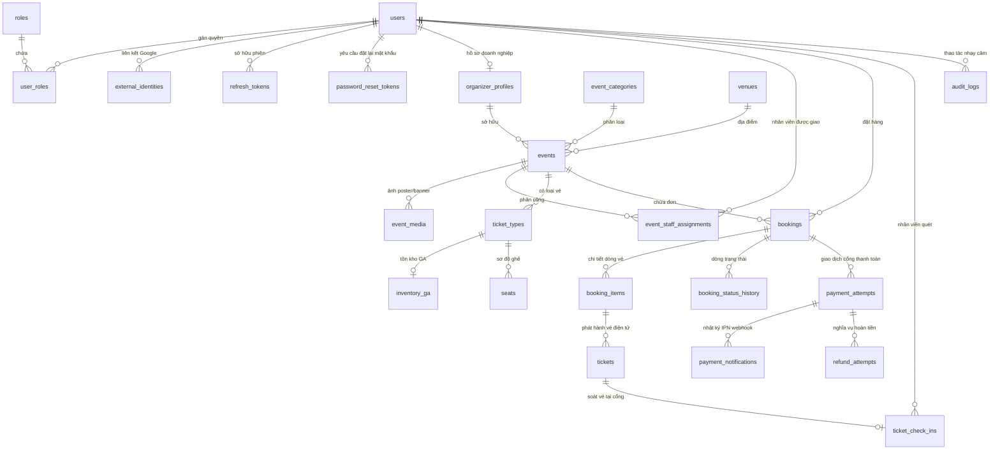

# EVENTFLOW V2 — ĐỀ XUẤT THIẾT KẾ CƠ SỞ DỮ LIỆU & FLYWAY MIGRATIONS (V11+)
## DATABASE RECOMMENDATION & ARCHITECTURAL SPECIFICATION

> **Dự án:** EventFlow — High-Concurrency Event Ticketing Platform  
> **Chuyên gia phụ trách:** Database Architect, Principal Software Architect, Senior Security Architect  
> **Cơ sở dữ liệu:** PostgreSQL 17 · Schema: `ticketing` · Quản trị Migration: Flyway  
> **Phiên bản:** V2.0-PROPOSAL · **Mã tài liệu:** `DB-REC-V2-01`  
> **Trạng thái:** Bản đề xuất kỹ thuật (Chờ Chủ dự án và Tech Lead phê duyệt)

---

## 1. NGUYÊN TẮC BẢO TOÀN DỮ LIỆU VÀ QUY TẮC MIGRATION

Để bảo đảm tính ổn định tuyệt đối của hệ thống đang vận hành và các bài kiểm thử tự động (Unit Test, Integration Test, Concurrency Test), bản đề xuất thiết kế Database tuân thủ nghiêm ngặt 5 nguyên tắc bất biến:

1. **Bất biến đối với Flyway Migrations V1–V10:**
   - Tuyệt đối không thay đổi, không sửa chữa, không đổi tên hoặc xóa các file migration từ `V1` đến `V10__user_authentication.sql`.
   - Toàn bộ dữ liệu hiện tại trong 19 bảng (`ticketing.users`, `events`, `ticket_types`, `inventory_ga`, `seats`, `seat_holds`, `bookings`, `booking_items`, `booking_status_history`, `payments`, `tickets`, `outbox_events`, `inbox_events`, `failure_events`, `contact_leads`, v.v.) được bảo toàn 100%.
2. **Tiến hóa Schema Additive thuần túy (Pure Additive Migrations):**
   - Mọi thay đổi cấu trúc bảng, bổ sung cột, tạo bảng mới hoặc chỉ mục mới đều được thực hiện từ migration `V11` trở đi.
   - Không thực hiện `DROP COLUMN` hoặc `ALTER COLUMN ... DROP NOT NULL` làm phá vỡ các câu lệnh truy vấn của code hiện tại.
3. **Duy trì tương thích ngược với Fixtures & Test Profile:**
   - Bảng `ticketing.users` tiếp tục duy trì cột `id`, `email`, `password_hash`, `display_name`, `demo_role`.
   - Migration V11 sẽ bổ sung bảng quan hệ `roles` và `user_roles` chuẩn hóa cho 4 vai trò (`CUSTOMER`, `STAFF`, `ORGANIZER`, `ADMIN`), đồng thời đồng bộ hai chiều với cột `demo_role` để các test case hiện hữu sử dụng Mock Bearer tokens (`CUSTOMER` ID `10000000-0000-4000-8000-000000000001`, `ADMIN` ID `10000000-0000-4000-8000-000000000002`) tiếp tục chạy xanh 100%.
4. **Không sử dụng LocalStorage hay Client State thay thế SQL:**
   - PostgreSQL 17 là Single Source of Truth cho toàn bộ dữ liệu nghiệp vụ: Trạng thái đơn hàng, số dư vé, vị trí ghế, quyền hạn nhân viên, mã soát vé, giao dịch thanh toán và lịch sử kiểm toán.
5. **Bảo toàn Transaction Boundaries & Row-level Locking:**
   - Cơ chế khóa hàng `SELECT FOR UPDATE` trên `inventory_ga` và `seats` được giữ nguyên vẹn để cam kết 0% bán lố vé (Zero Oversell Invariant).

---

## 2. SƠ ĐỒ THỰC THỂ QUAN HỆ TOÀN THỂ (V2 COMPLETE ERD)



---

## 3. THIẾT KẾ CHI TIẾT 15 BẢNG MỚI (MIGRATION V11+)

### 3.1. Phân Hệ Xác Thực & Phân Quyền (Identity & RBAC)

#### 1. Bảng `ticketing.roles`
- **Mục đích:** Danh mục chuẩn hóa các vai trò trong hệ thống.
- **Cấu trúc DDL đề xuất:**
  ```sql
  CREATE TABLE ticketing.roles (
      id VARCHAR(32) PRIMARY KEY,
      name VARCHAR(64) NOT NULL,
      description TEXT,
      created_at TIMESTAMPTZ NOT NULL DEFAULT clock_timestamp()
  );
  -- Seed data ban đầu:
  -- ('CUSTOMER', 'Khách hàng', 'Đặt vé, thanh toán, quản lý vé cá nhân'),
  -- ('STAFF', 'Nhân viên soát vé', 'Soát vé tại cổng cho sự kiện được phân công'),
  -- ('ORGANIZER', 'Nhà tổ chức sự kiện', 'Quản lý sự kiện, cấu hình vé, xem báo cáo doanh thu'),
  -- ('ADMIN', 'Quản trị viên toàn hệ thống', 'Toàn quyền cấu hình hệ thống, duyệt hoàn tiền, audit log')
  ```

#### 2. Bảng `ticketing.user_roles`
- **Mục đích:** Thiết lập quan hệ nhiều-nhiều giữa tài khoản và vai trò; hỗ trợ 1 tài khoản có thể vừa là Khách hàng vừa là Nhà tổ chức.
- **Cấu trúc DDL đề xuất:**
  ```sql
  CREATE TABLE ticketing.user_roles (
      user_id UUID NOT NULL REFERENCES ticketing.users(id) ON DELETE CASCADE,
      role_id VARCHAR(32) NOT NULL REFERENCES ticketing.roles(id) ON DELETE RESTRICT,
      granted_by UUID REFERENCES ticketing.users(id) ON DELETE SET NULL,
      granted_at TIMESTAMPTZ NOT NULL DEFAULT clock_timestamp(),
      CONSTRAINT pk_user_roles PRIMARY KEY (user_id, role_id)
  );
  CREATE INDEX idx_user_roles_role ON ticketing.user_roles(role_id);
  ```

#### 3. Bảng `ticketing.external_identities` (Google OIDC)
- **Mục đích:** Lưu trữ định danh bên ngoài của người dùng đăng nhập bằng Google OAuth2.
- **Cấu trúc DDL đề xuất:**
  ```sql
  CREATE TABLE ticketing.external_identities (
      id UUID PRIMARY KEY DEFAULT gen_random_uuid(),
      user_id UUID NOT NULL REFERENCES ticketing.users(id) ON DELETE CASCADE,
      provider VARCHAR(32) NOT NULL, -- 'GOOGLE'
      provider_subject VARCHAR(255) NOT NULL, -- 'sub' claim trong Google ID Token
      email VARCHAR(255) NOT NULL,
      display_name VARCHAR(255),
      picture_url TEXT,
      linked_at TIMESTAMPTZ NOT NULL DEFAULT clock_timestamp(),
      last_login_at TIMESTAMPTZ NOT NULL DEFAULT clock_timestamp(),
      CONSTRAINT uq_provider_subject UNIQUE (provider, provider_subject),
      CONSTRAINT uq_user_provider UNIQUE (user_id, provider)
  );
  CREATE INDEX idx_external_identities_sub ON ticketing.external_identities(provider, provider_subject);
  ```

#### 4. Bảng `ticketing.refresh_tokens` (Token Family & Reuse Detection)
- **Mục đích:** Quản lý phiên làm việc lâu dài trên trình duyệt bằng HttpOnly Cookie; tự động phát hiện và thu hồi toàn bộ token family khi bị tấn công tái sử dụng (replay attack).
- **Cấu trúc DDL đề xuất:**
  ```sql
  CREATE TABLE ticketing.refresh_tokens (
      id UUID PRIMARY KEY DEFAULT gen_random_uuid(),
      user_id UUID NOT NULL REFERENCES ticketing.users(id) ON DELETE CASCADE,
      token_hash VARCHAR(64) NOT NULL, -- SHA-256 hash của raw secret token
      family_id UUID NOT NULL, -- Chuỗi luân chuyển token
      is_revoked BOOLEAN NOT NULL DEFAULT FALSE,
      expires_at TIMESTAMPTZ NOT NULL,
      created_at TIMESTAMPTZ NOT NULL DEFAULT clock_timestamp(),
      replaced_by UUID, -- Con trỏ tới token kế tiếp trong chuỗi
      user_agent TEXT,
      ip_address VARCHAR(45),
      CONSTRAINT uq_refresh_tokens_hash UNIQUE (token_hash)
  );
  CREATE INDEX idx_refresh_tokens_family ON ticketing.refresh_tokens(family_id);
  CREATE INDEX idx_refresh_tokens_user ON ticketing.refresh_tokens(user_id);
  ```

#### 5. Bảng `ticketing.password_reset_tokens`
- **Mục đích:** Lưu trữ token đặt lại mật khẩu sử dụng 1 lần (TTL 15 phút), gửi qua email.
- **Cấu trúc DDL đề xuất:**
  ```sql
  CREATE TABLE ticketing.password_reset_tokens (
      id UUID PRIMARY KEY DEFAULT gen_random_uuid(),
      user_id UUID NOT NULL REFERENCES ticketing.users(id) ON DELETE CASCADE,
      token_hash VARCHAR(64) NOT NULL,
      expires_at TIMESTAMPTZ NOT NULL,
      used_at TIMESTAMPTZ,
      created_at TIMESTAMPTZ NOT NULL DEFAULT clock_timestamp(),
      CONSTRAINT uq_password_reset_hash UNIQUE (token_hash)
  );
  ```

---

### 3.2. Phân Hệ Nhà Tổ Chức, Địa Điểm & Danh Mục (Organizer & Events)

#### 6. Bảng `ticketing.organizer_profiles`
- **Mục đích:** Quản lý thông tin doanh nghiệp/pháp nhân của đối tác tổ chức sự kiện.
- **Cấu trúc DDL đề xuất:**
  ```sql
  CREATE TABLE ticketing.organizer_profiles (
      id UUID PRIMARY KEY DEFAULT gen_random_uuid(),
      user_id UUID NOT NULL REFERENCES ticketing.users(id) ON DELETE RESTRICT,
      organization_name VARCHAR(255) NOT NULL,
      contact_email VARCHAR(255) NOT NULL,
      phone VARCHAR(32) NOT NULL,
      tax_code VARCHAR(64),
      status VARCHAR(32) NOT NULL DEFAULT 'ACTIVE', -- 'ACTIVE', 'SUSPENDED'
      created_at TIMESTAMPTZ NOT NULL DEFAULT clock_timestamp(),
      updated_at TIMESTAMPTZ NOT NULL DEFAULT clock_timestamp(),
      CONSTRAINT uq_organizer_user UNIQUE (user_id)
  );
  ```

#### 7. Bảng `ticketing.venues`
- **Mục đích:** Danh mục các nhà hát, trung tâm hội nghị, sân vận động chuẩn hóa.
- **Cấu trúc DDL đề xuất:**
  ```sql
  CREATE TABLE ticketing.venues (
      id UUID PRIMARY KEY DEFAULT gen_random_uuid(),
      name VARCHAR(255) NOT NULL,
      address TEXT NOT NULL,
      city VARCHAR(100) NOT NULL,
      country VARCHAR(64) NOT NULL DEFAULT 'Vietnam',
      capacity INTEGER NOT NULL CHECK (capacity > 0),
      seating_layout_json JSONB,
      created_at TIMESTAMPTZ NOT NULL DEFAULT clock_timestamp()
  );
  ```

#### 8. Bảng `ticketing.event_categories`
- **Mục đích:** Phân loại thể loại sự kiện (Concert, Nhạc cổ điển, Hội nghị, Thể thao...).
- **Cấu trúc DDL đề xuất:**
  ```sql
  CREATE TABLE ticketing.event_categories (
      id VARCHAR(32) PRIMARY KEY, -- 'CONCERT', 'THEATER', 'CONFERENCE', 'SPORTS'
      name VARCHAR(100) NOT NULL,
      description TEXT,
      icon_url TEXT
  );
  ```

#### 9. Bảng `ticketing.event_media`
- **Mục đích:** Quản lý poster, hero banner, sơ đồ khán phòng và thư viện ảnh của sự kiện.
- **Cấu trúc DDL đề xuất:**
  ```sql
  CREATE TABLE ticketing.event_media (
      id UUID PRIMARY KEY DEFAULT gen_random_uuid(),
      event_id UUID NOT NULL REFERENCES ticketing.events(id) ON DELETE CASCADE,
      media_type VARCHAR(32) NOT NULL, -- 'POSTER', 'HERO_BANNER', 'SEAT_MAP', 'GALLERY'
      file_path TEXT NOT NULL,
      file_url TEXT NOT NULL,
      mime_type VARCHAR(64) NOT NULL,
      file_size_bytes BIGINT NOT NULL,
      sort_order INTEGER NOT NULL DEFAULT 0,
      created_at TIMESTAMPTZ NOT NULL DEFAULT clock_timestamp()
  );
  CREATE INDEX idx_event_media_event ON ticketing.event_media(event_id, media_type);
  ```

#### 10. Bảng `ticketing.event_staff_assignments`
- **Mục đích:** Gán nhân viên soát vé (Staff) phụ trách các sự kiện cụ thể; thực thi Event Scope Access Control.
- **Cấu trúc DDL đề xuất:**
  ```sql
  CREATE TABLE ticketing.event_staff_assignments (
      id UUID PRIMARY KEY DEFAULT gen_random_uuid(),
      event_id UUID NOT NULL REFERENCES ticketing.events(id) ON DELETE CASCADE,
      staff_user_id UUID NOT NULL REFERENCES ticketing.users(id) ON DELETE CASCADE,
      assigned_by UUID NOT NULL REFERENCES ticketing.users(id) ON DELETE RESTRICT,
      assigned_at TIMESTAMPTZ NOT NULL DEFAULT clock_timestamp(),
      revoked_at TIMESTAMPTZ,
      CONSTRAINT uq_event_staff_active UNIQUE NULLS NOT DISTINCT (event_id, staff_user_id, revoked_at)
  );
  CREATE INDEX idx_staff_assignment_lookup ON ticketing.event_staff_assignments(staff_user_id, event_id)
      WHERE revoked_at IS NULL;
  ```

---

### 3.3. Phân Hệ Cổng Thanh Toán & Hoàn Tiền (Payment Gateway & Refunds)

#### 11. Bảng `ticketing.payment_attempts`
- **Mục đích:** Lưu trữ chi tiết từng lượt khởi tạo thanh toán tới cổng đối tác (VNPAY Sandbox) hoặc Simulator nội bộ.
- **Cấu trúc DDL đề xuất:**
  ```sql
  CREATE TABLE ticketing.payment_attempts (
      id UUID PRIMARY KEY DEFAULT gen_random_uuid(),
      booking_id UUID NOT NULL REFERENCES ticketing.bookings(id) ON DELETE RESTRICT,
      provider VARCHAR(32) NOT NULL, -- 'VNPAY', 'SIMULATOR'
      merchant_ref VARCHAR(64) NOT NULL, -- 'EVF_100293_1699999'
      amount_vnd BIGINT NOT NULL CHECK (amount_vnd > 0),
      currency VARCHAR(3) NOT NULL DEFAULT 'VND',
      status VARCHAR(32) NOT NULL DEFAULT 'INITIATED', -- 'INITIATED', 'SUCCESS', 'FAILED', 'EXPIRED', 'REFUNDED'
      gateway_url TEXT,
      provider_tx_ref VARCHAR(128),
      expires_at TIMESTAMPTZ NOT NULL,
      created_at TIMESTAMPTZ NOT NULL DEFAULT clock_timestamp(),
      updated_at TIMESTAMPTZ NOT NULL DEFAULT clock_timestamp(),
      CONSTRAINT uq_payment_merchant_ref UNIQUE (merchant_ref)
  );
  CREATE INDEX idx_payment_attempts_booking ON ticketing.payment_attempts(booking_id);
  ```

#### 12. Bảng `ticketing.payment_notifications` (Webhook IPN Journal)
- **Mục đích:** Nhật ký bất biến tiếp nhận toàn bộ Webhook/IPN callback từ cổng thanh toán; bảo đảm xử lý Idempotent 100%.
- **Cấu trúc DDL đề xuất:**
  ```sql
  CREATE TABLE ticketing.payment_notifications (
      id UUID PRIMARY KEY DEFAULT gen_random_uuid(),
      attempt_id UUID REFERENCES ticketing.payment_attempts(id) ON DELETE SET NULL,
      provider VARCHAR(32) NOT NULL,
      provider_tx_ref VARCHAR(128) NOT NULL,
      event_type VARCHAR(64) NOT NULL, -- 'PAYMENT_SUCCESS', 'PAYMENT_FAILURE'
      raw_payload JSONB NOT NULL,
      signature TEXT NOT NULL,
      signature_valid BOOLEAN NOT NULL,
      processed BOOLEAN NOT NULL DEFAULT FALSE,
      processed_at TIMESTAMPTZ,
      created_at TIMESTAMPTZ NOT NULL DEFAULT clock_timestamp(),
      CONSTRAINT uq_payment_ipn_tx UNIQUE (provider, provider_tx_ref, event_type)
  );
  CREATE INDEX idx_payment_notif_lookup ON ticketing.payment_notifications(provider, provider_tx_ref);
  ```

#### 13. Bảng `ticketing.refund_attempts`
- **Mục đích:** Theo dõi nghĩa vụ và trạng thái hoàn tiền khi khách thanh toán trễ (`REFUND_REQUIRED`) hoặc sự kiện bị hủy.
- **Cấu trúc DDL đề xuất:**
  ```sql
  CREATE TABLE ticketing.refund_attempts (
      id UUID PRIMARY KEY DEFAULT gen_random_uuid(),
      booking_id UUID NOT NULL REFERENCES ticketing.bookings(id) ON DELETE RESTRICT,
      payment_attempt_id UUID NOT NULL REFERENCES ticketing.payment_attempts(id) ON DELETE RESTRICT,
      amount_vnd BIGINT NOT NULL CHECK (amount_vnd > 0),
      reason VARCHAR(255) NOT NULL, -- 'LATE_PAYMENT_AFTER_EXPIRY', 'EVENT_CANCELLED'
      provider_refund_ref VARCHAR(128),
      status VARCHAR(32) NOT NULL DEFAULT 'PENDING', -- 'PENDING', 'APPROVED', 'SUCCESS', 'MANUAL_REVIEW'
      created_at TIMESTAMPTZ NOT NULL DEFAULT clock_timestamp(),
      settled_at TIMESTAMPTZ
  );
  CREATE INDEX idx_refund_attempts_booking ON ticketing.refund_attempts(booking_id);
  ```

---

### 3.4. Phân Hệ Soát Vé & Nhật Ký Kiểm Toán (Check-in & Audit Logs)

#### 14. Bảng `ticketing.ticket_check_ins` (Anti-duplicate Scan Constraint)
- **Mục đích:** Ghi nhận phiên soát vé nguyên tử; bảo đảm mỗi vé chỉ có thể check-in đúng 1 lần duy nhất trong toàn hệ thống.
- **Cấu trúc DDL đề xuất:**
  ```sql
  CREATE TABLE ticketing.ticket_check_ins (
      id UUID PRIMARY KEY DEFAULT gen_random_uuid(),
      ticket_id UUID NOT NULL REFERENCES ticketing.tickets(id) ON DELETE RESTRICT,
      event_id UUID NOT NULL REFERENCES ticketing.events(id) ON DELETE RESTRICT,
      staff_user_id UUID NOT NULL REFERENCES ticketing.users(id) ON DELETE RESTRICT,
      check_in_at TIMESTAMPTZ NOT NULL DEFAULT clock_timestamp(),
      gate_name VARCHAR(64) NOT NULL DEFAULT 'MAIN_GATE',
      client_scan_ref VARCHAR(64),
      CONSTRAINT uq_ticket_single_checkin UNIQUE (ticket_id) -- RÀNG BUỘC CHỐNG CHECK-IN TRÙNG NGUYÊN TỬ!
  );
  CREATE INDEX idx_check_ins_event ON ticketing.ticket_check_ins(event_id, check_in_at);
  ```

#### 15. Bảng `ticketing.audit_logs` (Append-only Security Journal)
- **Mục đích:** Nhật ký kiểm toán an toàn ghi nhận các hành vi nhạy cảm (Cấp vai trò, duyệt hoàn tiền, replay outbox, hủy sự kiện).
- **Cấu trúc DDL đề xuất:**
  ```sql
  CREATE TABLE ticketing.audit_logs (
      id BIGSERIAL PRIMARY KEY,
      actor_id UUID REFERENCES ticketing.users(id) ON DELETE SET NULL,
      actor_role VARCHAR(32) NOT NULL,
      action VARCHAR(64) NOT NULL, -- 'ROLE_ASSIGN', 'REFUND_APPROVE', 'OUTBOX_REPLAY'
      target_type VARCHAR(64) NOT NULL, -- 'USER', 'BOOKING', 'PAYMENT', 'EVENT'
      target_id VARCHAR(128) NOT NULL,
      ip_address VARCHAR(45),
      user_agent TEXT,
      details_json JSONB,
      created_at TIMESTAMPTZ NOT NULL DEFAULT clock_timestamp()
  );
  CREATE INDEX idx_audit_logs_actor ON ticketing.audit_logs(actor_id);
  CREATE INDEX idx_audit_logs_target ON ticketing.audit_logs(target_type, target_id);
  ```

---

## 4. CHIẾN LƯỢC ĐỒNG THỜI & RANH GIỚI TRANSACTION (CONCURRENCY CONTROL)

1. **Khóa hàng cấp nguyên tử (Row-Level Locking):**
   - Trong quá trình giữ chỗ vé GA:
     ```sql
     SELECT id, total_capacity, held_quantity, sold_quantity
     FROM ticketing.inventory_ga
     WHERE ticket_type_id = :ticketTypeId
     FOR UPDATE;
     ```
     Đảm bảo không hai transaction nào cùng đọc một số lượng tồn kho và bán vượt quá `total_capacity`.
   - Trong quá trình giữ chỗ vé Ghế (Seated):
     ```sql
     SELECT id, status
     FROM ticketing.seats
     WHERE id IN (:seatIds)
     FOR UPDATE;
     ```
     Chỉ cho phép giữ chỗ khi toàn bộ danh sách ghế đều có `status = 'AVAILABLE'`. Nếu một ghế bất kỳ đã là `HELD` hoặc `SOLD`, transaction sẽ rollback toàn bộ (All-or-Nothing).
2. **Xử lý thanh toán trễ & Không hồi phục kho (Late Payment Recovery):**
   - Nếu webhook IPN báo thanh toán thành công sau khi đơn hàng đã hết hạn (`committed_expiry_at < now()`) và kho vé đã được giải phóng cho người khác:
   - Hệ thống chuyển trạng thái đơn hàng sang `REFUND_REQUIRED`.
   - Ghi nhận một bản ghi vào `ticketing.refund_attempts`.
   - Tuyệt đối không cướp lại vé của khách hàng khác!

---

## 5. DỰ KIẾN LỊCH TRÌNH FILE FLYWAY MIGRATIONS V11+

```
backend/src/main/resources/db/migration/
├── V10__user_authentication.sql                      [ĐÃ CÓ - BẤT BIẾN]
├── V11__four_role_rbac_and_external_identities.sql    [Phân hệ Auth: roles, user_roles, external_identities, refresh_tokens, reset_tokens]
├── V12__organizer_venues_and_staff_assignments.sql    [Phân hệ Vận hành: organizer_profiles, venues, categories, media, staff_assignments]
├── V13__payment_gateway_attempts_and_refunds.sql      [Phân hệ Tài chính: payment_attempts, payment_notifications, refund_attempts]
└── V14__ticket_check_ins_and_audit_logs.sql           [Phân hệ Soát vé: ticket_check_ins, audit_logs]
```

---

## 6. KHUYẾN NGHỊ CHO TECH LEAD & ĐỊNH NGHĨA HOÀN THÀNH (DoD)

1. **Database Migration Testing:** Mọi migration V11+ trước khi áp dụng phải vượt qua bài test chạy trên database sạch và chạy nâng cấp trên database có sẵn dữ liệu của V1-V10 mà không gây lỗi khóa dữ liệu (table lock quá 200ms).
2. **Partitioning & Retention:** Bảng `ticketing.payment_notifications` và `ticketing.audit_logs` nên được đánh index partitioned theo tháng nếu lưu lượng giao dịch thực tế vượt quá 500.000 records/tháng.
3. **Phê duyệt:** Kính chuyển Tech Lead và Database Administrator xem xét phê duyệt trước khi tạo file migration thực tế.
