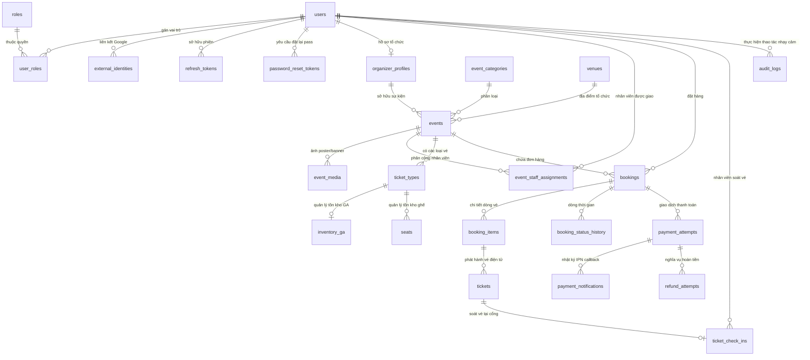

# EVENTFLOW V2 — THIẾT KẾ CƠ SỞ DỮ LIỆU & MIGRATIONS V11+ (DATA MODEL V2)

> **Phiên bản:** 2.0.0 · **Mã tài liệu:** `DATA-MODEL-V2-T11.2`  
> **Tác giả:** Principal Software Architect, Senior Security Architect, Senior Full-stack Engineer  
> **Trạng thái:** Thiết kế phê duyệt mô hình dữ liệu (Approved Data Model Design)  
> **Áp dụng cho:** Database PostgreSQL 17, schema `ticketing`, migration V11 trở đi.

---

## 1. QUY TẮC MIGRATION & BẢO TOÀN DỮ LIỆU HIỆN CÓ

1. **Bất biến Migration V1–V10:** Toàn bộ 10 migration Flyway đã chạy trên môi trường (`V1` đến `V10__user_authentication.sql`) là bất biến. Tuyệt đối không sửa đổi, không xóa hoặc ghi đè các migration cũ.
2. **Schema Additive duy nhất (V11+):** Toàn bộ các bảng mới, quan hệ mới hoặc cột bổ sung phải được triển khai thông qua các file migration mới: `V11__...sql`, `V12__...sql`, v.v.
3. **Tương thích ngược tuyệt đối (Backward Compatibility):**
   - Bảng `ticketing.users` tiếp tục duy trì cột `id`, `email`, `password_hash`, `display_name`, `demo_role`.
   - Migration V11 sẽ nới lỏng CHECK constraint trên `demo_role` (để hỗ trợ thêm `STAFF`, `ORGANIZER`) hoặc duy trì song song với bảng quan hệ chuẩn `roles` và `user_roles`.
   - Các mock bearer tokens trong profile `local/test` (`CUSTOMER` ID `10000000-0000-4000-8000-000000000001`, `ADMIN` ID `10000000-0000-4000-8000-000000000002`) tiếp tục hoạt động nguyên vẹn trong bộ test suite.

---

## 2. SƠ ĐỒ THỰC THỂ QUAN HỆ TOÀN THỂ (V2 ERD)



---

## 3. THIẾT KẾ CHI TIẾT CÁC BẢNG MỚI (V11+)

### 3.1. Nhóm Định Danh & Phân Quyền (Identity & RBAC)

#### Bảng `ticketing.roles`
- **Mục đích:** Danh mục chuẩn hóa các vai trò trong hệ thống.
- **Cột:**
  - `id` (VARCHAR(32), PK): Mã định danh vai trò (`CUSTOMER`, `STAFF`, `ORGANIZER`, `ADMIN`).
  - `name` (VARCHAR(64), NOT NULL): Tên hiển thị (Khách hàng, Nhân viên sự kiện, Nhà tổ chức, Quản trị viên).
  - `description` (TEXT): Mô tả quyền hạn.
  - `created_at` (TIMESTAMPTZ, NOT NULL DEFAULT clock_timestamp()).
- **Unique & Index:** PK `id`.
- **Retention:** Vĩnh viễn (Static configuration data). Seed sẵn 4 vai trò.

#### Bảng `ticketing.user_roles`
- **Mục đích:** Quan hệ nhiều-nhiều giữa tài khoản người dùng và vai trò; hỗ trợ 1 tài khoản giữ nhiều vai trò.
- **Cột:**
  - `user_id` (UUID, NOT NULL, FK ➔ `ticketing.users(id)` ON DELETE CASCADE).
  - `role_id` (VARCHAR(32), NOT NULL, FK ➔ `ticketing.roles(id)` ON DELETE RESTRICT).
  - `granted_by` (UUID, NULL, FK ➔ `ticketing.users(id)` ON DELETE SET NULL): Admin đã cấp quyền.
  - `granted_at` (TIMESTAMPTZ, NOT NULL DEFAULT clock_timestamp()).
- **Constraints:** PK `(user_id, role_id)`.
- **Index:** `idx_user_roles_role` trên `(role_id)`.
- **Security:** Người dùng đăng ký tự do chỉ được gán vai trò `CUSTOMER`. Chỉ `ADMIN` mới có quyền insert vào bảng này cho các vai trò khác.

#### Bảng `ticketing.external_identities`
- **Mục đích:** Lưu trữ định danh bên ngoài của người dùng (Google OIDC).
- **Cột:**
  - `id` (UUID, PK DEFAULT gen_random_uuid()).
  - `user_id` (UUID, NOT NULL, FK ➔ `ticketing.users(id)` ON DELETE CASCADE).
  - `provider` (VARCHAR(32), NOT NULL): Nhà cung cấp định danh (`GOOGLE`).
  - `provider_subject` (VARCHAR(255), NOT NULL): Giá trị `sub` chuẩn OIDC (bất biến, duy nhất từ Google).
  - `email` (VARCHAR(255), NOT NULL): Email được Google trả về trong ID Token.
  - `display_name` (VARCHAR(255)): Tên hiển thị từ Google profile.
  - `picture_url` (TEXT): Avatar Google.
  - `linked_at` (TIMESTAMPTZ, NOT NULL DEFAULT clock_timestamp()).
  - `last_login_at` (TIMESTAMPTZ, NOT NULL DEFAULT clock_timestamp()).
- **Constraints:**
  - `UNIQUE(provider, provider_subject)`: Một định danh Google chỉ gắn với tối đa một tài khoản EventFlow.
  - `UNIQUE(user_id, provider)`: Một tài khoản chỉ liên kết với một tài khoản của cùng một provider.
- **Index:** `idx_external_identities_sub` trên `(provider, provider_subject)`.

#### Bảng `ticketing.refresh_tokens`
- **Mục đích:** Lưu trữ các phiên refresh token an toàn; quản lý chuỗi token (Token Family) và phát hiện tấn công tái sử dụng (Reuse Detection).
- **Cột:**
  - `id` (UUID, PK DEFAULT gen_random_uuid()).
  - `user_id` (UUID, NOT NULL, FK ➔ `ticketing.users(id)` ON DELETE CASCADE).
  - `token_hash` (VARCHAR(64), NOT NULL): Mã băm SHA-256 của token bí mật gửi tới client qua HttpOnly Cookie.
  - `family_id` (UUID, NOT NULL): Định danh chuỗi luân chuyển token (Token Family).
  - `is_revoked` (BOOLEAN, NOT NULL DEFAULT FALSE): Cờ thu hồi hiệu lực.
  - `expires_at` (TIMESTAMPTZ, NOT NULL): Thời hạn hết hạn token (mặc định 7 ngày).
  - `created_at` (TIMESTAMPTZ, NOT NULL DEFAULT clock_timestamp()).
  - `replaced_by` (UUID, NULL): Con trỏ tới token mới được sinh ra khi token hiện tại được luân chuyển.
- **Constraints:** `UNIQUE(token_hash)`.
- **Index:** `idx_refresh_tokens_family` trên `(family_id)`, `idx_refresh_tokens_user` trên `(user_id)`.
- **Retention:** Tự động xóa các token đã hết hạn hoặc thu hồi quá 30 ngày.

#### Bảng `ticketing.password_reset_tokens`
- **Mục đích:** Lưu trữ token đặt lại mật khẩu sử dụng một lần.
- **Cột:**
  - `id` (UUID, PK DEFAULT gen_random_uuid()).
  - `user_id` (UUID, NOT NULL, FK ➔ `ticketing.users(id)` ON DELETE CASCADE).
  - `token_hash` (VARCHAR(64), NOT NULL): SHA-256 của mã reset một lần gửi qua email.
  - `expires_at` (TIMESTAMPTZ, NOT NULL): Thời hạn hiệu lực (mặc định 15 phút).
  - `used_at` (TIMESTAMPTZ, NULL): Thời điểm đã sử dụng.
  - `created_at` (TIMESTAMPTZ, NOT NULL DEFAULT clock_timestamp()).
- **Constraints:** `UNIQUE(token_hash)`.
- **Security:** Token bị hủy ngay sau lần sử dụng đầu tiên (`used_at IS NOT NULL`).

---

### 3.2. Nhóm Nhà Tổ Chức, Địa Điểm & Danh Mục (Organizer & Events)

#### Bảng `ticketing.organizer_profiles`
- **Mục đích:** Lưu trữ thông tin pháp nhân/tổ chức của đối tác tổ chức sự kiện.
- **Cột:**
  - `id` (UUID, PK DEFAULT gen_random_uuid()).
  - `user_id` (UUID, NOT NULL, FK ➔ `ticketing.users(id)` ON DELETE RESTRICT): Tài khoản chủ sở hữu.
  - `organization_name` (VARCHAR(255), NOT NULL): Tên doanh nghiệp/tổ chức.
  - `contact_email` (VARCHAR(255), NOT NULL): Email liên hệ đối tác.
  - `phone` (VARCHAR(32), NOT NULL): Số điện thoại hotline.
  - `tax_code` (VARCHAR(64)): Mã số thuế doanh nghiệp.
  - `status` (VARCHAR(32), NOT NULL DEFAULT 'ACTIVE'): `ACTIVE`, `SUSPENDED`.
  - `created_at` (TIMESTAMPTZ, NOT NULL DEFAULT clock_timestamp()).
  - `updated_at` (TIMESTAMPTZ, NOT NULL DEFAULT clock_timestamp()).
- **Constraints:** `UNIQUE(user_id)`.

#### Bảng `ticketing.venues`
- **Mục đích:** Quản lý danh mục địa điểm tổ chức biểu diễn chuẩn hóa.
- **Cột:**
  - `id` (UUID, PK DEFAULT gen_random_uuid()).
  - `name` (VARCHAR(255), NOT NULL): Tên địa điểm (Nhà hát Lớn Hà Nội, Trung tâm Hội nghị Quốc gia...).
  - `address` (TEXT, NOT NULL): Địa chỉ chi tiết.
  - `city` (VARCHAR(100), NOT NULL): Tỉnh/Thành phố (Hà Nội, TP. Hồ Chí Minh...).
  - `country` (VARCHAR(64), NOT NULL DEFAULT 'Vietnam').
  - `capacity` (INTEGER, NOT NULL CHECK (capacity > 0)): Sức chứa tối đa.
  - `seating_layout_json` (JSONB): Metadata sơ đồ ghế chuẩn của địa điểm.
  - `created_at` (TIMESTAMPTZ, NOT NULL DEFAULT clock_timestamp()).

#### Bảng `ticketing.event_categories`
- **Mục đích:** Danh mục thể loại sự kiện (Âm nhạc, Hội nghị, Thể thao, Sân khấu kịch...).
- **Cột:**
  - `id` (VARCHAR(32), PK): Mã danh mục (`CONCERT`, `THEATER`, `CONFERENCE`, `SPORTS`).
  - `name` (VARCHAR(100), NOT NULL): Tên danh mục tiếng Việt.
  - `description` (TEXT): Mô tả.
  - `icon_url` (TEXT): Đường dẫn icon biểu tượng.

#### Bảng `ticketing.event_media`
- **Mục đích:** Lưu trữ ảnh poster, banner và tư liệu của sự kiện.
- **Cột:**
  - `id` (UUID, PK DEFAULT gen_random_uuid()).
  - `event_id` (UUID, NOT NULL, FK ➔ `ticketing.events(id)` ON DELETE CASCADE).
  - `media_type` (VARCHAR(32), NOT NULL): `POSTER`, `HERO_BANNER`, `SEAT_MAP_DIAGRAM`, `GALLERY`.
  - `file_path` (TEXT, NOT NULL): Đường dẫn lưu trữ nội bộ trên disk/storage.
  - `file_url` (TEXT, NOT NULL): Đường dẫn URL công khai cho client.
  - `mime_type` (VARCHAR(64), NOT NULL): `image/jpeg`, `image/png`, `image/webp`.
  - `file_size_bytes` (BIGINT, NOT NULL): Dung lượng file byte.
  - `sort_order` (INTEGER NOT NULL DEFAULT 0): Thứ tự hiển thị.
  - `created_at` (TIMESTAMPTZ, NOT NULL DEFAULT clock_timestamp()).
- **Index:** `idx_event_media_event` trên `(event_id, media_type)`.

#### Bảng `ticketing.event_staff_assignments`
- **Mục đích:** Phân công nhân viên soát vé (Staff) phụ trách các sự kiện cụ thể.
- **Cột:**
  - `id` (UUID, PK DEFAULT gen_random_uuid()).
  - `event_id` (UUID, NOT NULL, FK ➔ `ticketing.events(id)` ON DELETE CASCADE).
  - `staff_user_id` (UUID, NOT NULL, FK ➔ `ticketing.users(id)` ON DELETE CASCADE).
  - `assigned_by` (UUID, NOT NULL, FK ➔ `ticketing.users(id)` ON DELETE RESTRICT): Organizer hoặc Admin gán.
  - `assigned_at` (TIMESTAMPTZ, NOT NULL DEFAULT clock_timestamp()).
  - `revoked_at` (TIMESTAMPTZ, NULL): Thời điểm thu hồi quyền soát vé.
- **Constraints:** `UNIQUE(event_id, staff_user_id)` khi `revoked_at IS NULL`.
- **Index:** `idx_staff_assigned_lookup` trên `(staff_user_id, event_id)` WHERE `revoked_at IS NULL`.

---

### 3.3. Nhóm Giao Dịch Cổng Thanh Toán & Hoàn Tiền (Payments & Refunds)

#### Bảng `ticketing.payment_attempts`
- **Mục đích:** Ghi nhận từng lần khởi tạo thanh toán tới cổng thanh toán ngoài (VNPAY Sandbox) hoặc Simulator.
- **Cột:**
  - `id` (UUID, PK DEFAULT gen_random_uuid()).
  - `booking_id` (UUID, NOT NULL, FK ➔ `ticketing.bookings(id)` ON DELETE RESTRICT).
  - `provider` (VARCHAR(32), NOT NULL): `VNPAY`, `SIMULATOR`.
  - `merchant_ref` (VARCHAR(64), NOT NULL): Mã tham chiếu đơn hàng gửi sang cổng thanh toán (ví dụ: `EVF_100293_1699999`).
  - `amount_vnd` (BIGINT, NOT NULL CHECK (amount_vnd > 0)): Số tiền phải thu (trích xuất từ booking snapshot).
  - `currency` (VARCHAR(3), NOT NULL DEFAULT 'VND'): Đơn vị tiền tệ.
  - `status` (VARCHAR(32), NOT NULL DEFAULT 'INITIATED'): `INITIATED`, `REDIRECTED`, `SUCCESS`, `FAILED`, `EXPIRED`, `REFUNDED`.
  - `gateway_url` (TEXT): URL chuyển hướng thanh toán đã ký số.
  - `provider_tx_ref` (VARCHAR(128), NULL): Mã giao dịch do cổng thanh toán trả về.
  - `expires_at` (TIMESTAMPTZ, NOT NULL): Thời hạn hết hạn phiên thanh toán.
  - `created_at` (TIMESTAMPTZ, NOT NULL DEFAULT clock_timestamp()).
  - `updated_at` (TIMESTAMPTZ, NOT NULL DEFAULT clock_timestamp()).
- **Constraints:** `UNIQUE(merchant_ref)`.
- **Index:** `idx_payment_attempts_booking` trên `(booking_id)`.
- **Security:** Không bao giờ lưu trữ số thẻ, CVV hay thông tin tài khoản ngân hàng của khách hàng.

#### Bảng `ticketing.payment_notifications`
- **Mục đích:** Nhật ký bất biến tiếp nhận toàn bộ Webhook IPN / Callback từ cổng thanh toán; bảo đảm xử lý Idempotent.
- **Cột:**
  - `id` (UUID, PK DEFAULT gen_random_uuid()).
  - `attempt_id` (UUID, NULL, FK ➔ `ticketing.payment_attempts(id)` ON DELETE SET NULL).
  - `provider` (VARCHAR(32), NOT NULL): `VNPAY`, `SIMULATOR`.
  - `provider_tx_ref` (VARCHAR(128), NOT NULL): Mã giao dịch phía đối tác.
  - `event_type` (VARCHAR(64), NOT NULL): `PAYMENT_SUCCESS`, `PAYMENT_FAILURE`, `REFUND_NOTIFY`.
  - `raw_payload` (JSONB, NOT NULL): Toàn bộ payload tham số HTTP POST/GET nhận từ webhook.
  - `signature` (TEXT, NOT NULL): Chữ ký số nhận được từ cổng thanh toán.
  - `signature_valid` (BOOLEAN, NOT NULL): Kết quả xác minh chữ ký số của server.
  - `processed` (BOOLEAN, NOT NULL DEFAULT FALSE): Trạng thái đã xử lý vào đơn hàng.
  - `processed_at` (TIMESTAMPTZ, NULL).
  - `created_at` (TIMESTAMPTZ, NOT NULL DEFAULT clock_timestamp()).
- **Constraints:** `UNIQUE(provider, provider_tx_ref, event_type)`.
- **Index:** `idx_payment_notif_tx` trên `(provider, provider_tx_ref)`.

#### Bảng `ticketing.refund_attempts`
- **Mục đích:** Theo dõi nghĩa vụ hoàn tiền khi đơn hàng bị hủy hoặc thanh toán muộn (`REFUND_REQUIRED`).
- **Cột:**
  - `id` (UUID, PK DEFAULT gen_random_uuid()).
  - `booking_id` (UUID, NOT NULL, FK ➔ `ticketing.bookings(id)` ON DELETE RESTRICT).
  - `payment_attempt_id` (UUID, NOT NULL, FK ➔ `ticketing.payment_attempts(id)` ON DELETE RESTRICT).
  - `amount_vnd` (BIGINT, NOT NULL CHECK (amount_vnd > 0)): Số tiền hoàn lại.
  - `reason` (VARCHAR(255), NOT NULL): `LATE_PAYMENT_AFTER_EXPIRY`, `CUSTOMER_CANCELLATION`, `EVENT_CANCELLED`.
  - `provider_refund_ref` (VARCHAR(128), NULL): Mã tham chiếu hoàn tiền từ cổng đối tác.
  - `status` (VARCHAR(32), NOT NULL DEFAULT 'PENDING'): `PENDING`, `APPROVED`, `PROCESSING`, `SUCCESS`, `MANUAL_REVIEW`.
  - `created_at` (TIMESTAMPTZ, NOT NULL DEFAULT clock_timestamp()).
  - `settled_at` (TIMESTAMPTZ, NULL).
- **Index:** `idx_refund_attempts_booking` trên `(booking_id)`.

---

### 3.4. Nhóm Soát Vé & Nhật Ký Kiểm Toán (Check-in & Audit)

#### Bảng `ticketing.ticket_check_ins`
- **Mục đích:** Ghi nhận phiên soát vé nguyên tử; chống tuyệt đối tình trạng quét trùng vé (Anti-duplicate Scan).
- **Cột:**
  - `id` (UUID, PK DEFAULT gen_random_uuid()).
  - `ticket_id` (UUID, NOT NULL, FK ➔ `ticketing.tickets(id)` ON DELETE RESTRICT): Mã vé được quét.
  - `event_id` (UUID, NOT NULL, FK ➔ `ticketing.events(id)` ON DELETE RESTRICT): Sự kiện đối chiếu.
  - `staff_user_id` (UUID, NOT NULL, FK ➔ `ticketing.users(id)` ON DELETE RESTRICT): Nhân viên soát vé.
  - `check_in_at` (TIMESTAMPTZ, NOT NULL DEFAULT clock_timestamp()).
  - `gate_name` (VARCHAR(64), NOT NULL DEFAULT 'MAIN_GATE'): Tên cổng soát vé.
  - `client_scan_ref` (VARCHAR(64), NULL): Idempotency token từ thiết bị máy quét.
- **Constraints:** `UNIQUE(ticket_id)` ➔ Bảo đảm mỗi vé chỉ có thể check-in thành công duy nhất một lần trong toàn bộ hệ thống!
- **Index:** `idx_check_ins_event` trên `(event_id, check_in_at)`.

#### Bảng `ticketing.audit_logs`
- **Mục đích:** Nhật ký kiểm toán an toàn dạng append-only ghi nhận toàn bộ các thao tác nhạy cảm (Đổi role, duyệt hoàn tiền, hủy vé, replay outbox).
- **Cột:**
  - `id` (BIGSERIAL, PK).
  - `actor_id` (UUID, NULL, FK ➔ `ticketing.users(id)` ON DELETE SET NULL): Người thực hiện.
  - `actor_role` (VARCHAR(32), NOT NULL): Vai trò tại thời điểm thực hiện (`ADMIN`, `ORGANIZER`, `SYSTEM`).
  - `action` (VARCHAR(64), NOT NULL): Mã thao tác (`ROLE_ASSIGN`, `ROLE_REVOKE`, `REFUND_APPROVE`, `OUTBOX_REPLAY`, `EVENT_CANCEL`).
  - `target_type` (VARCHAR(64), NOT NULL): Loại đối tượng chịu tác động (`USER`, `BOOKING`, `PAYMENT`, `EVENT`).
  - `target_id` (VARCHAR(128), NOT NULL): Khóa định danh của đối tượng.
  - `ip_address` (VARCHAR(45)): Địa chỉ IP client.
  - `user_agent` (TEXT): Trình duyệt/Client agent.
  - `details_json` (JSONB): Chi tiết thông số thay đổi.
  - `created_at` (TIMESTAMPTZ, NOT NULL DEFAULT clock_timestamp()).
- **Index:** `idx_audit_logs_actor` trên `(actor_id)`, `idx_audit_logs_target` trên `(target_type, target_id)`.
- **Security:** Bảng chỉ có quyền `INSERT` và `SELECT`. Không cấp quyền `UPDATE` hoặc `DELETE` cho bất kỳ database user ứng dụng nào.

---

## 4. DỰ KIẾN KẾ HOẠCH FILE FLYWAY MIGRATION V11+

```
backend/src/main/resources/db/migration/
├── V10__user_authentication.sql                     [ĐÃ CÓ - IMMUTABLE]
├── V11__four_role_rbac_and_external_identities.sql   [T12: roles, user_roles, external_identities, refresh_tokens, password_reset_tokens]
├── V12__organizer_venues_and_staff_assignments.sql   [T13: organizer_profiles, venues, event_categories, event_media, event_staff_assignments]
├── V13__payment_gateway_attempts_and_refunds.sql     [T15: payment_attempts, payment_notifications, refund_attempts]
└── V14__ticket_check_ins_and_audit_logs.sql          [T16-T17: ticket_check_ins, audit_logs]
```
