# EVENTFLOW V2 — LỘ TRÌNH KỸ THUẬT TRIỂN KHAI (IMPLEMENTATION ROADMAP)
## PHASE-BY-PHASE WORK BREAKDOWN STRUCTURE & DEFINITION OF DONE

> **Dự án:** EventFlow — High-Concurrency Commercial Event Ticketing Platform  
> **Chuyên gia phụ trách:** Principal Software Architect, Product Manager, Senior Full-stack Engineer, QA Lead  
> **Phiên bản:** V2.0-PROPOSAL · **Mã tài liệu:** `ROADMAP-REC-V2-01`  
> **Trạng thái:** Bản đề xuất kỹ thuật (Chờ Chủ dự án và Tech Lead phê duyệt)

---

## 1. NGUYÊN TẮC QUẢN TRỊ TIẾN ĐỘ & PHÊ DUYỆT (GOVERNANCE PRINCIPLES)

1. **Tuân thủ quy trình kiểm soát Cổng (Quality Gates G0 ➔ G8):** Tuyệt đối không nhảy cóc sang giai đoạn sau khi cổng chất lượng của giai đoạn trước chưa đạt yêu cầu kiểm thử và phê duyệt.
2. **Ưu tiên luồng nghiệp vụ End-to-End thực tế:** Không phát triển ồ ạt màn hình Frontend khi Backend API và Database chưa sẵn sàng; mỗi tính năng phải hoàn chỉnh từ SQL -> API -> UI -> Test.
3. **Bảo toàn bất biến V1–V10 & Invariants cũ:** Mọi thay đổi code không được làm gãy các bài test kiểm tra Row-lock `SELECT FOR UPDATE`, Outbox/Inbox và cam kết 0% bán lố vé.
4. **Một nhiệm vụ chính tại một thời điểm:** Tránh sửa đổi đa module phân tán làm mất dấu vết hồi quy (regression drift).

---

## 2. TỔNG QUAN CÁC GIAI ĐOẠN TRIỂN KHAI (PHASES OVERVIEW)

```mermaid
flowchart LR
    P0["Giai đoạn 0 (T11)<br/>Chốt Thiết Kế & Re-baseline"] --> G0{"Gate G0"}
    G0 --> P1["Giai đoạn 1 (T12)<br/>Identity, RBAC & Google OIDC"] --> G1{"Gate G1"}
    G1 --> P2["Giai đoạn 2 (T13)<br/>Organizer & Event Catalog"] --> G2{"Gate G2"}
    G2 --> P3["Giai đoạn 3 (T14)<br/>Customer Commerce & E-Ticket"] --> G3{"Gate G3"}
    G3 --> P4["Giai đoạn 4 (T15)<br/>Payment Gateway Sandbox"] --> G4{"Gate G4"}
    G4 --> P5["Giai đoạn 5 (T16)<br/>Staff Mobile Check-in"] --> G5{"Gate G5"}
    G5 --> P6["Giai đoạn 6 (T17)<br/>Admin Portal & Recovery"] --> G6{"Gate G6"}
    G6 --> P7["Giai đoạn 7 (T18)<br/>Enterprise Multi-Page Polish"] --> G7{"Gate G7"}
    G7 --> P8["Giai đoạn 8 (T19)<br/>Tải Đồng Thời & Nghiệm Thu"] --> G8{"Hoàn Thành V2"}
```

---

## 3. CHI TIẾT CÁC GIAI ĐOẠN VÀ TỪNG TASK CỤ THỂ

---

### Giai đoạn 0: Re-baseline & Chốt Thiết Kế Kỹ Thuật (Task T11)

#### Task T11.1: Audit Mã Nguồn, Cơ Sở Dữ Liệu & Xác Lập Ma Trận Khoảng Trống (Gap Matrix)
- **Mục tiêu:** Rà soát thực tế toàn bộ source code Backend, Frontend, database migrations và test suites hiện có so với tài liệu baseline.
- **Chức năng cần làm:** Chạy `git status`, kiểm tra health endpoint, kiểm tra 10 migrations Flyway, lập danh mục các điểm đã làm và còn thiếu.
- **File/Module liên quan:** `docs/upgrade-v2/SOURCE_REBASELINE.md`, `docs/upgrade-v2/GAP_MATRIX.md`.
- **Database migration:** Không.
- **API:** Không.
- **Frontend:** Không.
- **Test:** Chạy `mvn test` và kiểm tra HTTP 200 frontend.
- **Definition of Done (DoD):** Hoàn thành tài liệu Re-baseline và Gap Matrix; xác nhận branch sạch và không có dirty files ngoài ý muốn.
- **Dependencies:** Không.
- **Rủi ro:** Nhầm lẫn giữa code đã viết và tài liệu dự thảo cũ. **Giảm thiểu:** Kiểm tra trực tiếp file `.java` và `.ts`.

#### Task T11.2: Soạn Thảo Bộ Đề Xuất Chiến Lược & Tài Liệu Kỹ Thuật V2
- **Mục tiêu:** Cung cấp đầy đủ 8 tài liệu đề xuất chuyên sâu theo yêu cầu của Chủ dự án.
- **Chức năng cần làm:** Viết Product Recommendation, Feature Backlog, Architecture, Database, API, UI/UX, Roadmap, Risks & Decisions.
- **File/Module liên quan:** Thư mục `docs/upgrade-v2/*.md`.
- **Database migration:** Không (chỉ thiết kế DDL).
- **API:** Không.
- **Frontend:** Không.
- **Test:** Đánh giá chéo kiến trúc (Architectural Review).
- **Definition of Done (DoD):** Đầy đủ 8 tài liệu chất lượng cao, đối chiếu sát với source code, trình Chủ dự án duyệt.
- **Dependencies:** T11.1.
- **Rủi ro:** Đề xuất xa rời thực tế hạ tầng hiện tại. **Giảm thiểu:** Bám sát Java 25, Spring Boot 4.1.2, React 19, PostgreSQL 17, Kafka 4.2.

> **CỔNG CHẤT LƯỢNG G0 (Gate G0):** Chủ dự án và Tech Lead chính thức ký duyệt bộ 8 tài liệu đề xuất V2 trước khi bắt đầu viết bất kỳ dòng mã nào của Giai đoạn 1.

---

### Giai đoạn 1: Phân Hệ Identity, 4-Role RBAC & Google OIDC (Task T12)

#### Task T12.1: Migration V11 Additive Schema cho Identity & RBAC
- **Mục tiêu:** Tạo các bảng dữ liệu chuẩn hóa cho quyền hạn và phiên làm việc lâu dài.
- **Chức năng cần làm:** Viết migration `V11__four_role_rbac_and_external_identities.sql` tạo các bảng: `roles`, `user_roles`, `external_identities`, `refresh_tokens`, `password_reset_tokens`. Seed sẵn 4 vai trò.
- **File/Module liên quan:** `backend/src/main/resources/db/migration/V11__...sql`.
- **Database migration:** `V11`.
- **API:** Không.
- **Frontend:** Không.
- **Test:** Test chạy migration trên PostgreSQL sạch và database nâng cấp từ V10; verify constraint.
- **Definition of Done (DoD):** Migration chạy thành công, không làm hỏng dữ liệu của bảng `users` cũ.
- **Dependencies:** Phê duyệt G0.
- **Rủi ro:** Xung đột khóa ngoại hoặc lỗi cú pháp PostgreSQL 17. **Giảm thiểu:** Test kỹ trên container local trước.

#### Task T12.2: Triển Khai Token Family Refresh Store & Đăng Ký/Đăng Nhập Chuẩn
- **Mục tiêu:** Hoàn thiện luân chuyển Refresh Token Cookie an toàn, ngăn chặn tấn công Token Reuse.
- **Chức năng cần làm:** Cài đặt `RefreshTokenService`, cập nhật `AuthController` hỗ trợ endpoint `/api/auth/refresh` và `/api/auth/logout`. Băm SHA-256 token hash.
- **File/Module liên quan:** `backend/.../identity/*`, `SecurityConfiguration.java`.
- **Database migration:** Đã có từ T12.1.
- **API:** `POST /api/auth/refresh`, `POST /api/auth/logout`.
- **Frontend:** Cập nhật client Axios/Fetch tự động làm mới token khi nhận lỗi 401.
- **Test:** Unit test xoay vòng token, test giả lập reuse detection (thu hồi cả family khi token cũ bị dùng lại).
- **Definition of Done (DoD):** Token được luân chuyển thành công; cookie HttpOnly SameSite=Strict hoạt động chuẩn.
- **Dependencies:** T12.1.
- **Rủi ro:** Cookie bị chặn bởi trình duyệt do thiết lập CORS/Domain. **Giảm thiểu:** Cấu hình đúng `SameSite=Lax` trong môi trường local dev.

#### Task T12.3: Tích Hợp Xác Thực Google OIDC (Authorization Code Flow)
- **Mục tiêu:** Cho phép khách hàng đăng nhập/đăng ký 1-click an toàn bằng tài khoản Google thật.
- **Chức năng cần làm:** Triển khai endpoint tiếp nhận callback `/api/auth/oauth2/callback/google`, xác thực Google ID Token với Google JWKS endpoint (kiểm tra issuer, audience, sub, expiry), liên kết bản ghi vào `external_identities`.
- **File/Module liên quan:** `backend/.../identity/GoogleOidcService.java`, `OAuth2CallbackController.java`.
- **Database migration:** Không.
- **API:** `GET /api/auth/oauth2/google`, `GET /api/auth/oauth2/callback/google`.
- **Frontend:** Nút bấm "Tiếp tục với Google" chuẩn Google Brand Guidelines; modal đón tiếp callback.
- **Test:** Test với tài khoản Google Sandbox và mock test ID Token validator.
- **Definition of Done (DoD):** Đăng nhập Google thành công, tạo tài khoản trong PostgreSQL và trả về phiên làm việc hợp lệ.
- **Dependencies:** T12.1, T12.2.
- **Rủi ro:** Lộ Client Secret Google trong Git. **Giảm thiểu:** Tuyệt đối lưu qua biến môi trường `GOOGLE_CLIENT_SECRET`, không commit vào git.

#### Task T12.4: Thực Thi Phân Quyền Bốn Vai Trò (4-Role RBAC & Method Security)
- **Mục tiêu:** Ngăn chặn tuyệt đối leo quyền trái phép giữa Khách hàng, Nhân viên, Nhà tổ chức và Quản trị viên.
- **Chức năng cần làm:** Bật `@EnableMethodSecurity`, cấu hình `JwtAuthenticationFilter` đọc danh sách roles từ bảng `user_roles`, bảo vệ toàn bộ API với `@PreAuthorize("hasRole('...')")`.
- **File/Module liên quan:** `SecurityConfiguration.java`, `UserPrincipal.java`, các Controller.
- **Database migration:** Không.
- **API:** Toàn bộ API hiện hữu và mới.
- **Frontend:** Phân quyền điều hướng trên thanh Navbar (Ẩn các trang quản trị đối với tài khoản không có quyền).
- **Test:** Negative test suite kiểm tra mọi vai trò gọi API của nhau (trả về đúng 403 Forbidden).
- **Definition of Done (DoD):** 100% API được gán quyền chính xác; không có lỗ hổng IDOR hoặc leo quyền.
- **Dependencies:** T12.1.
- **Rủi ro:** Bỏ sót endpoint không được bảo vệ. **Giảm thiểu:** Cấu hình mặc định `anyRequest().authenticated()`.

> **CỔNG CHẤT LƯỢNG G1 (Gate G1):** Toàn bộ quy trình đăng ký, đăng nhập mật khẩu và Google OIDC lưu trữ chuẩn trong PostgreSQL; 4 vai trò được cô lập hoàn toàn.

---

### Giai đoạn 2: Nhà Tổ Chức, Địa Điểm & Quản Lý Sự Kiện (Task T13)

#### Task T13.1: Migration V12 cho Organizer Profiles, Venues & Staff Assignments
- **Mục tiêu:** Tạo các bảng quản lý đối tác, địa điểm chuẩn hóa và phân công nhân viên soát vé.
- **Chức năng cần làm:** Viết migration `V12__organizer_venues_and_staff_assignments.sql` tạo các bảng: `organizer_profiles`, `venues`, `event_categories`, `event_media`, `event_staff_assignments`.
- **File/Module liên quan:** `backend/src/main/resources/db/migration/V12__...sql`.
- **Database migration:** `V12`.
- **API:** Không.
- **Frontend:** Không.
- **Test:** Test migration trên database có dữ liệu.
- **Definition of Done (DoD):** Migration hoàn thành sạch, thiết lập đầy đủ khóa ngoại và index.
- **Dependencies:** G1.
- **Rủi ro:** Khóa ngoại bảng events nếu thiếu cột. **Giảm thiểu:** Sử dụng `ALTER TABLE ticketing.events ADD COLUMN IF NOT EXISTS organizer_id UUID`.

#### Task T13.2: API & Nghiệp Vụ Quản Trị Sự Kiện Của Organizer (Event Ownership)
- **Mục tiêu:** Cho phép Organizer tạo và chỉnh sửa sự kiện của riêng mình; kiểm soát Event Scope nghiêm ngặt.
- **Chức năng cần làm:** Triển khai `OrganizerEventController` với các chức năng tạo sự kiện `DRAFT`, cấu hình loại vé GA/ghế, xuất bản `PUBLISHED`.
- **File/Module liên quan:** `backend/.../catalog/organizer/*`, `EventSecurityService.java`.
- **Database migration:** Không.
- **API:** `GET/POST /api/organizer/events`, `PUT /api/organizer/events/{id}`, `POST /api/organizer/events/{id}/publish`.
- **Frontend:** Màn hình Organizer Event Builder và Dashboard quản lý.
- **Test:** Test cô lập: Organizer A không thể xem hoặc sửa sự kiện của Organizer B (trả về 403 Forbidden).
- **Definition of Done (DoD):** Organizer tự vận hành được toàn bộ vòng đời sự kiện; Public catalog chỉ hiển thị sự kiện `PUBLISHED`.
- **Dependencies:** T13.1.
- **Rủi ro:** Rò rỉ dữ liệu giữa các Organizer. **Giảm thiểu:** Kiểm tra `@PreAuthorize("@eventSecurity.isEventOwner(#id, principal)")`.

#### Task T13.3: Phân Công Nhân Viên Soát Vé (Staff Assignments)
- **Mục tiêu:** Cho phép Organizer gán nhân viên (Staff) phụ trách các sự kiện cụ thể.
- **Chức năng cần làm:** Triển khai endpoint gán nhân viên qua email, lưu bản ghi vào `event_staff_assignments`.
- **File/Module liên quan:** `OrganizerStaffController.java`, `StaffAssignmentService.java`.
- **Database migration:** Không.
- **API:** `POST /api/organizer/events/{id}/staff`.
- **Frontend:** Giao diện quản lý danh sách nhân viên soát vé trong từng sự kiện.
- **Test:** Test gán nhân viên thành công và thu hồi quyền.
- **Definition of Done (DoD):** Nhân viên chỉ có thể soát vé cho đúng sự kiện đã được phân công.
- **Dependencies:** T13.1, T13.2.
- **Rủi ro:** Gán nhầm tài khoản không phải vai trò STAFF. **Giảm thiểu:** Kiểm tra vai trò của người được gán trong backend.

> **CỔNG CHẤT LƯỢNG G2 (Gate G2):** Ranh giới phân quyền Organizer và phân công Staff được kiểm thử bảo mật 100% đạt yêu cầu.

---

### Giai đoạn 3: Trải Nghiệm Thương Mại Khách Hàng (Customer Commerce) (Task T14)

#### Task T14.1: Trang Khám Phá & Bộ Lọc Đa Chiều (Discovery & Search UI)
- **Mục tiêu:** Xây dựng trang `/dat-ve` với bộ lọc đa tiêu chí (thành phố, thể loại, mức giá) kết nối API thật.
- **Chức năng cần làm:** Xây dựng component `EventFilterSidebar`, `EventCardGrid`, `SearchBar` kết nối `GET /api/events`.
- **File/Module liên quan:** `frontend/src/app/DiscoveryPage.ts`, `api/events.ts`.
- **Database migration:** Không.
- **API:** `GET /api/events`.
- **Frontend:** Hoàn thiện giao diện responsive, phân trang mượt mà.
- **Test:** Kiểm thử tìm kiếm với từ khóa tiếng Việt có dấu, không dấu.
- **Definition of Done (DoD):** Khách hàng tìm kiếm và lọc sự kiện chính xác trong <200ms.
- **Dependencies:** G2.
- **Rủi ro:** Query tìm kiếm chậm khi lượng dữ liệu lớn. **Giảm thiểu:** Đánh chỉ mục `trgm` trên tên sự kiện và thành phố.

#### Task T14.2: Tích Hợp Đặt Vé Với Tài Khoản Thật & Bảo Toàn ACID Row-Lock
- **Mục tiêu:** Đảm bảo mọi đơn hàng giữ chỗ được gắn chặt với `user_id` của tài khoản đăng nhập; bảo toàn cơ chế All-or-Nothing.
- **Chức năng cần làm:** Cập nhật `BookingService` lấy danh tính từ `SecurityContext`, bảo đảm `SELECT FOR UPDATE` trên kho vé không bị suy giảm hiệu năng.
- **File/Module liên quan:** `backend/.../bookings/BookingService.java`, `BookingController.java`.
- **Database migration:** Không.
- **API:** `POST /api/bookings`.
- **Frontend:** Cập nhật màn hình chọn vé GA và sơ đồ ghế SVG, đồng hồ đếm ngược 10 phút.
- **Test:** Chạy bài test tranh chấp đồng thời 100 luồng giữ cùng 1 ghế (chỉ duy nhất 1 khách thành công).
- **Definition of Done (DoD):** Cam kết 0% bán lố vé được giữ vững 100%; đơn hàng lưu đúng tài khoản.
- **Dependencies:** T12.4.
- **Rủi ro:** Deadlock khi giữ nhiều ghế cùng lúc. **Giảm thiểu:** Sắp xếp danh sách `seat_id` tăng dần trước khi thực hiện `SELECT FOR UPDATE`.

#### Task T14.3: Ví Vé Điện Tử & Mã QR Code Vector (My Tickets Wallet)
- **Mục tiêu:** Cung cấp trang `/ve-cua-toi` cho phép khách hàng xem toàn bộ vé đã mua và hiển thị mã QR soát vé.
- **Chức năng cần làm:** Xây dựng endpoint sinh mã QR Token ký số HMAC-SHA256 `/api/tickets/{id}/qr`, render mã QR SVG trên giao diện.
- **File/Module liên quan:** `backend/.../ticketing/TicketQrService.java`, `frontend/src/app/MyBookingsPage.ts`.
- **Database migration:** Không.
- **API:** `GET /api/me/bookings`, `GET /api/tickets/{id}/qr`.
- **Frontend:** Màn hình ví vé điện tử chuẩn mobile-friendly, hỗ trợ tải file PDF.
- **Test:** Quét thử mã QR bằng ứng dụng quét tiêu chuẩn để xác minh chuỗi ký số.
- **Definition of Done (DoD):** Vé hiển thị chuẩn xác số ghế, ngày giờ; mã QR hợp lệ.
- **Dependencies:** T14.2.
- **Rủi ro:** Mã QR chứa thông tin cá nhân nhạy cảm (PII). **Giảm thiểu:** Mã QR chỉ chứa chuỗi token opaque ký số, không chứa CMND/CCCD hoặc email.

> **CỔNG CHẤT LƯỢNG G3 (Gate G3):** Luồng Khám phá -> Đặt vé -> Giữ kho -> Ví vé hoạt động thông suốt trên tài khoản thực.

---

### Giai đoạn 4: Cổng Thanh Toán Đối Tác (Payment Gateway Sandbox) (Task T15)

#### Task T15.1: Migration V13 cho Giao Dịch Cổng Thanh Toán & Hoàn Tiền
- **Mục tiêu:** Tạo các bảng ghi nhận nỗ lực thanh toán, nhật ký IPN webhook và danh sách hoàn tiền.
- **Chức năng cần làm:** Viết migration `V13__payment_gateway_attempts_and_refunds.sql` tạo các bảng: `payment_attempts`, `payment_notifications`, `refund_attempts`.
- **File/Module liên quan:** `backend/src/main/resources/db/migration/V13__...sql`.
- **Database migration:** `V13`.
- **API:** Không.
- **Frontend:** Không.
- **Test:** Test migration V13.
- **Definition of Done (DoD):** Cấu trúc bảng thanh toán sẵn sàng tiếp nhận giao dịch.
- **Dependencies:** G3.
- **Rủi ro:** Lỗi định dạng số tiền. **Giảm thiểu:** Lưu trữ số tiền dạng `BIGINT` đơn vị đồng (VND), không dùng float/double.

#### Task T15.2: Triển Khai Payment Gateway Port & VNPAY Sandbox Adapter
- **Mục tiêu:** Kết nối với cổng thanh toán VNPAY Sandbox bằng mô hình Ports & Adapters; giữ nguyên Simulator Adapter cho kiểm thử tự động.
- **Chức năng cần làm:** Cài đặt `VnPayGatewayAdapter`, tạo URL thanh toán ký số HMAC-SHA512, lưu attempt vào bảng `payment_attempts`.
- **File/Module liên quan:** `backend/.../payments/adapter/VnPayGatewayAdapter.java`, `PaymentCheckoutService.java`.
- **Database migration:** Không.
- **API:** `POST /api/payments/checkout`.
- **Frontend:** Màn hình thanh toán chuyển hướng sang cổng đối tác.
- **Test:** Test sinh URL thanh toán với checksum chuẩn tài liệu kỹ thuật của VNPAY.
- **Definition of Done (DoD):** Khách hàng click chuyển hướng sang màn hình thanh toán VNPAY Sandbox thành công.
- **Dependencies:** T15.1.
- **Rủi ro:** Khóa bí mật hash secret bị lộ. **Giảm thiểu:** Lưu trong biến môi trường bảo mật.

#### Task T15.3: Webhook IPN Callback Server-to-Server Xử Lý Idempotent Tuyệt Đối
- **Mục tiêu:** Tiếp nhận kết quả thanh toán từ VNPAY qua kênh Server-to-Server; xác minh chữ ký và xử lý bất đồng bộ an toàn.
- **Chức năng cần làm:** Triển khai endpoint `/api/payments/vnpay/ipn`. Ghi nhận IPN vào `payment_notifications`. Xác thực chữ ký. Chuyển trạng thái đơn hàng sang `CONFIRMED`, phát hành vé trong Transaction ACID, gửi event Kafka Outbox.
- **File/Module liên quan:** `PaymentWebhookController.java`, `PaymentNotificationProcessor.java`.
- **Database migration:** Không.
- **API:** `GET /api/payments/vnpay/ipn`.
- **Frontend:** Trang `/payment-return` hiển thị kết quả cho khách sau khi quay về từ cổng.
- **Test:** Test giả lập gọi IPN 5 lần liên tiếp cùng một mã giao dịch (kết quả trả về `RspCode: 02` Order already confirmed, không tạo vé trùng).
- **Definition of Done (DoD):** Webhook IPN xử lý idempotent 100%, bảo đảm không cấp vé thừa.
- **Dependencies:** T15.2.
- **Rủi ro:** Cổng gọi IPN chậm hơn thời gian khách đợi. **Giảm thiểu:** Client hỗ trợ polling trạng thái qua API `/payment-status`.

#### Task T15.4: Xử Lý Thanh Toán Trễ & Tạo Nghĩa Vụ Hoàn Tiền (Late Payment Obligation)
- **Mục tiêu:** Bảo vệ tính toàn vẹn của kho vé khi khách thanh toán sau khi đơn hàng đã bị Expiry Worker hủy.
- **Chức năng cần làm:** Nếu IPN báo thanh toán thành công nhưng đơn hàng đã bị hết hạn (`committed_expiry_at < now()`) và ghế đã bán cho người khác: Đơn hàng chuyển sang `REFUND_REQUIRED`, tự động tạo bản ghi vào `refund_attempts`, tuyệt đối không cướp vé của khách mới.
- **File/Module liên quan:** `PaymentArbitrationService.java`, `RefundService.java`.
- **Database migration:** Không.
- **API:** Không.
- **Frontend:** Thông báo rõ ràng cho khách *"Thanh toán nhận được sau khi hết hạn giữ chỗ. Tiền sẽ được hoàn lại tự động"*.
- **Test:** Test kịch bản thanh toán trễ: Đảm bảo tồn kho vé mới giữ nguyên và bản ghi hoàn tiền được tạo.
- **Definition of Done (DoD):** Kho vé không bao giờ bị bán lố trong mọi tình huống thanh toán trễ.
- **Dependencies:** T15.3.
- **Rủi ro:** Khách hàng khiếu nại vì mất vé. **Giảm thiểu:** Hiển thị rõ quy định giữ chỗ 10 phút trước khi thanh toán.

> **CỔNG CHẤT LƯỢNG G4 (Gate G4):** Giao dịch VNPAY Sandbox hoàn tất chu trình end-to-end; late payment xử lý hoàn tiền an toàn.

---

### Giai đoạn 5: Soát Vé Tại Cổng Dành Cho Nhân Viên (Staff Check-in) (Task T16)

#### Task T16.1: Migration V14 cho Ticket Check-ins & Audit Logs
- **Mục tiêu:** Tạo bảng soát vé nguyên tử với ràng buộc chống quét trùng tuyệt đối (`UNIQUE(ticket_id)`).
- **Chức năng cần làm:** Viết migration `V14__ticket_check_ins_and_audit_logs.sql` tạo bảng `ticket_check_ins` và `audit_logs`.
- **File/Module liên quan:** `backend/src/main/resources/db/migration/V14__...sql`.
- **Database migration:** `V14`.
- **API:** Không.
- **Frontend:** Không.
- **Test:** Test migration V14.
- **Definition of Done (DoD):** Bảng soát vé sẵn sàng vận hành.
- **Dependencies:** G4.
- **Rủi ro:** Trùng lặp khóa. **Giảm thiểu:** Kiểm tra ràng buộc `UNIQUE(ticket_id)`.

#### Task T16.2: Triển Khai API Soát Vé Cấp Nguyên Tử (Atomic Anti-duplicate Scan)
- **Mục tiêu:** Cung cấp API soát vé tốc độ cao (<50ms), chống quét trùng nguyên tử bằng SQL Constraint.
- **Chức năng cần làm:** Cài đặt endpoint `POST /api/staff/events/{eventId}/check-in`. Kiểm tra quyền Event Scope của nhân viên, giải mã QR token, thực hiện `INSERT INTO ticketing.ticket_check_ins`. Nếu vi phạm unique constraint -> Bắt `DuplicateKeyException` và trả về ngay HTTP 409 Conflict.
- **File/Module liên quan:** `StaffCheckInController.java`, `CheckInService.java`.
- **Database migration:** Không.
- **API:** `POST /api/staff/events/{eventId}/check-in`, `GET /api/staff/events/{eventId}/stats`.
- **Frontend:** Không.
- **Test:** Concurrency test: Gửi đồng thời 10 request quét cùng 1 vé -> Đúng 1 request nhận HTTP 200 OK, 9 request còn lại nhận HTTP 409 Conflict.
- **Definition of Done (DoD):** 100% không thể check-in trùng vé dù mạng chập chờn hay thiết bị bấm liên tục.
- **Dependencies:** T16.1.
- **Rủi ro:** Quét vé giả mạo. **Giảm thiểu:** Xác minh chữ ký số HMAC của QR token trước khi truy vấn DB.

#### Task T16.3: Ứng Dụng Web Soát Vé Di Động (Staff Mobile Scanner View)
- **Mục tiêu:** Xây dựng màn hình `/staff` tối ưu cho điện thoại di động với camera live và phản hồi âm thanh/màu sắc trực quan.
- **Chức năng cần làm:** Tích hợp thư viện quét mã HTML5 QR Scanner, phát âm thanh Beep (thành công) / Buzzer (quét trùng), hiển thị thông tin vé lớn rõ nét.
- **File/Module liên quan:** `frontend/src/app/StaffPage.ts`, `assets/audio/*`.
- **Database migration:** Không.
- **API:** Kết nối API T16.2.
- **Frontend:** Giao diện tối ưu di động, nút chuyển đổi camera trước/sau, thanh tiến độ check-in realtime.
- **Test:** Thử nghiệm quét thực tế qua camera điện thoại trên 20 mã vé mẫu.
- **Definition of Done (DoD):** Tốc độ quét và hiển thị kết quả trung bình <200ms trên thiết bị di động.
- **Dependencies:** T16.2.
- **Rủi ro:** Trình duyệt không cấp quyền camera. **Giảm thiểu:** Có ô nhập mã vé thủ công (Manual Code Input) làm phương án dự phòng.

> **CỔNG CHẤT LƯỢNG G5 (Gate G5):** Nghiệp vụ soát vé tại cổng ngăn chặn tuyệt đối tình trạng gian lận vé và quét trùng.

---

### Giai đoạn 6: Cổng Quản Trị Hệ Thống & Phục Hồi Lỗi (Admin & Recovery) (Task T17)

#### Task T17.1: Phân Hệ Quản Trị Người Dùng & Cấp Phát Vai Trò (User RBAC Governance)
- **Mục tiêu:** Cung cấp cho Admin toàn quyền tra cứu người dùng, gán/thu hồi vai trò `STAFF`, `ORGANIZER`, `ADMIN`, khóa tài khoản.
- **Chức năng cần làm:** Cài đặt endpoint `POST /api/admin/users/{id}/roles`, ghi nhật ký kiểm toán vào `ticketing.audit_logs`.
- **File/Module liên quan:** `AdminUserController.java`, `AuditLogService.java`.
- **Database migration:** Không.
- **API:** `GET /api/admin/users`, `POST /api/admin/users/{id}/roles`, `PUT /api/admin/users/{id}/status`.
- **Frontend:** Bảng danh sách người dùng trên `/admin` có modal phân quyền và badge trạng thái.
- **Test:** Test cấp quyền Admin và kiểm tra nhật ký audit log tương ứng trong database.
- **Definition of Done (DoD):** Mọi thay đổi quyền hạn đều được lưu trữ và có vết kiểm toán rõ ràng.
- **Dependencies:** G5.
- **Rủi ro:** Admin tự tước quyền của chính mình gây mất quyền quản trị. **Giảm thiểu:** Chặn hành động tự xóa role ADMIN của tài khoản đang đăng nhập.

#### Task T17.2: Quản Lý Hoàn Tiền & Giám Sát Phục Hồi Sự Cố Outbox (Disaster Recovery)
- **Mục tiêu:** Cho phép Admin xem danh sách các giao dịch cần hoàn tiền (`REFUND_REQUIRED`), kích hoạt lệnh hoàn tiền tự động và replay sự kiện Kafka Outbox bị lỗi.
- **Chức năng cần làm:** Cài đặt endpoint `POST /api/admin/refunds/{id}/process`, tích hợp giao diện điều khiển replay outbox (giới hạn tối đa 3 lần replay).
- **File/Module liên quan:** `AdminRefundController.java`, `AdminOutboxController.java`.
- **Database migration:** Không.
- **API:** `GET /api/admin/refunds`, `POST /api/admin/refunds/{id}/process`, `POST /api/admin/outbox/replay`.
- **Frontend:** Tab "Tài chính & Hoàn tiền" và "Hạ tầng & Outbox" trên Bảng Quản Trị.
- **Test:** Test replay 1 message outbox trong trạng thái FAILED sang PROCESSED.
- **Definition of Done (DoD):** Quy trình xử lý hoàn tiền và khắc phục sự cố Kafka hoạt động ổn định.
- **Dependencies:** T17.1.
- **Rủi ro:** Replay outbox vô hạn gây tràn Kafka. **Giảm thiểu:** Giới hạn cứng `retry_count <= 3` trong code.

> **CỔNG CHẤT LƯỢNG G6 (Gate G6):** Bảng Quản trị Admin kiểm soát toàn bộ người dùng, đối soát tài chính và hạ tầng.

---

### Giai đoạn 7: Hoàn Thiện Giao Diện Doanh Nghiệp Đa Trang (Enterprise Multi-Page Polish) (Task T18)

#### Task T18.1: Chuẩn Hóa Điều Hướng Đa Trang & Mega-Menu Sao Kim Branding
- **Mục tiêu:** Hoàn thiện trải nghiệm web doanh nghiệp thương mại theo chuẩn phong cách Sao Kim: Điều hướng trang con độc lập (`/`, `/dat-ve`, `/giai-phap`, `/bang-gia`, `/lien-he`), hỗ trợ mở tab mới, mega-dropdown mượt mà.
- **Chức năng cần làm:** Cấu hình HTML5 History Router, cập nhật Navbar với mega-dropdown 2 cột, bổ sung breadcrumbs và title trang động.
- **File/Module liên quan:** `frontend/src/app/App.ts`, `DemoShell.ts`, `styles.css`.
- **Database migration:** Không.
- **API:** Không.
- **Frontend:** Toàn bộ các trang công khai.
- **Test:** Test điều hướng chuyển tab, bấm nút Back/Forward của trình duyệt, mở tab mới bằng chuột giữa.
- **Definition of Done (DoD):** Hệ thống hoạt động trơn tru như một ứng dụng web đa trang hiện đại; visual snapshot chuẩn chỉ.
- **Dependencies:** G6.
- **Rủi ro:** Nhấp nháy giao diện khi chuyển trang (FOUC). **Giảm thiểu:** CSS render-blocking tối ưu và giữ state chung trong App instance.

---

### Giai đoạn 8: Kiểm Thử Tải Đồng Thời & Nghiệm Thu Tổng Thể V2 (Task T19)

#### Task T19.1: Kiểm Thử Hồi Quy Toàn Diện & Tải Cao Tranh Chấp (Concurrency & Regression)
- **Mục tiêu:** Xác nhận toàn bộ hệ thống V2 đáp ứng đầy đủ cam kết: Zero Oversell dưới tải cao, không lỗi bảo mật, không phá vỡ tính năng V1.
- **Chức năng cần làm:** Chạy toàn bộ test suites (`mvn clean verify`), chạy kịch bản mô phỏng 500 khách hàng đồng thời tranh chấp 50 vé GA và 20 ghế khán phòng.
- **File/Module liên quan:** Toàn bộ test packages trong `backend/src/test/...`.
- **Database migration:** Đã áp dụng V11-V14.
- **API:** Toàn bộ endpoints.
- **Frontend:** Visual QA toàn bộ màn hình trên Chrome headless (1440px desktop và 375px mobile).
- **Test:** Đạt 100% tests PASS, bằng chứng log và ảnh chụp màn hình ghi nhận đầy đủ vào `docs/PROGRESS.md`.
- **Definition of Done (DoD):** Nghiệm thu toàn diện sản phẩm EventFlow V2; hệ thống sẵn sàng bàn giao vận hành.
- **Dependencies:** G7.
- **Rủi ro:** Tải cao làm đầy bộ nhớ database connection pool. **Giảm thiểu:** Cấu hình HikariCP tối đa 30 connections và timeout hợp lý.

> **CỔNG CHẤT LƯỢNG G8 (Gate G8):** Sản phẩm hoàn thành xuất sắc các tiêu chí thương mại và kỹ thuật; sẵn sàng phát hành chính thức!
