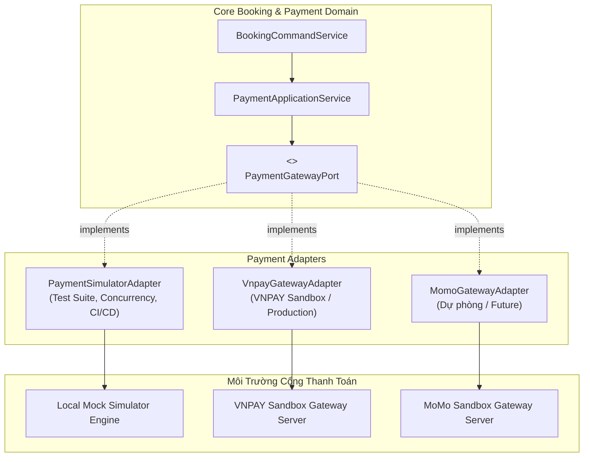
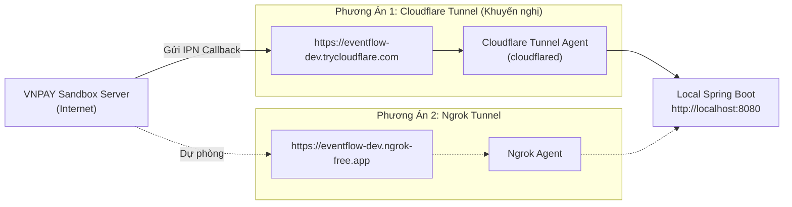

# EVENTFLOW V2 — PHƯƠNG ÁN KIẾN TRÚC CỔNG THANH TOÁN (PAYMENT GATEWAY DECISION)

> **Phiên bản:** 2.0.0 · **Mã tài liệu:** `PAY-GATEWAY-V2-T11.2`  
> **Tác giả:** Principal Software Architect, Senior Security Architect, Senior Full-stack Engineer  
> **Trạng thái:** Báo cáo phân tích kiến trúc & Đề xuất cổng thanh toán (Architecture Recommendation)  
> **Áp dụng cho:** Module `payments`, tích hợp Sandbox đối tác và bảo toàn Simulator.

---

## 1. TỔNG QUAN KIẾN TRÚC THANH TOÁN (HEXAGONAL ARCHITECTURE)

Hệ thống thanh toán của EventFlow V2 được thiết kế theo mẫu kiến trúc **Ports and Adapters (Kiến trúc Lục giác)** nhằm tách biệt hoàn toàn logic nghiệp vụ cốt lõi khỏi SDK hoặc giao thức kỹ thuật của từng nhà cung cấp cổng thanh toán:



### 1.1. Interface Cốt Lõi `PaymentGatewayPort`
```java
public interface PaymentGatewayPort {
    PaymentProvider getProvider();
    
    CheckoutInitiationResult initiateCheckout(PaymentAttempt attempt);
    
    CallbackVerificationResult verifyCallback(Map<String, String> callbackParams);
    
    PaymentQueryResult queryTransaction(String merchantRef, String providerTxRef);
    
    RefundResult initiateRefund(RefundAttempt refundAttempt);
}
```

### 1.2. Bảo Tồn Tuyệt Đối `PaymentSimulatorAdapter`
- Giữ nguyên 100% logic của bộ mô phỏng thanh toán hiện tại (`PaymentSimulatorService`, kịch bản `SUCCESS`, `FAILURE`, `DELAY_TIMEOUT`).
- Bộ mô phỏng tiếp tục là công cụ đắc lực phục vụ bộ kiểm thử tự động (Unit / Integration / Concurrency tests trong Maven) và luồng CI/CD mà không phụ thuộc vào kết nối Internet hay tình trạng máy chủ đối tác bên ngoài.

---

## 2. ĐỐI SOÁT & SO SÁNH CÁC NHÀ CUNG CẤP CỔNG THANH TOÁN TẠI VIỆT NAM

Chủ dự án chưa chốt nhà cung cấp chính thức. Dưới đây là bảng đối soát chi tiết 4 nhà cung cấp thanh toán phổ biến nhất tại thị trường Việt Nam cho các dự án thương mại điện tử và bán vé sự kiện:

| Tiêu chí đánh giá | VNPAY (Khuyến nghị số 1) | MoMo (Dự phòng số 2) | ZaloPay | PayOS (Open Source / Cổng nội địa) |
|---|---|---|---|---|
| **Môi trường Sandbox** | ✅ Có sẵn cổng Sandbox công khai ổn định (`sandbox.vnpayment.vn`). Cung cấp tài khoản test mẫu và thẻ ngân hàng ảo. | ✅ Có Sandbox (`test-payment.momo.vn`), cung cấp app MoMo test và tài khoản test. | ⚠️ Có Sandbox nhưng quy trình cấp tài khoản đối tác xét duyệt chặt chẽ hơn. | ✅ Có Sandbox tức thì, tạo API Key trực tiếp trên Web Dashboard. |
| **Giao thức IPN / Webhook** | ✅ Server-to-Server GET/POST Webhook, chữ ký số HMAC-SHA512 an toàn. | ✅ Server-to-Server POST Webhook (JSON payload), chữ ký HMAC-SHA256. | ✅ POST Webhook (JSON payload), chữ ký HMAC-SHA256. | ✅ POST Webhook (JSON payload), chữ ký HMAC-SHA256. |
| **Cơ chế Ký số & Checksum** | **HMAC-SHA512** chuẩn bảo mật cao; sắp xếp các param theo alphabet tăng dần. | **HMAC-SHA256** trên chuỗi canonical key-value. | **HMAC-SHA256** trên dữ liệu data string. | **HMAC-SHA256** trên payload checksum. |
| **API Hoàn tiền (Refund)** | ✅ Hỗ trợ API `refund` (Yêu cầu chữ ký SHA512, trích xuất IPN hoặc query). | ✅ Hỗ trợ API `refund` trực tiếp qua REST JSON. | ✅ Hỗ trợ API hoàn tiền `refund`. | ⚠️ Hoàn tiền tự động phụ thuộc vào gói ngân hàng liên kết. |
| **Tài liệu Kỹ thuật (Docs)** | ✅ Đầy đủ, rõ ràng, có sẵn mẫu code Java / Spring Boot và checklist kiểm thử IPN. | ✅ Tài liệu REST API hiện đại, chi tiết, có Postman collection. | ⚠️ Tài liệu phân tán, một số API cập nhật không đồng đều. | ✅ Tài liệu tiếng Việt trực quan, mã nguồn mở, tích hợp nhanh. |
| **Phù hợp Vé Sự Kiện** | ⭐⭐⭐⭐⭐ Rất cao: Hỗ trợ thanh toán qua mã VNPAY-QR của mọi ứng dụng Mobile Banking ngân hàng Việt Nam. | ⭐⭐⭐⭐ Cao: Người dùng trẻ dùng ví điện tử phổ biến; quét QR app ví. | ⭐⭐⭐ Trung bình: Tập trung nhiều vào hệ sinh thái Zalo. | ⭐⭐⭐⭐ Tốt cho tài khoản ngân hàng cá nhân/doanh nghiệp nhỏ. |
| **Mức độ phức tạp tích hợp** | Thấp — Trung bình (Redirect URL chuẩn HTTP GET/POST). | Thấp — Trung bình (REST API JSON). | Trung bình. | Rất thấp (REST API đơn giản). |

### Đề Xuất Của Đội Ngũ Kỹ Thuật:
1. **Khuyến nghị Lựa chọn VNPAY Sandbox**:
   - VNPAY là chuẩn thanh toán phổ biến nhất cho các sự kiện biểu diễn và hòa nhạc tại Việt Nam (hỗ trợ quét QR trực tiếp từ hơn 40 ứng dụng ngân hàng lớn: Vietcombank, Techcombank, BIDV, VietinBank...).
   - Tài liệu API ổn định, hỗ trợ đầy đủ các kịch bản: Thanh toán thành công, Hủy thanh toán, Quá hạn, và API truy vấn QueryDR.
2. **Kế hoạch hành động trong T11.2**:
   - **Chưa cấu hình credentials và chưa tích hợp SDK trong T11.2.**
   - Chuẩn bị sẵn cấu trúc `PaymentGatewayPort` và kịch bản Adapter để khi Chủ dự án cung cấp thông tin Merchant Sandbox (`vnp_TmnCode`, `vnp_HashSecret`), đội ngũ có thể kích hoạt ngay trong Phase T15 mà không làm xáo trộn kiến trúc.

---

## 3. CÁC NGUYÊN TẮC BẢO VỆ GIAO DỊCH TÀI CHÍNH BẤT BIẾN

Toàn bộ các luồng tích hợp cổng thanh toán bên ngoài bắt buộc phải tuân thủ nghiêm ngặt 7 nguyên tắc tài chính sau:

### 3.1. Tuyệt Đối Không Nhận Số Tiền Từ Client
- Client (Frontend) tuyệt đối **không được phép** gửi tham số `amount` trong request khởi tạo thanh toán.
- Số tiền thanh toán (`amount_vnd`) **chỉ được trích xuất duy nhất từ snapshot của đơn hàng** trong database (`ticketing.bookings.total_amount_vnd`).

### 3.2. Return URL Chỉ Là Giao Diện Hiển Thị (Display-Only)
- Khi khách hàng hoàn tất thanh toán trên cổng VNPAY và được chuyển hướng về `Return URL`:
  $$\text{Return URL TUYỆT ĐỐI KHÔNG được phép chuyển trạng thái đơn hàng sang CONFIRMED hay phát hành vé!}$$
- Lý do: Khách hàng có thể can thiệp sửa đổi các query parameters trên trình duyệt để giả mạo trạng thái thành công. Return URL chỉ đóng vai trò hiển thị màn hình: *"Đang chờ hệ thống xác nhận thanh toán..."* và kích hoạt cơ chế polling kiểm tra trạng thái từ backend.

### 3.3. Webhook IPN Phía Server Là Nguồn Sự Thật Xác Nhận Duy Nhất
- Trạng thái `CONFIRMED` và quyết định cấp vé điện tử **chỉ được kích hoạt khi máy chủ EventFlow tiếp nhận và xác thực thành công Webhook IPN (Server-to-Server Callback)** từ máy chủ VNPAY.
- Quy trình xác thực Webhook IPN:
  1. Kiểm tra chữ ký số SHA-512 khớp với `vnp_HashSecret`.
  2. Kiểm tra mã tham chiếu đơn hàng `vnp_TxnRef` tồn tại trong bảng `ticketing.payment_attempts`.
  3. Kiểm tra số tiền `vnp_Amount` nhận được (sau khi chia 100) khớp chính xác 100% với `attempt.amount_vnd`.
  4. Kiểm tra đơn hàng đang ở trạng thái hợp lệ (`PENDING_PAYMENT`).

### 3.4. Xử Lý Callback Idempotent Chống Trùng Lặp
- Cổng thanh toán có thể gửi lại IPN nhiều lần do cơ chế retry khi mạng chập chờn.
- Bảng `ticketing.payment_notifications` sử dụng ràng buộc khóa duy nhất:
  $$\text{UNIQUE(provider, provider\_tx\_ref, event\_type)}$$
- Khi nhận callback trùng lặp, backend trả về ngay mã phản hồi thành công `{"RspCode":"00","Message":"Confirm Success"}` mà không thực hiện lại các thao tác ghi nhận đơn hàng.

### 3.5. Chính Sách Thứ Tự Callback & Bảo Vệ Trạng Thái Terminal
- Nếu callback thất bại hoặc hủy đến sau khi đơn hàng đã `CONFIRMED`: Bỏ qua callback đến muộn, bảo vệ trạng thái đã xác nhận.
- Trạng thái terminal (`CONFIRMED`, `CANCELLED`, `EXPIRED`, `REFUND_REQUIRED`) không bao giờ bị đảo ngược bởi bất kỳ callback đến sai thứ tự nào.

### 3.6. Trọng Tài Xử Lý Thanh Toán Muộn (Late Payment Arbitration)
- Khi khách hàng giữ vé, hệ thống cho thời gian thanh toán là 600 giây (10 phút).
- Nếu sau 10 phút khách hàng mới bấm thanh toán trên cổng VNPAY, trong khi đó Background Expiry Worker đã quét đơn hàng chuyển sang `EXPIRED` và **đã nhả ghế/vé GA ra kho cho người khác mua**:
  $$\implies \text{Hệ thống TUYỆT ĐỐI KHÔNG được phép cấp vé cho đơn hàng này!}$$
- **Hành động xử lý tự động:**
  1. Ghi nhận giao dịch thanh toán thành công vào `payment_attempts`.
  2. Chuyển trạng thái đơn hàng sang **`REFUND_REQUIRED`** (Nghĩa vụ hoàn tiền).
  3. Tự động tạo bản ghi trong bảng `ticketing.refund_attempts` với lý do `LATE_PAYMENT_AFTER_EXPIRY`.
  4. Kích hoạt quy trình hoàn tiền tự động hoặc thông báo cho Admin trên Dashboard để hoàn tiền lại vào tài khoản ngân hàng của khách hàng.

---

## 4. GIẢI PHÁP TIẾP NHẬN CALLBACK HTTPS TRÊN LOCAL DEVELOPMENT

Một trong những thách thức lớn nhất khi tích hợp Webhook Sandbox là cổng thanh toán yêu cầu URL Callback (IPN) phải là **đường dẫn HTTPS công khai có thể truy cập được từ Internet**, trong khi máy chủ lập trình viên đang chạy tại `http://localhost:8080`.

Đội ngũ kỹ thuật đưa ra 2 phương án khả thi đã được kiểm chứng:



1. **Phương án Khuyến nghị (Cloudflare Tunnel - `cloudflared`):**
   - Miễn phí, ổn định cao, không giới hạn thời gian phiên kết nối.
   - Lệnh kích hoạt nhanh:
     ```bash
     cloudflared tunnel --url http://localhost:8080
     ```
   - Cung cấp URL HTTPS công khai (ví dụ: `https://xxx.trycloudflare.com/api/payments/vnpay/ipn`) để cấu hình vào cổng Sandbox.
2. **Phương án Dự phòng (Ngrok):**
   - Sử dụng client `ngrok http 8080`.
3. **Cơ chế Fallback Tự Động (Offline Reconciliation):**
   - Khi mạng local bị ngắt hoặc không mở tunnel, hệ thống cung cấp background job chạy API `queryTransaction` (QueryDR) để chủ động thăm dò kết quả thanh toán từ VNPAY mà không phụ thuộc hoàn toàn vào Webhook đẩy tới.
