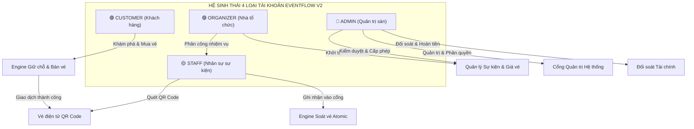

# EVENTFLOW V2 — CHIẾN LƯỢC SẢN PHẨM & ĐỀ XUẤT TÍNH NĂNG THƯƠNG MẠI
## PRODUCT RECOMMENDATION & STRATEGY REPORT

> **Phiên bản:** 2.0.0 · **Mã tài liệu:** `DOC-REC-01`  
> **Đơn vị tư vấn:** Ban Cố vấn Kiến trúc & Phát triển Sản phẩm EventFlow  
> **Đối tượng xem xét:** Chủ dự án (Project Owner), Tech Lead, Hội đồng Giám khảo Đồ án  
> **Căn cứ:** Baseline v0.4, Source Re-baseline commit `dd2cead`, và thực tiễn ngành phân phối vé sự kiện tại Việt Nam (Ticketbox, Actiup, Eventbrite).

---

## 1. TẦM NHÌN SẢN PHẨM & MỤC TIÊU KINH DOANH (PRODUCT VISION)

### 1.1 Tuyên ngôn Sản phẩm (Product Statement)
EventFlow V2 định vị là **Nền tảng Quản trị & Phân phối Vé Sự kiện Toàn diện (All-in-One Event Commerce & Operations Platform)** dành cho thị trường Việt Nam:
- **Đối với Khách hàng (Customer):** Trải nghiệm mua vé thông minh, mượt mà chuẩn thương mại điện tử; chọn vị trí ghế trực quan trên sơ đồ nhà hát; giữ chỗ minh bạch, thanh toán an toàn qua cổng quốc gia/quốc tế; quản lý ví vé điện tử QR Code chống vé giả.
- **Đối với Nhà tổ chức (Organizer):** Cổng tự phục vụ (Self-service Portal) toàn diện từ khởi tạo sự kiện, thiết lập giá vé đa phân khúc, cấu hình sơ đồ ghế phân tầng, theo dõi doanh thu thời gian thực, quản lý phân công nhân sự tại cổng.
- **Đối với Nhân viên soát vé (Staff):** Công cụ check-in di động quét mã QR tốc độ cao, xác thực nguyên tử (Atomic Check-in), chống gian lận và chống quét trùng lặp vé (Anti Double Check-in).
- **Đối với Quản trị sàn (Admin):** Trung tâm kiểm soát toàn diện: kiểm duyệt sự kiện, quản trị người dùng, đối soát giao dịch tài chính, quản lý hoàn tiền, giám sát hạ tầng kỹ thuật Kafka/Outbox.

### 1.2 Bốn Trụ cột Giá trị Cốt lõi (Core Value Pillars)
1. **Zero Oversell Invariant:** Cam kết tuyệt đối 0% bán lố vé trong mọi kịch bản giật vé cao điểm nhờ hạ tầng khóa dòng ACID PostgreSQL `SELECT FOR UPDATE`.
2. **Event-Driven Resilience (EDA):** Tách biệt xử lý bất đồng bộ, bảo vệ toàn vẹn dữ liệu qua Transactional Outbox, Kafka CDC, Inbox Deduplication và Dead Letter Queue Replay.
3. **Enterprise UI/UX (Chuẩn Sao Kim Branding):** Giao diện Deep Royal Blue sang trọng, cấu trúc Đa trang (Multi-Page Architecture), chuyển đổi cao, tối ưu responsive trên mọi thiết bị.
4. **End-to-End Real World Operations:** Vận hành thực tế với 4 phân vai (RBAC + Event Scope), cổng thanh toán Sandbox chuẩn hóa, và kiểm soát ra vào cổng thực thụ.

---

## 2. PHÂN TÍCH 4 LOẠI TÀI KHOẢN & MA TRẬN NHU CẦU NGHIỆP VỤ

### 2.1 Vai trò CUSTOMER (Khách hàng)
- **Mục tiêu chính:** Tìm kiếm nhanh chóng sự kiện yêu thích, chọn được vị trí ghế ngồi mong muốn, thanh toán nhanh gọn không lỗi, và sở hữu vé điện tử an toàn.
- **Nỗi đau (Pain points) được giải quyết:**
  - Nỗi sợ bị bán trùng ghế khi mạng gián đoạn -> Giải quyết bằng *Atomic Reservation Lock 10 phút*.
  - Mất vé giấy, rách vé -> Giải quyết bằng *Ví vé điện tử (E-Ticket Wallet) kèm mã QR SVG động*.
  - Thanh toán thành công nhưng không có vé -> Giải quyết bằng *Trọng tài thanh toán muộn (Late Payment Arbitration) tự động hoàn tiền*.

### 2.2 Vai trò ORGANIZER (Nhà tổ chức sự kiện)
- **Mục tiêu chính:** Tiếp cận hàng ngàn khán giả, kiểm soát doanh thu minh bạch, phân tầng giá vé thông minh để tối ưu hóa lợi nhuận, và quản trị ngày diễn ra sự kiện không bị tắc nghẽn cổng vào.
- **Nỗi đau được giải quyết:**
  - Không có công cụ cấu hình ghế phân tầng -> Cung cấp *Seat Matrix Designer*.
  - Bị đơn vị bán vé giữ tiền mập mờ -> Cung cấp *Dashboard doanh thu thời gian thực và lịch sử đối soát*.
  - Khó kiểm soát nhân viên soát vé thuê ngoài -> Cung cấp *Cơ chế Event Scope gán Staff theo ca diễn*.

### 2.3 Vai trò STAFF (Nhân viên soát vé)
- **Mục tiêu chính:** Thao tác soát vé dưới 1 giây/khách, giao diện quét camera mượt mà, phân biệt rõ vé hợp lệ / vé giả mạo / vé đã sử dụng.
- **Nỗi đau được giải quyết:**
  - Tình trạng một mã vé chia sẻ cho nhiều người cùng vào -> Giải quyết bằng *Khóa dòng Database `UNIQUE(ticket_id)` ghi nhận check-in tức thì*.
  - Khách làm mất điện thoại / hết pin -> Cung cấp *Công cụ tra cứu vé khẩn cấp theo CMND/CCCD/SĐT*.

### 2.4 Vai trò ADMIN (Quản trị viên toàn hệ thống)
- **Mục tiêu chính:** Đảm bảo toàn bộ sàn hoạt động tuân thủ pháp luật, bảo vệ uy tín nền tảng, xử lý tranh chấp khiếu nại, đối soát tài chính với cổng thanh toán và ngân hàng.
- **Nỗi đau được giải quyết:**
  - Organizer lừa đảo tạo sự kiện giả -> Áp dụng *Quy trình Event Approval (Kiểm duyệt sự kiện trước khi mở bán)*.
  - Lỗi giao dịch thanh toán bất đồng bộ -> Cung cấp *Giao diện đối soát và công cụ Replay sự kiện Outbox*.

---

## 3. ĐÁNH GIÁ CHỨC NĂNG & ĐỀ XUẤT NÂNG CẤP V2

Chúng tôi phân loại toàn bộ tính năng theo 4 trạng thái trung thực:
- `[HIỆN CÓ]`: Đã triển khai và kiểm chứng trong source code (V1-V10, commits `5c10c00` -> `dd2cead`).
- `[CẦN HOÀN THIỆN]`: Đã có nền tảng hoặc giao diện sơ khởi nhưng cần hoàn chỉnh theo tiêu chuẩn V2.
- `[MỚI ĐỀ XUẤT]`: Chức năng giá trị cao do Ban Cố vấn đề xuất nhằm hoàn thiện sản phẩm thương mại.
- `[CHƯA PHÊ DUYỆT]`: Ý tưởng nằm ngoài phạm vi cốt lõi, chờ Chủ dự án xem xét trong tương lai.

### 3.1 Nhóm Khách Hàng (Customer Capabilities)
1. **Đăng ký / Đăng nhập Email + Mật khẩu `[HIỆN CÓ]`:** Băm mật khẩu BCrypt độ an toàn chuẩn, lưu trữ bền vững tại PostgreSQL `ticketing.users`.
2. **Đăng nhập Google (Google OIDC) `[CẦN HOÀN THIỆN]`:** Kiến trúc Authorization Code Flow với PKCE qua backend Spring Security.
3. **Quản lý Hồ sơ & Đổi mật khẩu `[CẦN HOÀN THIỆN]`:** Cập nhật số điện thoại, họ tên, đổi mật khẩu và xem lịch sử đăng nhập.
4. **Khám phá & Bộ lọc Sự kiện `[HIỆN CÓ]`:** Lọc theo ngành nghề (Concert, Thính phòng, Công nghệ, Thể thao), tìm kiếm theo từ khóa.
5. **Chọn vé GA & Sơ đồ Ghế Sân khấu Realtime `[HIỆN CÓ]`:** Sân khấu cong `🎭 SÂN KHẤU CHÍNH`, hiển thị ghế Trống/Đang chọn/Đang giữ/Đã bán.
6. **Khóa Giữ Chỗ Nguyên Tử (Atomic Hold) `[HIỆN CÓ]`:** Cơ chế `SELECT FOR UPDATE` giữ vé độc quyền 10 phút.
7. **Ví Vé Điện Tử (E-Ticket Wallet) `[HIỆN CÓ]`:** Thẻ Boarding pass chính thức, mã check-in định danh và mã QR SVG tại cổng.
8. **Mã Giảm Giá / Khuyến Mãi (Voucher & Coupons) `[MỚI ĐỀ XUẤT]`:** Hỗ trợ nhập mã giảm giá (theo % hoặc số tiền cố định), kiểm tra hạn sử dụng và số lượt dùng tối đa.
9. **Yêu Thích Sự Kiện (Wishlist / Bookmark) `[MỚI ĐỀ XUẤT]`:** Khách hàng lưu sự kiện quan tâm để nhận thông báo khi mở bán vé Early Bird.
10. **Thông Báo Email Vé Điện Tử (Email Receipts) `[MỚI ĐỀ XUẤT]`:** Tự động gửi email đính kèm tệp PDF vé điện tử có mã QR sau khi thanh toán thành công qua dịch vụ Resend / SMTP.
11. **Gửi Yêu Cầu Hỗ Trợ (Customer Support Ticket) `[MỚI ĐỀ XUẤT]`:** Form khiếu nại/hỗ trợ đổi thông tin vé có mã tra cứu.

### 3.2 Nhóm Nhà Tổ Chức (Organizer Capabilities)
1. **Organizer Self-Service Dashboard `[CẦN HOÀN THIỆN]`:** Thống kê tổng số vé bán ra, tổng tiền thu được, biểu đồ doanh thu theo ngày.
2. **Quy Trình Tạo Sự Kiện Đa Bước (Event Wizard) `[MỚI ĐỀ XUẤT]`:** Thiết lập thông tin chung -> Chọn địa điểm -> Cấu hình loại vé -> Cấu hình sơ đồ ghế -> Tải poster -> Gửi duyệt.
3. **Quản Lý Tồn Kho & Giá Vé (Ticket Types & Pricing) `[CẦN HOÀN THIỆN]`:** Bật/tắt vé Early Bird, vé Tiêu chuẩn, vé VIP; định giá VNĐ.
4. **Cấu Hình Sơ Đồ Ghế (Visual Seatmap Builder) `[MỚI ĐỀ XUẤT]`:** Công cụ kéo thả hoặc ma trận tọa độ hàng/cột (Row A..Z, Seat 1..50).
5. **Phân Công Nhân Sự Soát Vé (Staff Assignment) `[MỚI ĐỀ XUẤT]`:** Organizer gán tài khoản Staff vào quản lý cổng cho sự kiện cụ thể của mình (Event Scope).
6. **Báo Cáo Danh Sách Khán Giả (Attendee Export) `[MỚI ĐỀ XUẤT]`:** Xuất danh sách người mua vé ra file CSV/Excel phục vụ công tác an ninh và in ấn thẻ đeo.
7. **Yêu Cầu Quyết Toán & Rút Tiền (Settlement Request) `[MỚI ĐỀ XUẤT]`:** Organizer gửi yêu cầu nhận tiền bán vé sau khi sự kiện kết thúc thành công.

### 3.3 Nhóm Nhân Viên Soát Vé (Staff Capabilities)
1. **Giao Diện Soát Vé Di Động (Staff Mobile View) `[CẦN HOÀN THIỆN]`:** Giao diện tối ưu màn hình cảm ứng điện thoại, hỗ trợ camera quét QR trực tiếp.
2. **Xác Minh Vé Nguyên Tử (Atomic Verification Engine) `[CẦN HOÀN THIỆN]`:** Kiểm tra chữ ký mã QR, trạng thái vé, đúng ngày giờ và địa điểm.
3. **Cơ Chế Chống Quét Trùng Lặp (Anti Double Check-in) `[MỚI ĐỀ XUẤT]`:** Khóa dòng database ghi nhận check-in lần đầu; nếu quét lần 2 ngay lập tức báo động đỏ "VÉ ĐÃ SỬ DỤNG VÀO LÚC HH:mm:ss".
4. **Tra Cứu Khẩn Cấp (Manual Lookup) `[MỚI ĐỀ XUẤT]`:** Tìm kiếm vé bằng số điện thoại hoặc mã vé khi camera không đọc được QR.
5. **Bảng Thống Kê Vào Cổng Thời Gian Thực (Live Gate Feed) `[MỚI ĐỀ XUẤT]`:** Hiển thị số lượng khán giả đã vào cổng / tổng số vé đã bán.

### 3.4 Nhóm Quản Trị Viên Sàn (Admin Capabilities)
1. **Admin Master Dashboard `[HIỆN CÓ]`:** Giám sát toàn sàn, quản lý booking, xem danh sách outbox, recovery replay.
2. **Quản Lý Người Dùng & Phân Quyền (User & Role Management) `[HIỆN CÓ]`:** Quản lý danh sách tài khoản thật từ PostgreSQL, tìm kiếm phân trang. Cần mở rộng gán 4 vai trò.
3. **Kiểm Duyệt Sự Kiện (Event Review & Approval) `[MỚI ĐỀ XUẤT]`:** Xem xét nội dung, giấy phép biểu diễn của Organizer trước khi chuyển trạng thái sang `PUBLISHED`.
4. **Trung Tâm Đối Soát & Hoàn Tiền (Refund & Dispute Center) `[MỚI ĐỀ XUẤT]`:** Xử lý các đơn `REFUND_REQUIRED`, kiểm tra đối soát với Payment Gateway.
5. **Quản Lý Danh Mục (Categories) & Địa Điểm (Venues) `[MỚI ĐỀ XUẤT]`:** Quản lý danh sách các nhà hát, sân vận động, trung tâm hội nghị chuẩn hóa toàn quốc.
6. **Nhật Ký Kiểm Toán (Admin Audit Trail) `[MỚI ĐỀ XUẤT]`:** Lưu vết toàn bộ hành vi duyệt sự kiện, khóa tài khoản, can thiệp hoàn tiền.

---

## 4. MA TRẬN PHÂN BỔ GIÁ TRỊ & MỨC ĐỘ KHẢ THI (VALUE VS. COMPLEXITY)

| Chức năng | Giá trị Nghiệp vụ | Độ phức tạp Kỹ thuật | Khuyến nghị Lộ trình |
|---|---|---|---|
| **Google OIDC + 4-Role RBAC** | CỰC CAO (Bắt buộc cho hệ thống thật) | VỪA PHẢI (Có Spring Security hỗ trợ) | **P0 (Sprint 1 - T12)** |
| **Cổng Thanh toán Sandbox (VNPAY/PayOS)** | CỰC CAO (Trọng tâm thương mại) | VỪA PHẢI (Theo Ports & Adapters) | **P0 (Sprint 4 - T15)** |
| **Staff Mobile QR Check-in** | CỰC CAO (Khép kín vòng đời vé) | TRUNG BÌNH (Khóa dòng chống quét trùng) | **P0 (Sprint 5 - T16)** |
| **Organizer Event Scope & Dashboard** | CỰC CAO (Tách quyền đối tác) | TRUNG BÌNH (Filter theo ownership) | **P0 (Sprint 2 - T13)** |
| **Email Receipt đính kèm PDF vé** | CAO (Trải nghiệm khách hàng) | THẤP (Tích hợp Resend API) | **P1 (Sprint 7 - T18)** |
| **Mã Giảm Giá / Voucher Engine** | CAO (Marketing bán vé) | TRUNG BÌNH (Kiểm tra điều kiện & quota) | **P1 (Sprint 7 - T18)** |
| **Multi-Organizer Payout / Rút tiền thật** | TRUNG BÌNH (Cần pháp nhân & hợp đồng) | CỰC CAO (Tích hợp Ngân hàng / Chi hộ) | **P2 (Hậu V2)** |
| **Hàng Đợi Mua Vé Virtual Queue (Waiting Room)**| TRUNG BÌNH (Chỉ cần khi 500k CCU) | CAO (Cần cụm Redis/Cloudflare Worker) | **P2 (Hậu V2)** |

---

## 5. KẾT LUẬN & KIẾN NGHỊ TỪ BAN CỐ VẤN

1. **Khẳng định tính khả thi:** Nền tảng hiện tại của EventFlow (commit `dd2cead`) đã sở hữu Core Engine xuất sắc bậc nhất về xử lý đồng thời và kiến trúc hướng sự kiện. Việc nâng cấp lên V2 không phải là đập đi xây lại, mà là **mở rộng có kiểm soát (Additive Evolution)**.
2. **Kiên định giữ vững Invariants:** Giữ nguyên khóa hàng PostgreSQL `SELECT FOR UPDATE`, Transactional Outbox, và Simulator test. Mọi nghiệp vụ V2 phải tôn trọng nguyên tắc bảo toàn dữ liệu.
3. **Đề xuất phê chuẩn:** Kính đề nghị Chủ dự án và Tech Lead xem xét thông qua Chiến lược Sản phẩm này để bước vào phê duyệt Kiến trúc và Mô hình Dữ liệu chi tiết.
