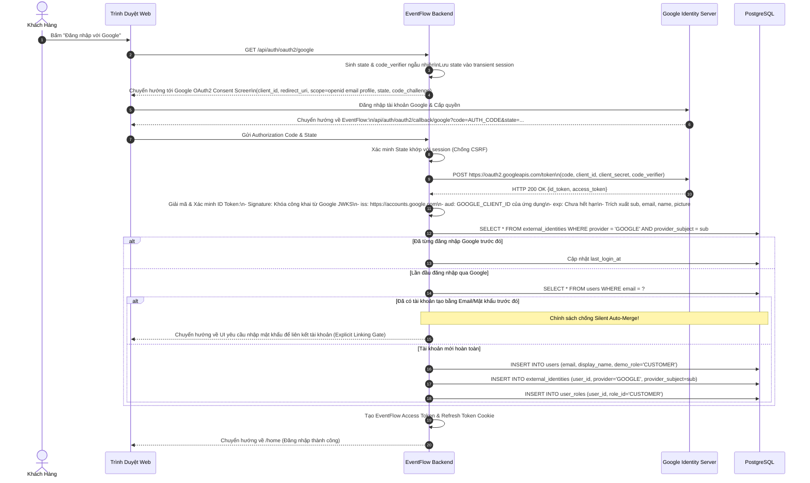

# EVENTFLOW V2 — MÔ HÌNH BẢO MẬT & PHÂN QUYỀN (SECURITY MODEL V2)

> **Phiên bản:** 2.0.0 · **Mã tài liệu:** `SEC-MODEL-V2-T11.2`  
> **Tác giả:** Principal Software Architect, Senior Security Architect  
> **Trạng thái:** Thiết kế phê duyệt mô hình bảo mật (Approved Security Model Design)  
> **Áp dụng cho:** Toàn bộ hệ thống xác thực, phân quyền và giao dịch an toàn.

---

## 1. MÔ HÌNH PHÂN QUYỀN BỐN VAI TRÒ (FOUR-ROLE RBAC) & EVENT SCOPE

### 1.1. Ma Trận Quyền Hạn Chi Tiết (Role Permission Matrix)

Hệ thống thiết lập 4 vai trò độc lập với ranh giới trách nhiệm rõ ràng:

| Miền chức năng | Quyền hạn chi tiết | CUSTOMER | STAFF | ORGANIZER | ADMIN |
|---|---|:---:|:---:|:---:|:---:|
| **Xác thực & Hồ sơ** | Đăng ký, đăng nhập email/mật khẩu, Google OIDC | ✅ | ✅ | ✅ | ✅ |
| | Xem và cập nhật hồ sơ cá nhân | ✅ | ✅ | ✅ | ✅ |
| | Đổi mật khẩu, liên kết/hủy liên kết Google | ✅ | ✅ | ✅ | ✅ |
| **Thương mại Khách hàng** | Xem catalog sự kiện công khai (`PUBLISHED`) | ✅ | ✅ | ✅ | ✅ |
| | Đặt vé GA/Ghế (Row-lock ACID, Idempotent) | ✅ | ❌ | ❌ | ✅ |
| | Thanh toán đơn hàng (Sandbox Gateway) | ✅ | ❌ | ❌ | ❌ |
| | Xem vé của tôi, tải mã QR SVG | ✅ (Own data) | ❌ | ❌ | ✅ (All) |
| **Soát Vé (Check-in)** | Xem danh sách sự kiện được phân công | ❌ | ✅ (Assigned) | ❌ | ✅ (All) |
| | Quét QR & xác thực vé tại cổng soát vé | ❌ | ✅ (Assigned) | ❌ | ✅ (All) |
| | Xem thống kê số khách đã check-in theo cổng | ❌ | ✅ (Assigned) | ✅ (Owned) | ✅ (All) |
| **Quản Trị Sự Kiện** | Tạo sự kiện mới, sửa thông tin sự kiện | ❌ | ❌ | ✅ (Owned) | ✅ (All) |
| | Cấu hình loại vé, sức chứa GA & sơ đồ ghế | ❌ | ❌ | ✅ (Owned) | ✅ (All) |
| | Phân công nhân viên soát vé (Staff Assignment) | ❌ | ❌ | ✅ (Owned) | ✅ (All) |
| | Xuất bản sự kiện (`DRAFT` ➔ `PUBLISHED`) | ❌ | ❌ | ✅ (Owned) | ✅ (All) |
| | Xem báo cáo doanh số & danh sách người mua | ❌ | ❌ | ✅ (Owned) | ✅ (All) |
| **Quản Trị Nền Tảng** | Xem toàn bộ tài khoản, tìm kiếm người dùng | ❌ | ❌ | ❌ | ✅ |
| | Khóa / mở khóa tài khoản, đổi vai trò (Role) | ❌ | ❌ | ❌ | ✅ |
| | Quản lý danh mục sự kiện & địa điểm toàn cục | ❌ | ❌ | ❌ | ✅ |
| | Duyệt & thực hiện hoàn tiền giao dịch | ❌ | ❌ | ❌ | ✅ |
| | Replay sự kiện outbox bounded (max 3 lần) | ❌ | ❌ | ❌ | ✅ |
| | Xem nhật ký kiểm toán hệ thống (`audit_logs`) | ❌ | ❌ | ❌ | ✅ |

### 1.2. Phân Quyền Theo Phạm Vi Sự Kiện (Event Scope / Object-level Security)
- **Quy tắc Nhà tổ chức (Organizer Scope):**
  Khi một tài khoản có vai trò `ORGANIZER` thực hiện bất kỳ thao tác nào trên sự kiện (`GET`, `PUT`, `POST` liên quan đến `eventId`), backend bắt buộc truy vấn bảng `ticketing.events` và so khớp:
  $$\text{event.organizer\_id} == \text{current\_user.organizer\_profile\_id}$$
  Nếu không trùng khớp, backend trả về ngay lập tức mã lỗi **`HTTP 403 Forbidden`** với mã lỗi `EVENT_ACCESS_DENIED`. Organizer A tuyệt đối không thể đọc hoặc chỉnh sửa sự kiện của Organizer B!
- **Quy tắc Nhân viên soát vé (Staff Scope):**
  Khi tài khoản có vai trò `STAFF` thực hiện soát vé tại endpoint `/api/staff/events/{eventId}/check-in`, backend kiểm tra trong bảng `ticketing.event_staff_assignments`:
  $$\exists \text{ assignment WHERE } \text{staff\_user\_id} = \text{current\_user.id} \text{ AND } \text{event\_id} = \text{eventId} \text{ AND } \text{revoked\_at IS NULL}$$
  Nếu nhân viên không được phân công cho sự kiện này, hệ thống trả về **`HTTP 403 Forbidden`** với mã lỗi `STAFF_NOT_ASSIGNED_TO_EVENT`.

### 1.3. Xử Lý Tài Khoản Giữ Nhiều Vai Trò (Multi-Role Resolution)
- Bảng `ticketing.user_roles` lưu danh sách tất cả các vai trò mà một tài khoản sở hữu.
- Khi người dùng đăng nhập, Access Token JWT chứa mảng các quyền hạn:
  ```json
  "roles": ["CUSTOMER", "ORGANIZER"]
  ```
- **Xác định quyền thực thi phía Server (Active Authority):**
  - Mọi request đều được kiểm tra theo tập hợp quyền hợp nhất (Union of Authorities).
  - Backend tuyệt đối **không tin cậy** bất kỳ tham số `role`, `organizerId` hay `staffId` nào do frontend tự gửi trong body hoặc header. Toàn bộ thông tin định danh và quyền hạn đều được trích xuất trực tiếp từ JWT Principal đã xác minh chữ ký số của server.

---

## 2. KIẾN TRÚC XÁC THỰC & BẢO VỆ PHIÊN (SESSION & TOKENS)

```mermaid
sequenceDiagram
    autonumber
    actor User as Người Dùng
    participant Client as Frontend (Vite)
    participant AuthAPI as Auth Controller
    participant TokenSvc as Token Service
    participant DB as PostgreSQL (users, refresh_tokens)

    User->>Client: Nhập Email & Mật khẩu
    Client->>AuthAPI: POST /api/auth/login {email, password}
    AuthAPI->>DB: Query user by email (status = ACTIVE)
    AuthAPI->>AuthAPI: BCrypt.checkpw(password, password_hash)
    alt Mật khẩu sai hoặc tài khoản bị khóa
        AuthAPI->>DB: Tăng fail_attempts (khóa nếu >= 5 lần)
        AuthAPI-->>Client: HTTP 401 Unauthorized / 423 Locked
    else Mật khẩu chính xác
        AuthAPI->>TokenSvc: generateTokens(user)
        TokenSvc->>TokenSvc: Tạo Access Token JWT (15 phút, HMAC-SHA256)
        TokenSvc->>TokenSvc: Tạo Refresh Token ngẫu nhiên (64 bytes hex)
        TokenSvc->>DB: INSERT INTO refresh_tokens (token_hash, family_id, expires_at)
        AuthAPI-->>Client: HTTP 200 OK {accessToken}\nSet-Cookie: refreshToken=...; HttpOnly; Secure; SameSite=Strict
    end

    Note over Client,AuthAPI: Sử dụng Access Token gọi các API bảo vệ
    Client->>AuthAPI: GET /api/me/bookings (Header: Bearer accessToken)
    AuthAPI-->>Client: HTTP 200 OK [Danh sách vé]

    Note over Client,AuthAPI: Khi Access Token hết hạn (15 phút)
    Client->>AuthAPI: POST /api/auth/refresh (Cookie: refreshToken)
    AuthAPI->>TokenSvc: rotateRefreshToken(cookieToken)
    alt Phát hiện Token bị tái sử dụng (Reuse Detection)
        TokenSvc->>DB: UPDATE refresh_tokens SET is_revoked = TRUE WHERE family_id = ?
        AuthAPI-->>Client: HTTP 401 Unauthorized (Cảnh báo bảo mật!)
    else Token hợp lệ
        TokenSvc->>DB: Đánh dấu token cũ đã thay thế (replaced_by), tạo token mới
        AuthAPI-->>Client: HTTP 200 OK {newAccessToken}\nSet-Cookie: newRefreshToken=...
    end
```

### 2.1. Quản Lý Access Token & Refresh Token
- **Access Token:**
  - Định dạng: JSON Web Token (JWT) chuẩn RFC 7519, thuật toán HMAC-SHA256.
  - Thời hạn: **15 phút**.
  - Chứa: `sub` (user_id), `email`, `roles`, `exp`, `iat`.
  - Lưu trữ phía Client: Bộ nhớ RAM (In-memory state) hoặc transient session.
- **Refresh Token:**
  - Định dạng: Chuỗi ngẫu nhiên mật mã (CSPRNG 256 bits).
  - Thời hạn: **7 ngày**.
  - Lưu trữ phía Client: **HTTP-only, Secure, SameSite=Strict Cookie** (Chống hoàn toàn tấn công XSS trích xuất token).
  - Lưu trữ phía Server: Bảng `ticketing.refresh_tokens` lưu mã băm **SHA-256** của token.

### 2.2. Token Family & Phát Hiện Tái Sử Dụng Token (Reuse Detection)
- Mỗi chuỗi refresh token được gán một `family_id` cố định từ lúc đăng nhập.
- Khi một refresh token được sử dụng để lấy token mới:
  - Token cũ bị đánh dấu đã thu hồi (`is_revoked = true`) và ghi nhận `replaced_by = new_token_id`.
  - Token mới cùng thuộc `family_id` được sinh ra và trả về client.
- **Xử lý Tấn công Tái sử dụng (Reuse Attack):**
  Nếu một refresh token đã bị thu hồi (`is_revoked = true`) lại được gửi lên server một lần nữa:
  $$\implies \text{Dấu hiệu Token đã bị kẻ xấu đánh cắp (Token Theft)!}$$
  Server lập tức thu hồi **toàn bộ các refresh token thuộc cùng `family_id`**, ép buộc tất cả các phiên đăng nhập liên quan phải đăng xuất ngay lập tức và ghi nhật ký cảnh báo an ninh.

### 2.3. Thu Hồi Phiên Phía Server (Session Revocation)
- **Đăng xuất (`POST /api/auth/logout`):** Thu hồi `family_id` trong SQL và xóa cookie client.
- **Đổi mật khẩu (`POST /api/me/change-password`):** Thu hồi toàn bộ refresh tokens của `user_id`, đăng xuất khỏi mọi thiết bị khác.
- **Khóa tài khoản bởi Admin:** Ngay lập tức vô hiệu hóa mọi phiên hoạt động.

### 2.4. Chính Sách Phòng Chống Tấn Công Brute-Force & Lockout
- Theo dõi số lần đăng nhập thất bại liên tiếp (`failed_login_attempts`).
- Nếu nhập sai mật khẩu **5 lần liên tiếp trong vòng 15 phút**:
  - Tài khoản tự động chuyển sang trạng thái tạm khóa trong **15 phút**.
  - Mọi yêu cầu đăng nhập tiếp theo đều bị chặn với thông báo lỗi `ACCOUNT_TEMPORARILY_LOCKED`.

---

## 3. TÍCH HỢP GOOGLE OPENID CONNECT (OIDC) CHUẨN DOANH NGHIỆP



### 3.1. Các Nguyên Tắc Bảo Mật OIDC Bắt Buộc
1. **Authorization Code Flow với PKCE:** Tuyệt đối không dùng Implicit Flow lỗi thời. Sử dụng Authorization Code Flow với PKCE (Proof Key for Code Exchange) để chống chặn bắt mã ủy quyền.
2. **Khóa Định Danh Vĩnh Viễn (`sub`):** Sử dụng trường `sub` (Subject Identifier) do Google cấp làm định danh chính để liên kết tài khoản. Không dùng email làm khóa chính vì người dùng có thể đổi email trên Google.
3. **Chống Tự Động Gộp Tài Khoản Không An Toàn (No Silent Auto-Merge):**
   Nếu một email từ Google trùng với một tài khoản email/mật khẩu đã có từ trước trong database:
   $$\text{Hệ thống KHÔNG tự động gộp (Silent Merge)!}$$
   Lý do: Kẻ tấn công có thể tạo tài khoản trên một IdP với email giả mạo để chiếm quyền tài khoản mục tiêu. Hệ thống yêu cầu người dùng phải xác thực quyền sở hữu (nhập mật khẩu hiện tại) trước khi liên kết (`Explicit Linking`).
4. **Cô Lập Tuyệt Đối Secrets:**
   - `GOOGLE_CLIENT_ID` và `GOOGLE_CLIENT_SECRET` được nạp qua biến môi trường hệ thống (`.env` hoặc runtime environment).
   - Tuyệt đối không commit Client Secret vào bất kỳ file nào trong Git repository.

---

## 4. AN TOÀN VÉ ĐIỆN TỬ & MÃ QR (QR CODE INTEGRITY)

### 4.1. Cấu Trúc Mã QR Vé Có Chữ Ký Số
Mã QR vé điện tử hiển thị trên giao diện người dùng **không bao giờ chứa dữ liệu thô (PII hoặc UUID thuần)** để phòng chống việc người dùng tự sửa đổi mã vé đi qua cổng soát vé.

Mã QR chứa một **chuỗi mã hóa an toàn (Signed Opaque QR Token)** có cấu trúc:
$$\text{QR\_TOKEN} = \text{base64url}(\text{eventId} \parallel \text{ticketId} \parallel \text{timestamp}) \parallel "." \parallel \text{HMAC-SHA256}(\text{payload}, \text{QR\_SECRET\_KEY})$$

### 4.2. Quy Trình Soát Vé & Chống Quét Trùng (Anti Double Check-in)
1. **Bước 1 — Xác minh chữ ký phía Server:** Khi thiết bị Staff quét mã QR, backend kiểm tra chữ ký HMAC-SHA256 với khóa bí mật của server. Nếu chữ ký sai, từ chối ngay lập tức (Vé giả mạo).
2. **Bước 2 — Kiểm tra phân công sự kiện:** Xác nhận nhân viên quét vé có tên trong danh sách nhân viên của `eventId` hay không.
3. **Bước 3 — Khóa nguyên tử & Ghi nhận Check-in:**
   Giao dịch SQL thực hiện:
   ```sql
   INSERT INTO ticketing.ticket_check_ins (ticket_id, event_id, staff_user_id, gate_name)
   VALUES (:ticketId, :eventId, :staffUserId, :gateName);
   ```
   Nhờ ràng buộc `UNIQUE(ticket_id)` trong PostgreSQL:
   - Lần quét đầu tiên: Insert thành công ➔ Trả về `CHECKED_IN` màu xanh, hiển thị tên khách và số ghế.
   - Bất kỳ lần quét thứ hai nào (dù cách nhau 1 giây hoặc xảy ra đồng thời ở 2 cổng): PostgreSQL tung lỗi `UniqueViolation` (SQLState `23505`) ➔ Backend bắt ngoại lệ và trả về ngay lập tức `ALREADY_CHECKED_IN` màu đỏ kèm thông tin: *Vé đã được quét lúc mấy giờ, tại cổng nào*.

---

## 5. NHẬT KÝ KIỂM TOÁN HỆ THỐNG (AUDIT TRAIL)

Toàn bộ các hành động nhạy cảm trong hệ thống bắt buộc phải được ghi nhận vào bảng `ticketing.audit_logs`:
- Gán / Thu hồi vai trò người dùng (`ROLE_ASSIGN`, `ROLE_REVOKE`).
- Khóa / Mở khóa tài khoản (`USER_LOCK`, `USER_UNLOCK`).
- Hủy đơn hàng hoặc phê duyệt hoàn tiền (`REFUND_APPROVE`).
- Kích hoạt phục hồi sự kiện (`OUTBOX_REPLAY`).
- Thay đổi trạng thái sự kiện (`EVENT_PUBLISH`, `EVENT_CANCEL`).

Bảng `ticketing.audit_logs` có tính chất **bất biến (Append-Only)**: Hệ thống chỉ hỗ trợ thao tác ghi thêm mới (`INSERT`) và tra cứu (`SELECT`), không có bất kỳ API hoặc hàm nghiệp vụ nào hỗ trợ chỉnh sửa hay xóa bản ghi kiểm toán.
