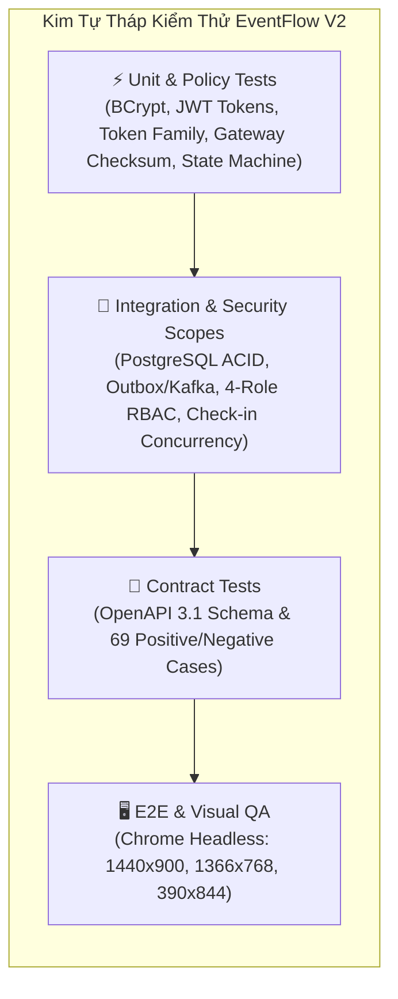

# EVENTFLOW V2 — CHIẾN LƯỢC KIỂM THỬ TOÀN DIỆN (TEST STRATEGY V2)

> **Phiên bản:** 2.0.0 · **Mã tài liệu:** `TEST-STRATEGY-V2-T11.2`  
> **Tác giả:** Principal Software Architect, Senior Security Architect, Senior Full-stack Engineer  
> **Trạng thái:** Kế hoạch kiểm thử phê duyệt (Approved Test Strategy)  
> **Phạm vi:** Phân tích 121 test suites bị skipped, chiến lược kiểm thử tính năng V2, bảo toàn Invariants và kiểm thử giao diện đa thiết bị.

---

## 1. PHÂN TÍCH CHUYÊN SÂU 121 INTEGRATION TESTS BỊ SKIPPED

### 1.1. Nguyên Nhân Gốc Rễ (Root Cause)
Khi chạy lệnh kiểm thử mặc định `backend/mvnw.cmd test`, console ghi nhận:
```
[INFO] Results:
[INFO] Tests run: 134, Failures: 0, Errors: 0, Skipped: 121
```
Nguyên nhân gốc rễ: Toàn bộ 121 phương thức kiểm thử integration này đều được khai báo với annotation điều kiện của JUnit 5:
```java
@EnabledIfEnvironmentVariable(named = "PG_IT_URL", matches = ".+")
// hoặc
@EnabledIfEnvironmentVariable(named = "KAFKA_IT_BOOTSTRAP", matches = ".+")
```
Khi chạy trên máy trạm cục bộ mà không truyền biến môi trường `PG_IT_URL`, JUnit 5 **cố ý bỏ qua (skip)** các test này. Đây là **cơ chế an toàn có chủ đích từ kiến trúc Baseline v0.4** nhằm bảo vệ cơ sở dữ liệu demo (`event_ticketing`) không bị các kịch bản test integration tự động xóa sạch dữ liệu (`cleanup()` xóa sự kiện, bảng vé).

### 1.2. Bảng Thống Kê Chi Tiết 121 Test Suites Bị Skipped

| Test Class | Số lượng test | Điều kiện kích hoạt | Vai trò kiểm chứng bất biến |
|---|:---:|---|---|
| `PostgresBookingTest.java` | **23 tests** | `PG_IT_URL` | Kiểm chứng tranh chấp giữ chỗ vé GA và Ghế; Row-level lock; All-or-Nothing multi-seat; chống bán lố Zero Oversell. |
| `PostgresSeatExpiryTest.java` | **23 tests** | `PG_IT_URL` | Kiểm chứng cơ chế Expiry Worker; tự động giải phóng ghế và vé GA sau 600 giây; chuyển booking sang `EXPIRED`. |
| `PostgresAdminTest.java` | **17 tests** | `PG_IT_URL` | Kiểm chứng CRUD sự kiện của Admin; bảo vệ sức chứa $capacity \ge held + sold$; phân trang danh sách đơn hàng. |
| `PostgresCatalogTest.java` | **15 tests** | `PG_IT_URL` | Kiểm chứng truy vấn danh mục sự kiện; tính toán tồn kho realtime khả dụng không khóa dòng. |
| `PostgresPaymentTest.java` | **14 tests** | `PG_IT_URL` | Kiểm chứng máy trạng thái thanh toán; kịch bản mô phỏng SUCCESS, FAILURE, DELAY_TIMEOUT; xử lý thanh toán muộn. |
| `KafkaRecoveryTest.java` | **12 tests** | `KAFKA_IT_BOOTSTRAP`, `KAFKA_IT_PG_URL` | Kiểm chứng phục hồi khi Kafka broker gặp sự cố; outbox bounded replay tối đa 3 lần; consumer idempotency. |
| `PostgresOutboxTest.java` | **7 tests** | `PG_IT_URL` | Kiểm chứng tính nguyên tử giữa nghiệp vụ booking và ghi sự kiện outbox trong cùng 1 transaction PostgreSQL. |
| `PostgresMetricsTest.java` | **5 tests** | `PG_IT_URL` | Kiểm chứng chỉ số đo lường Prometheus/Micrometer cho booking và payment. |
| `PostgresDashboardSecurityTest.java` | **3 tests** | `PG_IT_URL` | Kiểm chứng phân quyền bảo mật truy cập dashboard; chặn 401/403 cho tài khoản không có quyền Admin. |
| `PostgresProductionProfileTest.java` | **1 test** | `PG_IT_URL` | Kiểm chứng hệ thống tự fail startup nếu profile `prod` mà bật mock identity. |
| `PostgresSchemaTest.java` | **1 test** | `PG_IT_URL` | Kiểm chứng tính hợp lệ của toàn bộ Flyway migrations. |
| **TỔNG CỘNG** | **121 tests** | | |

### 1.3. Bằng Chứng Chạy Thành Công Trong CI (`.github/workflows/ci.yml`)
Trong file cấu hình CI chính thức của repository (`.github/workflows/ci.yml`), quy trình đã tự động khởi tạo database kiểm thử độc lập:
```bash
docker exec ${{ job.services.postgres.id }} createdb -U ticketing ticketing_ci
export PG_IT_URL="jdbc:postgresql://127.0.0.1:5432/ticketing_ci"
export KAFKA_IT_BOOTSTRAP="127.0.0.1:19092"
```
Tại commit `984e95d` và `11a83af`, toàn bộ **134/134 tests (bao gồm cả 121 tests trên)** đều được thực thi và đạt **PASS 100%** mà không có bất kỳ lỗi nào.

### 1.4. Quy Trình Chạy Toàn Bộ Integration Tests Trên Local An Toàn
Để chạy toàn bộ 121 integration tests trên máy trạm mà không ảnh hưởng tới dữ liệu demo:
```powershell
# Bước 1: Tạo database test riêng biệt trên container Postgres hiện có
docker exec event-ticketing-local-postgres-1 psql -U ticketing_user -d event_ticketing -c "CREATE DATABASE ticketing_it_temp OWNER ticketing_user;"

# Bước 2: Chạy Maven test với biến môi trường PG_IT_URL
$env:PG_IT_URL="jdbc:postgresql://localhost:5432/ticketing_it_temp"
backend/mvnw.cmd -f backend/pom.xml test

# Bước 3: Dọn dẹp database test sau khi chạy xong
Remove-Item Env:PG_IT_URL
docker exec event-ticketing-local-postgres-1 psql -U ticketing_user -d event_ticketing -c "DROP DATABASE ticketing_it_temp;"
```

---

## 2. KIM TỰ THÁP KIỂM THỬ CHO EVENTFLOW V2 (TEST PYRAMID)



### 2.1. Tầng 1: Unit & Policy Tests
- **Xác thực & Mật mã:**
  - `BCryptPasswordEncoderTest`: Kiểm tra độ phức tạp mật khẩu và băm an toàn.
  - `JwtServiceTest`: Kiểm tra ký token HMAC-SHA256, kiểm tra thời hạn hết hạn 15 phút.
  - `RefreshTokenServiceTest`: Kiểm tra sinh chuỗi ngẫu nhiên CSPRNG, mã băm SHA-256, và cơ chế phát hiện tái sử dụng Token Family (Reuse Detection).
- **Cổng thanh toán:**
  - `VnpaySignatureTest`: Kiểm tra thuật toán sắp xếp alphabet các tham số và tính toán chữ ký số HMAC-SHA512 đối chiếu với vector chuẩn của VNPAY.

### 2.2. Tầng 2: Integration & Object-Level Security Tests
- **Phân quyền 4 Vai trò & Event Scope:**
  - `OrganizerEventScopeTest`: Tạo Organizer A và B; kiểm tra Organizer A không thể sửa, xuất bản hoặc xem báo cáo sự kiện của Organizer B (kết quả trả về `403 Forbidden`).
  - `StaffCheckinScopeTest`: Gán Staff 1 vào Sự kiện 1; kiểm tra Staff 1 quét vé Sự kiện 2 bị chặn `403 Forbidden` (`STAFF_NOT_ASSIGNED_TO_EVENT`).
  - `AdminPrivilegeTest`: Kiểm tra chỉ Admin mới có quyền gán role, thu hồi role, duyệt hoàn tiền và khóa tài khoản.
- **Xử lý Webhook IPN & Trọng tài Thanh toán Muộn:**
  - `PaymentIpnIdempotencyTest`: Gửi cùng một Webhook IPN 5 lần liên tiếp; xác nhận chỉ có 1 lần xử lý ghi nhận đơn hàng, 4 lần sau trả về mã thành công mà không chạy lại logic.
  - `LatePaymentArbitrationTest`: Mô phỏng booking quá hạn 600s đã chuyển sang `EXPIRED` và nhả ghế; nhận webhook thanh toán thành công muộn; xác nhận đơn hàng chuyển sang `REFUND_REQUIRED` và sinh bản ghi `refund_attempts`, tuyệt đối không phát hành vé.
- **Soát vé nguyên tử (Anti Double Check-in):**
  - `ConcurrentCheckinTest`: Bắn đồng thời 20 thread quét cùng 1 mã vé `ticket_id`; xác nhận chính xác duy nhất 1 request nhận kết quả `CHECKED_IN` (HTTP 200), 19 request còn lại nhận `ALREADY_CHECKED_IN` (HTTP 409).

### 2.3. Tầng 3: Contract Tests (OpenAPI 3.1)
- Tiếp tục duy trì và mở rộng bộ kiểm thử `tools/contracts/verify.mjs`.
- Bổ sung kiểm tra schema hợp đồng cho toàn bộ các API mới của V2: OAuth Google, Đổi mật khẩu, Phân quyền Admin, Webhook IPN và API Check-in.

### 2.4. Tầng 4: Visual QA & Giao Diện Đa Thiết Bị
- Tự động chụp ảnh màn hình bằng Google Chrome Headless ở 3 độ phân giải tiêu chuẩn:
  1. **Desktop:** `1440x900`
  2. **Laptop:** `1366x768`
  3. **Mobile:** `390x844` (iPhone 14/15)
- Kiểm tra toàn bộ 7 trang chuyên biệt và các dashboard theo từng vai trò: Customer, Staff, Organizer, Admin.

---

## 3. CỔNG NGHIỆM THU KIỂM THỬ TRƯỚC KHI RELEASE (RELEASE GATE G8)

Trước khi đóng gói phát hành bất kỳ phiên bản nào của EventFlow V2, toàn bộ các tiêu chí kiểm thử sau đây bắt buộc phải đạt:

$$\text{Release Gate} = (\text{Unit Tests} = 100\% \text{ PASS}) \land (\text{Integration Tests} = 100\% \text{ PASS}) \land (\text{Contract Tests} = 100\% \text{ PASS}) \land (\text{Visual QA Reviewed})$$

1. **Backend Surefire:** 100% tests PASS (không có Failure, không có Error).
2. **Frontend Test Runner:** 100% tests PASS (54/54 tests cũ + các tests mới của V2).
3. **Contract Suite:** 100% test cases PASS.
4. **Không có bất kỳ Secret nào** bị lọt vào mã nguồn (Kiểm tra bằng GitLeaks).
