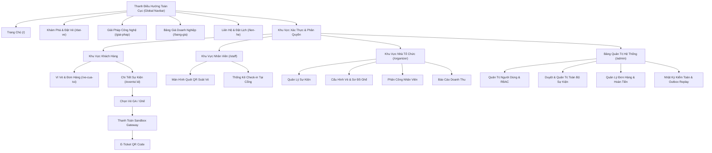

# EVENTFLOW V2 — ĐỀ XUẤT THIẾT KẾ GIAO DIỆN & TRẢI NGHIỆM NGƯỜI DÙNG (UI/UX)
## DESIGN SYSTEM, INFORMATION ARCHITECTURE & INTERACTION SPECIFICATION

> **Dự án:** EventFlow — High-Concurrency Commercial Event Ticketing Platform  
> **Chuyên gia phụ trách:** Senior UI/UX Designer, Product Manager, Senior Full-stack Engineer  
> **Phong cách tham chiếu:** Doanh nghiệp cao cấp & Thương mại hiện đại (Inspired by Sao Kim Branding & Event Platforms)  
> **Phiên bản:** V2.0-PROPOSAL · **Mã tài liệu:** `UIUX-REC-V2-01`  
> **Trạng thái:** Bản đề xuất thiết kế (Chờ Chủ dự án và Tech Lead phê duyệt)

---

## 1. NGUYÊN TẮC THIẾT KẾ & HỆ THỐNG NHẬN DIỆN (DESIGN SYSTEM)

Để EventFlow vượt qua giới hạn của một đồ án kỹ thuật demo và đạt chuẩn của một nền tảng thương mại trực tuyến chuyên nghiệp, hệ thống giao diện V2 được định hình dựa trên 4 trụ cột thiết kế:
1. **Corporate & Trustworthy:** Sử dụng dải màu Deep Royal Blue kết hợp Slate Gray tạo sự tin cậy, bảo chứng công nghệ cho các giao dịch tài chính lớn.
2. **Action-driven & High Contrast:** Các nút kêu gọi hành động (Call To Action - CTA) như "Đặt vé ngay", "Thanh toán", "Quét mã" sử dụng màu Coral Orange/Rose nổi bật trên nền xanh.
3. **Multi-page & Contextual Navigation:** Thay vì dồn nén toàn bộ tính năng trên 1 màn hình đơn lẻ, hệ thống phân chia rõ ràng các trang độc lập có URL riêng biệt (`/`, `/dat-ve`, `/giai-phap`, `/bang-gia`, `/ve-cua-toi`, `/organizer`, `/staff`, `/admin`), hỗ trợ mở tab mới, bookmark và điều hướng tự nhiên.
4. **State Transparency & Latency Feedback:** Mọi trạng thái tồn kho (AVAILABLE, HELD, SOLD), đếm ngược giữ vé (Countdown Timer) và kết quả quét soát vé (200 OK vs 409 Quét trùng) đều được thể hiện trực quan bằng màu sắc chuẩn mực.

### 1.1. Bảng Màu Chuẩn Doanh Nghiệp (Color Palette Tokens)

| Token CSS | Mã Màu HEX | Ứng Dụng | Ý Nghĩa / Cảm Xúc |
|---|---|---|---|
| `--color-primary-dark` | `#08142b` | Hero background, Header deep banner | Tối ưu độ sâu thị giác, sang trọng |
| `--color-primary-navy` | `#0a192f` | Card background cao cấp, Footer | Nhận diện thương hiệu chính |
| `--color-primary-blue` | `#1e3a8a` | Viền card, dropdown menu hover | Công nghệ, tin cậy |
| `--color-accent-orange`| `#f97316` | CTA chính, nút đặt lịch tư vấn, badge VIP | Thu hút hành động mua sắm |
| `--color-accent-coral` | `#ef4444` | Trạng thái Sold Out, cảnh báo hủy, quét trùng | Khẩn cấp, cảnh báo lỗi |
| `--color-surface-card`  | `#ffffff` | Nền nội dung trang con, form đặt vé | Sáng sủa, dễ đọc tài liệu dài |
| `--color-surface-bg`    | `#f8fafc` | Nền tổng thể các trang thương mại | Thoải mái cho mắt người dùng |
| `--color-text-main`     | `#0f172a` | Tiêu đề H1-H6, văn bản chính | Độ tương phản cao chuẩn WCAG AAA |
| `--color-text-muted`    | `#64748b` | Chú thích ngày giờ, địa điểm, breadcrumbs | Phân tầng thông tin rõ ràng |
| `--color-success-green` | `#10b981` | Đơn hàng CONFIRMED, vé hợp lệ | Khẳng định giao dịch thành công |

### 1.2. Hệ Thống Typography & Khoảng Cách

- **Font Family:** `Inter`, `-apple-system`, `BlinkMacSystemFont`, `Segoe UI`, `Roboto`, sans-serif.
- **Tỷ lệ chữ (Scale):**
  - `Hero H1`: 36px – 48px, Bold 800, Line-height 1.15.
  - `Section H2`: 28px – 32px, Bold 700, Line-height 1.25.
  - `Card Title H3`: 18px – 20px, Semi-bold 600.
  - `Body Regular`: 15px – 16px, Regular 400, Line-height 1.5.
  - `Caption / Meta`: 12px – 13px, Medium 500.
- **Lưới khoảng cách (8pt Grid):** 4px, 8px, 16px, 24px, 32px, 48px, 64px.

---

## 2. KIẾN TRÚC THÔNG TIN & ĐIỀU HƯỚNG ĐA TRANG (INFORMATION ARCHITECTURE)

---

## 3. THIẾT KẾ CHI TIẾT 10 KHU VỰC CHỨC NĂNG NGHIỆP VỤ

---

### 3.1. Trang Chủ Doanh Nghiệp (Homepage — `/`)

- **Mục tiêu người dùng:** Nắm bắt giá trị cốt lõi của nền tảng EventFlow (Zero Oversell, xử lý tức thì, bảo chứng tin cậy cho sự kiện lớn), xem các sự kiện tiêu biểu và dễ dàng bắt đầu hành trình mua vé hoặc liên hệ hợp tác.
- **Các thành phần giao diện chính:**
  1. **Top Announcement Bar:** Thông báo trạng thái hệ thống, hotline hỗ trợ, chuyển đổi ngôn ngữ.
  2. **Corporate Header & Mega-Menu:** Thanh điều hướng đa cấp với dropdown "Giải pháp", "Ngành nghề", "Bảng giá", ô tìm kiếm nhanh, nút "Đăng nhập / Đăng ký" và CTA "Đặt lịch tư vấn".
  3. **Hero Section:** Banner không gian vũ trụ/công nghệ màu xanh thẫm, tiêu đề lớn *"Giải Pháp Phân Phối Vé Trực Tuyến Tốc Độ Cao & Phân Bổ Chỗ Ngồi Độc Quyền"*, nút hành động kép ("Khám phá vé mở bán ngay" và "Xem bảng giá dịch vụ"), dải số liệu bảo chứng (100.000+ vé, 0% bán lố, 99.99% uptime, <50ms độ trễ).
  4. **Featured Events Carousel:** Khối sự kiện nổi bật với ảnh poster chất lượng cao, nhãn phân loại (Concert, Nhạc kịch, Hội nghị), giá vé từ máy chủ và nút "Xem chi tiết".
  5. **Client Proof & Industry Verticals:** Khối các ngành nghề phục vụ (Đại nhạc hội, Nhà hát hàn lâm, Triển lãm công nghệ, Thể thao).
  6. **Enterprise Footer:** Liên kết bản quyền, chứng nhận bảo mật, chính sách hoàn hủy và mạng xã hội.
- **API kết nối:** `GET /api/events` (lọc `status = 'PUBLISHED'`), `GET /api/categories`.
- **Dữ liệu SQL:** `ticketing.events`, `ticketing.event_categories`, `ticketing.event_media`.

---

### 3.2. Trang Khám Phá & Bộ Lọc Sự Kiện (Event Discovery — `/dat-ve`)

- **Mục tiêu người dùng:** Tìm kiếm, tra cứu sự kiện mong muốn theo địa điểm (Hà Nội, TP.HCM), thể loại, mức giá hoặc khoảng thời gian; xem trực tiếp tình trạng vé còn hay hết.
- **Các thành phần giao diện chính:**
  1. **Thanh tìm kiếm thông minh:** Nhập tên ca sĩ, ban nhạc, tên sự kiện hoặc địa điểm.
  2. **Bộ lọc đa chiều (Filter Sidebar):**
     - Thành phố: Toàn quốc, Hà Nội, TP. Hồ Chí Minh, Đà Nẵng.
     - Thể loại: Tất cả, Concert Âm nhạc, Nhạc kịch & Giao hưởng, Hội thảo Công nghệ, Giải đấu Thể thao.
     - Hình thức vé: Vé tự do (GA), Vé chọn ghế (Seated).
     - Khoảng giá: < 500k, 500k - 1tr, > 1tr.
  3. **Lưới thẻ sự kiện (Event Card Grid):**
     - Ảnh bìa 16:9 sắc nét, nhãn "Ghế chỉ định" hoặc "Vé đứng GA".
     - Tên sự kiện, ngày biểu diễn, địa điểm biểu diễn.
     - Giá khởi điểm từ máy chủ (`min_price_vnd`).
     - Trạng thái: "Đang mở bán" (Xanh) hoặc "Cháy vé" (Đỏ).
  4. **Phân trang (Pagination):** Hỗ trợ duyệt hàng chục trang sự kiện mà không bị tải chậm.
- **API kết nối:** `GET /api/events?search=...&city=...&category=...&page=0&size=12`.
- **Dữ liệu SQL:** `ticketing.events`, `ticketing.venues`, `ticketing.ticket_types`.

---

### 3.3. Trang Chi Tiết Sự Kiện (Event Detail — `/events/:id`)

- **Mục tiêu người dùng:** Xem đầy đủ thông tin sự kiện (thời gian diễn ra, địa chỉ chính xác, giới thiệu nội dung, quy định độ tuổi, sơ đồ khán phòng tổng thể) và nhấn nút chọn mua vé.
- **Các thành phần giao diện chính:**
  1. **Event Hero Header:** Banner lớn làm mờ hậu cảnh, poster sự kiện sắc nét, tên sự kiện, ngày giờ tổ chức, địa chỉ nhà hát.
  2. **Tab chuyển đổi nội dung:**
     - Tab "Giới thiệu": Nội dung chi tiết về chương trình, nghệ sĩ biểu diễn, timeline sự kiện.
     - Tab "Sơ đồ & Hạng vé": Xem sơ đồ vị trí khán phòng (Zone A, VIP, Hạng 1, Hạng 2).
     - Tab "Quy định & Lưu ý": Điều khoản hoàn hủy, độ tuổi quy định, hướng dẫn check-in.
  3. **Khung Sticky Booking CTA:** Cố định bên phải màn hình hiển thị khoảng giá vé và nút "Mua vé ngay" (kích hoạt chuyển hướng tới luồng đặt vé).
- **API kết nối:** `GET /api/events/{id}`.
- **Dữ liệu SQL:** `ticketing.events`, `ticketing.venues`, `ticketing.event_media`, `ticketing.ticket_types`.

---

### 3.4. Luồng Đặt Vé GA & Chọn Ghế Trực Quan (Booking Flow — `/dat-ve/:id`)

- **Mục tiêu người dùng:** Chọn số lượng vé GA hoặc click trực tiếp trên sơ đồ khán phòng tương tác để chọn ghế mong muốn; giữ vé trong vòng 10 phút để chuẩn bị thanh toán.
- **Các thành phần giao diện chính:**
  1. **Header giữ chỗ:** Hiển thị đồng hồ đếm ngược `09:59` nổi bật màu cam; cảnh báo nếu hết thời gian vé sẽ tự động nhả cho người khác.
  2. **Đối với sự kiện GA (General Admission):**
     - Bộ chọn số lượng vé (+ / -) kèm thông báo số lượng còn lại từ máy chủ.
     - Giới hạn tối đa 4 vé/lần đặt để chống bot đầu cơ.
  3. **Đối với sự kiện Ghế Chỉ Định (Seated Event):**
     - Sơ đồ ghế SVG tương tác đa tầng (Sân khấu, Hàng ghế VIP A1-A20, Hàng thường B1-B30).
     - Bảng chú giải màu sắc:
       - Trắng / Xanh: Ghế trống (AVAILABLE) — Cho phép chọn.
       - Vàng cam: Ghế bạn đang chọn (SELECTED).
       - Xám nhạt: Ghế người khác đang giữ (HELD) — Khóa click.
       - Đỏ / Đen: Ghế đã thanh toán (SOLD) — Khóa click.
  4. **Tóm tắt đơn hàng (Order Summary Sidebar):**
     - Danh sách ghế đã chọn kèm đơn giá snapshot.
     - Tạm tính tiền hàng (VND).
     - Nút "Tiến hành giữ vé & Thanh toán".
- **Luồng thao tác (User Journey):**
  1. Khách click chọn ghế -> Hệ thống highlight tạm thời trên UI.
  2. Khách nhấn "Xác nhận giữ vé" -> Gọi API `POST /api/bookings` kèm `Idempotency-Key`.
  3. Backend khóa hàng bằng `SELECT FOR UPDATE` trong transaction ACID.
  4. Thành công: Chuyển sang màn hình Checkout với mã đơn hàng `bookingId`.
  5. Thất bại (có người vừa chọn nhanh hơn): Báo lỗi tức thì *"Ghế A-12 vừa được người khác giữ, vui lòng chọn ghế khác"*.
- **API kết nối:** `GET /api/events/{id}/availability`, `POST /api/bookings`.
- **Dữ liệu SQL:** `ticketing.inventory_ga`, `ticketing.seats`, `ticketing.bookings`, `ticketing.booking_items`.

---

### 3.5. Trang Thanh Toán Cổng Đối Tác (Checkout — `/checkout/:bookingId`)

- **Mục tiêu người dùng:** Kiểm tra lại thông tin đơn hàng, chọn phương thức thanh toán an toàn (VNPAY Sandbox hoặc Simulator test), thực hiện thanh toán và nhận xác nhận vé.
- **Các thành phần giao diện chính:**
  1. **Đồng hồ đếm ngược thanh toán:** Nhắc nhở thời gian còn lại trước khi đơn hàng hết hạn.
  2. **Chi tiết đơn hàng:** Mã đơn hàng, tên sự kiện, danh sách loại vé/số ghế, tổng tiền thanh toán.
  3. **Chọn cổng thanh toán:**
     - Cổng VNPAY Sandbox (Thẻ ATM nội địa, QR VNPAY-QR, Thẻ quốc tế Visa/Mastercard).
     - Trình mô phỏng nội bộ (Payment Simulator) phục vụ kiểm thử nhanh không cần qua gateway.
  4. **Chính sách giao dịch:** Điều khoản thanh toán, quy định không hoàn vé sau khi phát hành.
  5. **Nút "Thanh toán ngay":** Chuyển hướng trình duyệt sang trang thanh toán của VNPAY Sandbox.
- **API kết nối:** `POST /api/payments/checkout`, `GET /api/bookings/{id}/payment-status`, `POST /api/bookings/{id}/simulate-payment`.
- **Dữ liệu SQL:** `ticketing.bookings`, `ticketing.payment_attempts`, `ticketing.payment_notifications`.

---

### 3.6. Trang Vé Của Tôi & Ví Vé Điện Tử (My Bookings — `/ve-cua-toi`)

- **Mục tiêu người dùng:** Xem lại lịch sử các đơn hàng đã đặt, tải vé điện tử (E-ticket) và hiển thị mã QR Code sắc nét để nhân viên quét tại cổng sự kiện.
- **Các thành phần giao diện chính:**
  1. **Danh sách thẻ đơn hàng:** Phân loại theo tab "Vé sắp diễn ra" và "Lịch sử vé cũ".
  2. **Chi tiết thẻ vé điện tử (E-Ticket Card):**
     - Tên sự kiện, thời gian bắt đầu, số ghế cụ thể.
     - Trạng thái vé: `HỢP LỆ (CONFIRMED)` (Xanh lá), `ĐÃ SỬ DỤNG (CHECKED_IN)` (Xám), `HẾT HẠN (EXPIRED)` (Đỏ).
     - Mã vé duy nhất (ví dụ: `TKT-SEATED-A1-9842`).
  3. **Mã QR Code động:** Hiển thị mã QR chuẩn Vector SVG tạo từ mã xác thực bảo mật HMAC-SHA256, tự động làm sáng màn hình điện thoại khi mở xem.
  4. **Nút "In vé PDF" / "Lưu vào máy":** Xuất file vé điện tử chuẩn A4/A5 để khách lưu trữ offline.
- **API kết nối:** `GET /api/me/bookings`, `GET /api/bookings/{id}/tickets`, `GET /api/tickets/{id}/qr`.
- **Dữ liệu SQL:** `ticketing.bookings`, `ticketing.tickets`, `ticketing.ticket_check_ins`.

---

### 3.7. Giao Diện Soát Vé Dành Cho Nhân Viên (Staff Check-in — `/staff`)

- **Mục tiêu người dùng:** Nhân viên tại cổng sự kiện đăng nhập trên điện thoại di động hoặc tablet, sử dụng camera quét nhanh mã QR của khách; nhận phản hồi tức thì trong <100ms để phân luồng khách.
- **Các thành phần giao diện chính:**
  1. **Chọn sự kiện phụ trách:** Nhân viên chỉ thấy danh sách các sự kiện mình được phân công.
  2. **Khung quét Camera Live (Scanner Viewport):** Tự động nhận diện QR trong khung hình với vạch laser đỏ chuyển động.
  3. **Âm thanh & Phản hồi xúc giác:**
     - Quét thành công: Đèn xanh chớp sáng, âm thanh "Beep" thanh thoát, hiện tên khách và số ghế.
     - Quét trùng (Vé đã vào cổng): Đèn đỏ rung cảnh báo, âm thanh "Buzzer" trầm, hiển thị rõ ràng: *"CẢNH BÁO: Vé này đã được quét lúc 19:40:05 tại Cổng B!"*.
     - Vé giả / Sai sự kiện: Đèn vàng cảnh báo *"Vé không hợp lệ cho sự kiện này"*.
  4. **Thanh thống kê tiến độ soát vé:** `Đã check-in: 1.420 / 2.000 vé (71%)`.
- **API kết nối:** `GET /api/staff/events`, `POST /api/staff/events/{eventId}/check-in`, `GET /api/staff/events/{eventId}/stats`.
- **Dữ liệu SQL:** `ticketing.event_staff_assignments`, `ticketing.tickets`, `ticketing.ticket_check_ins`.

---

### 3.8. Cổng Quản Trị Của Nhà Tổ Chức (Organizer Portal — `/organizer`)

- **Mục tiêu người dùng:** Nhà tổ chức theo dõi doanh thu thực tế, tạo sự kiện mới, tải ảnh poster, cấu hình các loại vé/sơ đồ ghế và phân công nhân viên soát vé.
- **Các thành phần giao diện chính:**
  1. **Dashboard tổng quan:** Tổng doanh thu (VND), số vé đã phát hành, tỷ lệ lấp đầy từng sự kiện.
  2. **Trình tạo & chỉnh sửa sự kiện (Event Form):** Nhập tên sự kiện, chọn địa điểm biểu diễn từ danh mục chuẩn, thời gian mở bán, ngày biểu diễn, upload poster và banner.
  3. **Quản lý phân loại vé (Ticket Tiers & Seats):**
     - Cấu hình vé GA: Tên loại vé, số lượng tối đa, đơn giá.
     - Cấu hình sơ đồ ghế: Tải layout JSON hoặc chọn mẫu nhà hát có sẵn, gán giá cho từng zone.
  4. **Phân công nhân viên (Staff Assignments):** Nhập email nhân viên soát vé để gán quyền vào sự kiện.
  5. **Báo cáo doanh số & Danh sách người mua:** Xem danh sách khách hàng đã mua vé, xuất báo cáo đối soát.
- **API kết nối:** `GET/POST /api/organizer/events`, `POST /api/organizer/events/{id}/publish`, `POST /api/organizer/events/{id}/staff`, `GET /api/organizer/events/{id}/reports`.
- **Dữ liệu SQL:** `ticketing.organizer_profiles`, `ticketing.events`, `ticketing.event_staff_assignments`, `ticketing.ticket_types`, `ticketing.bookings`.

---

### 3.9. Cổng Quản Trị Hệ Thống Toàn Nền Tảng (Admin Portal — `/admin`)

- **Mục tiêu người dùng:** Quản trị viên cấp cao (Admin) kiểm soát toàn bộ người dùng, cấp phát vai trò, giám sát toàn bộ đơn hàng, duyệt lệnh hoàn tiền và theo dõi sức khỏe hệ thống Kafka/Outbox.
- **Các thành phần giao diện chính:**
  1. **Tab Quản trị người dùng (User Management):**
     - Danh sách tài khoản: Họ tên, email, ngày tạo, vai trò hiện tại.
     - Modal phân quyền: Cấp/hủy vai trò `STAFF`, `ORGANIZER`, `ADMIN`.
     - Nút khóa/mở khóa tài khoản người dùng vi phạm.
  2. **Tab Quản trị sự kiện toàn cục:** Xem toàn bộ sự kiện của mọi Organizer, duyệt xuất bản hoặc đình chỉ sự kiện khẩn cấp.
  3. **Tab Quản lý đơn hàng & Hoàn tiền:**
     - Danh sách đơn hàng toàn hệ thống với bộ lọc theo trạng thái (`PENDING_PAYMENT`, `CONFIRMED`, `REFUND_REQUIRED`).
     - Nút "Kích hoạt hoàn tiền" cho các đơn khách thanh toán trễ (`REFUND_REQUIRED`).
  4. **Tab Đối tác tư vấn (Leads):** Xem thông tin các đơn vị đăng ký tư vấn giải pháp từ form liên hệ.
  5. **Tab Nhật ký kiểm toán & Phục hồi lỗi (Audit & Recovery):**
     - Nhật ký Audit log: Ai đã làm gì, vào thời điểm nào, IP nào.
     - Khối giám sát Outbox / Failure Events: Nút "Replay Outbox" để phát lại các message Kafka bị nghẽn (có giới hạn số lần an toàn).
- **API kết nối:** `GET /api/admin/users`, `POST /api/admin/users/{id}/roles`, `GET /api/admin/bookings`, `POST /api/admin/refunds/{id}/process`, `GET /api/admin/audit-logs`, `POST /api/admin/outbox/replay`.
- **Dữ liệu SQL:** `ticketing.users`, `ticketing.user_roles`, `ticketing.audit_logs`, `ticketing.outbox_events`, `ticketing.refund_attempts`.

---

### 3.10. Trang Giải Pháp, Bảng Giá & Liên Hệ Hợp Tác

- **Mục tiêu người dùng:** Cung cấp thông tin năng lực doanh nghiệp chuẩn mực (theo phong cách Sao Kim Branding) giúp đối tác tổ chức sự kiện tin tưởng và gửi thông tin tư vấn.
- **Các trang bao gồm:**
  1. **Trang Giải pháp công nghệ (`/giai-phap`):** Giới thiệu kiến trúc Event-Driven, khả năng chống nghẽn vé, phân bổ chỗ ngồi độc quyền và hệ thống bảo mật đa tầng.
  2. **Trang Bảng giá dịch vụ (`/bang-gia`):** Các gói dịch vụ (Gói Sự kiện Cơ bản, Gói Doanh nghiệp Pro, Gói Độc quyền Enterprise) kèm bảng so sánh tính năng chi tiết.
  3. **Trang Liên hệ & Đặt lịch tư vấn (`/lien-he`):** Biểu mẫu tiếp nhận thông tin (Họ tên, Doanh nghiệp, Số điện thoại, Quy mô sự kiện dự kiến, Nội dung yêu cầu), gửi dữ liệu trực tiếp vào bảng `ticketing.contact_leads`.
- **API kết nối:** `POST /api/contact/leads`.
- **Dữ liệu SQL:** `ticketing.contact_leads`.

---

## 4. TIÊU CHUẨN THIẾT KẾ ĐÁP ỨNG (RESPONSIVE BREAKPOINTS) & KHẢ NĂNG TRUY CẬP (A11Y)

1. **Breakpoints chuẩn:**
   - Desktop Wide: `>= 1440px` (Hiển thị đầy đủ sơ đồ khán phòng, sidebar bộ lọc 3 cột).
   - Desktop / Laptop: `1024px – 1439px` (Thu gọn padding, sidebar 2 cột).
   - Tablet: `768px – 1023px` (Chuyển menu sang Mobile Drawer, sơ đồ ghế hỗ trợ Pinch-to-Zoom).
   - Mobile: `< 768px` (Giao diện tối ưu thao tác 1 tay, thanh bottom navigation cho Staff Check-in, các card sự kiện xếp dọc 1 cột).
2. **Tiêu chuẩn tiếp cận (Accessibility WCAG 2.1 AA):**
   - Độ tương phản màu sắc chữ trên nền tối thiểu đạt tỷ lệ `4.5:1`.
   - Mọi nút bấm và tương tác ghế ngồi đều có thuộc tính `aria-label` và hỗ trợ phím `Tab`/`Enter`.
   - Tránh sử dụng màu sắc làm chỉ dấu duy nhất (Ví dụ: Ghế đã bán có cả gạch chéo icon 'X' và đổi màu xám).
